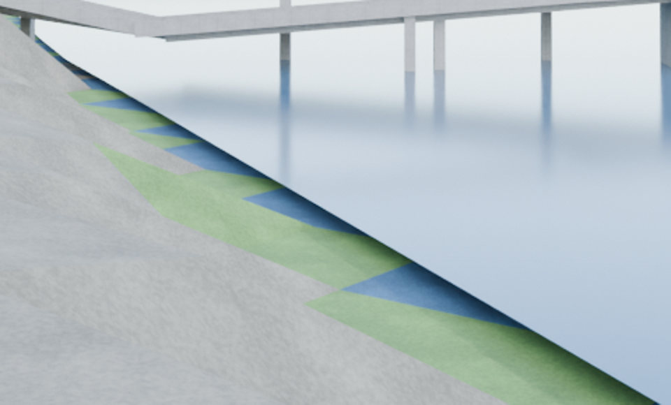

# S4-REVIEW: sprint 4 milestone review and test audit

Spec: [../tasks/S4-REVIEW.md](../tasks/S4-REVIEW.md) (D104). Run on main **d38d4e8**, covering #61–#72
(#60 was a scratch spike and was closed). Reviewer: design (product owner).

## Verdict

**NO-GO for REL-v0.5.0 until S4-WATER-BANK (S4-F1) merges. After that, GO with no further review round.**

* One blocker. Blue terrain triangles show on the riverbank above the new flat water. Terrain cells are still
  painted water-coloured, but the water now has its own shoreline-clipped mesh, so the straddling cells read as a
  blue saw-tooth on the bank. This is a smaller form of the user's "mat" complaint, so it should not ship. The
  fix is small and changes colours only: [S4-WATER-BANK](../tasks/S4-WATER-BANK.md) (D123).
* Every sprint-4 target is met on main:
  * Roofs: 45/67 meets the D105 stretch.
  * Collision: zero unreported degenerates.
  * Water: the invariant, the levels and both replays pass through both paths.
  * Performance: whole Generate+Export is faster than v0.4.0 on both presets.
  * Tests and publishing pass.
* "MB Water" stays untextured for v0.5.0 (not a blocker; D124). It is deferred as S5-TEX-WATER.
* The coordinator rules on the verdict form. **NO-GO until F1** is what I recommend. The alternative,
  "GO conditional on F1", is equivalent if REL is not started before F1 merges.

| # | Check | Verdict |
|---|---|---|
| 1 | Roofs | **met**: 45/67, against floor 29 and stretch 45. All 22 uncounted roofs are named. The replay is still 1/67. |
| 2 | Collision (D98, D111) | **met**: zero unreported degenerates. The sample count is not below its baseline (2 → 2); both triangles are hit-capable and kept under D111. |
| 3 | Water (D112–D118) | **met on the spec ACs; one blocker outside the spec** (S4-F1) |
| 4 | Performance (D91, D97, D120) | **met**: Generate+Export −2.4 % (Munich) and −4.1 % (Pittsburgh). #63 and #64 are byte-identical. |
| 5 | Tests | **met**: 813 tests, 0 errors, 0 ResourceWarnings, no wall-clock gates, PR CI 82 s. |
| 6 | Publishing | **met**, except the user actions (checklist items 10–13). |
| 7 | Format policy | **met**: the citations in one doc are stale (S4-F5, later). |
| 8 | Design conformance | **met**: no task exceeded D89, and no over-engineering was found. Domain notes are in §3. |
| 9 | v1.0 readiness (D102) | 4 met, 3 not met, 2 user action (§1.8) |

## Method and frozen inputs

* Trees: `git archive` of v0.4.0, 70d93c7 (the S4-WATER-SURFACE base), each sprint-4 merge and d38d4e8.
* Inputs: the frozen RC #56 caches for Munich Altstadt and Pittsburgh, by acquisition SHA-256. Every run was
  offline: `network_attempts = 0` in the CLI harness, and the socket guard in the Blender harness (D91).
* Settings follow `docs/DEMO.md`: seed 1, DSM on, and a fixed `created_utc`.
* Environment: Windows, Python 3.12, Blender 4.2.23 LTS (D9), and Cycles CPU for the renders (demokit cameras).
* **Host load caveat:** another session's Python process and the app webview (about 5.7 cores) were busy during
  the timings. Absolute times are inflated. The base/head **ratios** come from alternating same-host runs
  (D106) and are the measure.
* Evidence renders (not committed; the coordinator holds copies for REL) were taken from the head and v0.4.0
  packages:
  * Pittsburgh: overview, dsm-ground, bridge-under and tunnel-portal.
  * Munich: vertical-cut gables on 3 and 2 edges, and a named fallback.
  * The S4-F1 crop is committed: [img/S4-F1-pittsburgh-bank.png](img/S4-F1-pittsburgh-bank.png).

## 1 Acceptance

### 1.1 Roofs: met

* `tests.test_roofs_munich` and `tests.test_roofs`: 79 OK.
* Munich counted is **45/67** (`COUNTED = 45`). That meets the floor 29 and the stretch 45 (D105). The frozen
  v0.3.0 replay under the same checker is still **1/67**.
* All 22 uncounted roofs carry a named reason:
  * 18 are `fallback:hipped`, with the gable end not representable, and the vertical-cut reason named.
  * 4 are `fallback:flat`:
    * courtyard (relation/6618880);
    * `quadruple_saltbox` (way/80965525);
    * roof height 0 (way/264235611, D107);
    * concave pyramid with an 8-node ridge (way/283850484).
* Constructions: 28 full skeleton; 30 with a vertical gable wall on 2 edges; 3 with it on 3 edges.
* No real Munich roof has a **mixed end**. Only the synthetic test
  `test_mixed_ends_keep_a_hip_where_the_wall_is_not_representable` covers that case. This is acceptable, but
  REL should not claim mixed ends were seen on real data.
* Spot renders, all correct:
  * vertical cut on 3 edges: way/80965639;
  * vertical cut on 2 edges: way/80965543;
  * named fallback: way/79401261.

### 1.2 Collision: met

Validator degenerate-triangle warnings at head:

| Package | Baseline (S4-COL-DEGEN) | Head | Listed in `report.json` | Listed objects |
|---|---|---|---|---|
| sample | 2 | 2 | 2 | 1 |
| Munich CLI | 59 | 57 | 57 | 33 |
| Munich Blender | 58 | 56 | 56 | 33 |
| Pittsburgh CLI | 76 | 75 | 75 | 53 |
| Pittsburgh Blender | 72 (78 at v0.4.0) | 71 | 71 | 50 |

* Every remaining degenerate is listed, with the reason "kept: removing it would change a collision…".
  **Zero unreported** (the D98 gate).
* The counts are identical at 70d93c7 and d38d4e8, so water added none.
* The sample is not below its baseline. Both of its triangles are hit-capable and are kept under D111 (probe
  invariance outranks the count). This is accepted as specified.
* `tools/col_degen_replay.py` on the sample, 4233995 → 70d93c7: 0 differences in Python and C# (rays,
  capsules, 4 passages). Python and C# agree on every probe id and result.

### 1.3 Water: spec ACs met; blocker S4-F1

* **AC3, no terrain above water**, on the final emitted triangles (`tools/water_check.py --pre-carve`, base
  70d93c7), through CLI and Blender:
  * Pittsburgh: relation/1080, relation/7937544 and way/379511900 are each at −1.500000 m.
  * Sample: way/1087 is at −1.5 m.
  * way/1037461399 is named `fallback(no shore samples)`, with the note "no part inside the terrain extent".
    It has no surface mesh and no carve, so it is outside AC3–AC6.
* **AC4–AC6 on both export paths**, Pittsburgh at d38d4e8 from the frozen cache (my own runs). Each path is
  measured on its own output:
  * **CLI:** on the generated plan, which is what the CLI writes. Script:
    [bench/water_ac.py](../bench/water_ac.py); raw output:
    [data/S4-REVIEW-water-ac-cli.json](data/S4-REVIEW-water-ac-cli.json).
  * **Blender:** on the **emitted** package of the headless Blender Generate+Export (`bl_time.py` round 1,
    run 0; SHA-256 `81396E8D…6467C319`). It reads the `collision/map.mbcol` triangles and `report.json` against
    the Blender base package at 70d93c7 (`56907AE0…46411DFE`). Script:
    [bench/water_ac_pkg.py](../bench/water_ac_pkg.py); raw output:
    [data/S4-REVIEW-water-ac-blender.json](data/S4-REVIEW-water-ac-blender.json) and
    [data/S4-REVIEW-water-check-blender.txt](data/S4-REVIEW-water-check-blender.txt) (`tools/water_check.py`).
* **AC4 shoreline and AC5 level** (areas in m²; the AC0.2 metric is the 2 m raster symmetric difference between
  the mesh and the clipped polygon):

  | Body | Path | Outcome | Polygon / mesh area | Hausdorff mesh→poly / poly→mesh | AC0.2 (2 m raster) | Level (m) | p5 / p50 | `sanity_miss` |
  |---|---|---|---|---|---|---|---|---|
  | relation/1080 | CLI | built(flat) | 37 378.742 / 37 378.742 | 0.0 / 0.0 m | 0 of 9 241 cells → **0.0 m** | 218.9268 | 218.015 / 220.016 | no |
  | relation/1080 | **Blender** | built(flat) | 37 378.742 / 37 378.744 | 1.4·10⁻⁵ / 1.4·10⁻⁵ m | 0 of 9 241 cells → **0.0 m** | 218.9268 (= CLI) | 218.015 / 220.016 | no |
  | relation/7937544 | CLI | built(flat), "profile slope > 1 %" | 151 076.161 / 151 076.161 | 0.0 / 0.0 m | 0 of 37 664 cells → **0.0 m** | 214.1489 | 213.000 / 218.248 | no |
  | relation/7937544 | **Blender** | built(flat) | 151 076.161 / 151 076.162 | 2.0·10⁻⁵ / 2.0·10⁻⁵ m | 0 of 37 664 cells → **0.0 m** | 214.1489 (= CLI) | 213.000 / 218.248 | no |
  | way/379511900 | CLI | built(flat) | 631.281 / 631.281 | 0.0 / 0.0 m | 0 of 146 cells → **0.0 m** | 220.7617 | 220.607 / 221.145 | no |
  | way/379511900 | **Blender** | built(flat) | 631.281 / 631.282 | 1.3·10⁻⁵ / 0.8·10⁻⁵ m | 0 of 146 cells → **0.0 m** | 220.7617 (= CLI) | 220.607 / 221.145 | no |

  * AC4, both paths: Hausdorff ≤ 2·10⁻⁵ m ≤ 1 mm in both directions. The Blender residue is float32 storage in
    `.mbcol`. The AC0.2 staircase metric is 0.0 m ≤ 0.5 m on every built body.
  * AC5, both paths: every level lies inside its p5–p50 window, and there are **0** sanity misses. The Blender
    `report.json` levels equal the CLI ones exactly. The emitted water vertices sit at the level within
    5·10⁻⁵ m.
  * Correction to R1: the R1 table gave half these areas, copied from the #72 PR body. The 2 m raster confirms
    the values above: for example, 9 241 cells × 4 m² ≈ 36 964 m² for relation/1080.
* **AC6, decks, piers and wet clearance**, head d38d4e8 against base 70d93c7 on the same path:

  | Measure | CLI (plan) | **Blender (emitted `.mbcol`)** |
  |---|---|---|
  | Decks compared vertex by vertex | 33 | 33 |
  | Minimum deck change, head − base | **0.000 m** | **0.000 m** |
  | Raised decks (all listed in `report.json` `water_decks_raised`) | way/11950069 +0.231 m, way/173225719 +1.149 m | way/11950069 +0.231 m, way/173225719 +1.149 m |
  | Piers / wet piers | 20 / 13 (173225719 ×7, 11950069 ×3, 121593794 ×3) | 20 / 13 (same bridges) |
  | Maximum of pier bottom − bed under its footprint | **−1.000 m** (carved grid) | **−1.000 m** (emitted terrain triangles) |
  | Wet under-probe clearance over pre-carve ground + water (D116, ≥ 0.62 m) | 0.6200 m (`121593794:under`, `173225719:under`) | **0.6200 m** (same two probes; `water_check.py` PASS, AC3 −1.500000 m on all 3 bodies) |

  * Decks are never lowered on either path. The §7 change set counts one "deck raised" because only
    way/173225719 sits on a fixed query.
  * On both raised bridges, one pier moved about 0.5 m in xy between base and head. Its corners are compared as a
    pier, not as deck vertices.
  * **Parity evidence:** the Blender and CLI `collision/terrain.mbhf` are byte-identical (SHA-256
    `45aed583…a2add2fa`). The terrain and all 3 water objects in `.mbcol` have identical triangle sets on the two
    paths. 2 of the 33 bridges are identical too. The other 31 have the same triangle counts, but some quads are split
    on the other diagonal in Blender, so the bridge AC6 numbers above are measured directly on the Blender output.
  * **Probes:** wet under-probes `121593794:under` and `173225719:under` clear by **0.6200 m** (≥ 0.62, D116).
* **§7 replays:**

  | Replay | Result |
  |---|---|
  | (a) fixed-query, CLI | **PASS**, exit 0, seed 20260101. Change set {bed moved 51, new water hit 318, deck raised 1}, identical to #72. Python and C# agree on every query. |
  | (a) fixed-query, Blender | **PASS**, exit 0, same seed. 71 centroid rays (Blender degenerate set). The change set is identical to the CLI run. Python and C# agree on every query. |
  | (b) regenerated passages | base 13 → head 11. Each drop is listed with its head `report.json` blocker, and the two have different causes (below). Without these allowances, the replay fails only on these two. |

  * `osm:way/11950069:under`: blocked by a **pier of the neighbouring bridge `osm:way/121593794`**. The
    water-aware argmax moved the probe about 8 m along the span. The new path is also blocked by that pier on
    the base build, so the probe was not lost to the water or the carve. It was lost by moving onto an
    already-blocked path.
  * `osm:way/121593794:deck`: a **new water hit** at its abutment, blocked by `water:osm:relation/7937544`. The
    deck capsule reaches 0.53 m below the flat water surface there.

* **Munich:** the head CLI package is byte-identical to the 70d93c7 build, because Munich has no water body.
* **S4-TEX-WATER AC1, the colour rule:** overview pixels x 600–700, y 500–540 measure (142, 172, 202) at
  head, against (124, 162, 144) at v0.4.0. B > G holds.
* **Blocker S4-F1 (bank colour).** `build_terrain` (`core/generate.py:768–800`) still paints a cell
  water-coloured when its centre is inside a water polygon. Cells that straddle the shore are carved to the bed,
  and their parts outside the clipped water mesh show as blue triangles on the bank:
  
  * Geometry, collision and every gate above are correct; only the colour is wrong.
  * The #70 spec missed it (a design gap; see the retro notes).
  * Fix: [S4-WATER-BANK](../tasks/S4-WATER-BANK.md). A cell whose centre is inside a built body
    (`WaterModel.active()`) never gets the water colour, even when a fallback body also covers it. Cells covered
    only by fallback bodies keep it. `.mbcol` and `.mbhf` stay byte-identical on the CLI and Blender paths, and
    Munich is byte-identical on both.
* The green 10 m staircase in the same crop is the pre-existing cell-quantised park landcover (S4-F6, later).
* **"MB Water" material:** not a blocker (D124).
  * The flat, glossy surface with reflections answers the "ditch" complaint, and its colour passes AC1.
  * A texture would need UVs on the water mesh, a new CC0 asset and NOTICES entries (D86).
  * That work is deferred as S4-F2 → S5-TEX-WATER.

### 1.4 Performance (D91, D97, D120): met

Medians of per-round medians, 3 alternating rounds, on the same host and offline. Every raw run and the
aggregation are in [data/S4-REVIEW-timings.md](data/S4-REVIEW-timings.md).

| Path | Preset | v0.4.0 | d38d4e8 | Δ |
|---|---|---|---|---|
| CLI whole Generate | Munich | 6.36 s | 6.32 s | −0.6 % |
| CLI whole Generate | Pittsburgh | 27.28 s | 26.44 s | −3.1 % |
| Blender Generate | Munich | 4.55 s | 4.77 s | +4.8 % |
| Blender Export | Munich | 5.72 s | 5.25 s | −8.2 % |
| **Blender Generate+Export (D120)** | Munich | 10.26 s | 10.02 s | **−2.4 %** |
| Blender Generate | Pittsburgh | 14.50 s | 15.31 s | +5.6 % (stage, informational, D91/D109) |
| Blender Export | Pittsburgh | 32.37 s | 29.57 s | −8.6 % |
| **Blender Generate+Export (D120)** | Pittsburgh | 46.83 s | 44.92 s | **−4.1 %** |

* CLI stage split: acquire+plan is +8 to +11 % (the water stage), and package is −12 % (#63, single-pass
  deflate).
* The Pittsburgh Blender Generate stage at +5.6 % is above +5 % only as a stage. D91 judges the whole path,
  which is −4.1 %. REL should state it as informational.
* One outlier: round 1 of the Pittsburgh v0.4.0 CLI ran at 38.6 s (host load). It is excluded by the median.
* **D97 byte identity**, CLI, frozen caches:

  | PR | Base → head | Munich | Pittsburgh | Sample blob |
  |---|---|---|---|---|
  | #64 PERF-UV | fd104e7 → a06acf5 | `DFFF8DC3…` = | `FC61D53C…` = | `c7895965…` = |
  | #63 PERF-PKG | a06acf5 → a20474a | `DFFF8DC3…` = | `FC61D53C…` = | `c7895965…` = |

  * Both perf PRs are byte-identical.
  * #63 did not measure Munich (its PR body says so); this check covers that gap.
  * Munich then changes at #62 (aea5fd9, ROOF-NAMED), as expected for a roof change.
  * A rerun of aea5fd9 reproduced its hash, so the build is deterministic.

### 1.5 Tests: met

* Two full suites ran in parallel. Each had a private, unreachable NuGet feed configured through a temporary
  `APPDATA`, and ran with `-W error::ResourceWarning`.
  * Both passed (4 skipped) in 171 s and 165 s.
  * 0 ResourceWarnings. The guard is in `tests/__init__.py`.
* A single run with `--durations`: 813 tests OK in 143.6 s. The slowest:

  | Test | Time |
  |---|---|
  | `test_col_degen` (C#) | 6.1 s |
  | WideRoadBudget | 3.7 s |
  | HarmonicFill | 3.5 s |
  | TexturedPackage negatives | 3.3 s |

  `test_col_degen` is over the 5 s guideline because it includes a C# build. It is accepted as a later item
  (S4-F7).
* No wall-clock asserts: no `perf_counter`, `time.time` or `monotonic` in `tests/`.
* PR CI took 78–137 s across sprint 4, and 82 s on d38d4e8, within the 10-minute budget.

### 1.6 Publishing: met, except user actions

* `blender --command extension validate map_builder`: success.
* Two fresh-clone builds at d38d4e8 (`tools/build_extension.sh`) produced identical zips:
  * `map_builder-0.4.0.zip`, 878 851 B;
  * SHA-256 `D7BCAC56…E619CB`.
* `MB_EXTENSION_ZIP` tests: 16 OK, 1 skipped (website, a user TODO).
* `docs/PLATFORM_SUBMISSION.md`: items 1–9 are done. Items 10 (maintainer contact), 11 (website),
  12 (screenshots) and 13 (account and submission) are user actions (D100).
* The manifest version is still 0.4.0. REL-v0.5.0 bumps it (D50 guard).

### 1.7 Format policy: met

* `tests.test_format_policy` and `tests.test_manifest`: 26 OK, 2 expected skips.
* The `docs/PACKAGE_FORMAT.md` stability section matches D101 and D110.
* S4-F5: #72 added about 50 lines to `MbmapReader.cs`, so the C# line citations in that section are off by 50.
  For example, "unsupported schema major" is cited at 1339 but is now at 1389. The other affected citations:
  * unknown member, 1368 → 1418;
  * unlisted file, 1375 → 1425;
  * provenance, 1415 → 1465;
  * `MaxNameLength`, 1535 → 1585;
  * buffers, 393 → 443;
  * `extensionsRequired`, 390 → 440;
  * mbcol version, 188 → 238;
  * mbhf version, 310 → 360.

  The Python citations are correct. Fix in REL (docs) or later.

### 1.8 v1.0 readiness (D102)

| # | Criterion | Status |
|---|---|---|
| 1 | Format frozen | **not met**: the policy is a draft for the user, and no 2.x minor has been published under it |
| 2 | Real data, 0 warnings | **not met**: each package has listed degenerate warnings. The user decides on the D98 exception. |
| 3 | Roofs | **met** |
| 4 | Consumer | glTF-Validator is part of the REL RC check. The simulator import is a **user action**. |
| 5 | Extension | validate and reproducible build **met**. Checklist items 10–13 are **user actions**. |
| 6 | Licence | **met** (D13) |
| 7 | Docs | **met at REL** if the known limitations below are added |
| 8 | No open gap ≥ medium | **not met** until S4-F1 merges. After that, the open items are all low. |
| 9 | Performance ≤ 120 s | **met**: Pittsburgh CLI 26 s, Blender 45 s |

## 2 Test audit

* The new tests stay within the budget, except `test_col_degen` (6.1 s with the C# build, S4-F7).
* They are hermetic:
  * the C# tests use the repo-local NuGet configuration (D92);
  * none of them use the network;
  * there are no timing gates.
* Coverage of the new behaviour:
  * the water invariant, levels, fallbacks and probes in `tests/test_water.py`;
  * degenerate listing and probe equivalence in `test_col_degen`;
  * the vertical-cut ends in `test_roofs*`;
  * the bbox migration in the Blender checks.
* Gaps:
  * No test asserts the terrain colour around a built water body. That is how S4-F1 got through; S4-WATER-BANK
    adds the test.
  * The mixed-end roof is covered only synthetically (§1.1).

## 3 Design conformance

* **Review rounds (D89):**

  | PR | Rounds |
  |---|---|
  | #61 | AP |
  | #63, #66, #67 | CR, AP |
  | #62, #64, #65, #68, #69, #71 | CR, CR, AP |
  | #70 | CR ×3, closed by coordinator ruling D118 |
  | #72 | CR ×3, closed by coordinator ruling D122 |

  No PR went past the cap. Two of the twelve needed a coordinator ruling, both on the water work. That points to
  spec size (see the retro notes).
* **Conflict domains:** every deviation was serialised and none caused a conflict.
  * #71 fixed slivers at the source in `generate.py`, `pipeline.py` and `triangulate.py`. That is what D98(1)
    requires; the COL-DEGEN domain list was incomplete, which is a design miss.
  * #72 touched:
    * `core/package.py`: the `_MB_ID` pattern for `water:osm:…` (a spec gap);
    * `core/structures.py`;
    * the C# reader (`--ray-work`);
    * the D114 row in `design/roadmap.md`.
  * #68 edited the D110 row in `design/roadmap.md`, and `ci.yml`.
  * #66 edited `operators.py` and `ui.py` (the bbox migration).
  * #62 edited the Munich and scene tests.
  * #69 edited `tools/build_extension.sh`.
* **SOLID and size:**
  * `core/water.py` is one new, cohesive module (1191 lines, 60 functions; the longest, `_make_level`, is 119
    lines). It does not import `generate`.
  * `build_plan` grew from 336 to 347 lines; `build_terrain` is unchanged.
  * There are no speculative abstractions, so there is no over-engineering.
* **Decisions:** D119–D122 were made by the coordinator during the sprint but were missing from the log. This PR
  adds them with the coordinator's wording.

## 4 Gaps and S4-Fn tasks

| id | Gap | Tag | Task |
|---|---|---|---|
| S4-F1 | Water-coloured terrain triangles on the bank around built water bodies | **v0.5.0 blocker** (D123) | [S4-WATER-BANK](../tasks/S4-WATER-BANK.md) |
| S4-F2 | "MB Water" untextured | later (D124) | S5-TEX-WATER: UVs on the water mesh, CC0 asset and NOTICES (D86) |
| S4-F3 | Water tagging not covered: standalone `water=*`, riverbank multipolygons, coastline; way/1037461399 `fallback(no shore samples)` | later | S5 water coverage |
| S4-F4 | Untagged ground renders near-white or grey after the neutral terrain texture (D99). The v0.4.0 overview read green/tan. | later | S5 landcover default tint |
| S4-F5 | Stale C# line citations in the `PACKAGE_FORMAT.md` policy section (§1.7) | later; may be folded into REL docs | — |
| S4-F6 | Landcover is painted per 10 m cell, which gives a staircase at polygon edges (pre-existing) | later | S5, with S4-F4 |
| S4-F7 | `test_col_degen` 6.1 s (includes the C# build) | later | test hygiene |

### Notes for REL-v0.5.0

Known limitations to disclose:

* the listed, kept degenerate-triangle warnings (D98, D111);
* way/1037461399 not built (`fallback(no shore samples)`: no part inside the terrain extent);
* two Pittsburgh passages dropped, with different causes:
  * `osm:way/11950069:under`: the probe moved about 8 m onto a path blocked by a pier of the neighbouring
    bridge `osm:way/121593794`, which is blocked on the base build too;
  * `osm:way/121593794:deck`: a new water hit at its abutment (`water:osm:relation/7937544`; the capsule
    reaches 0.53 m below the water);
* the Blender Generate stage at +5.6 % on Pittsburgh (informational; the whole path is −4.1 %);
* water untextured (S4-F2);
* mixed roof ends seen only in synthetic tests.

Other REL actions:

* Bump the version to 0.5.0.
* Regenerate the demo renders after S4-WATER-BANK.

## 5 Retro notes

* **Went well:**
  * The roof stretch was met exactly (45).
  * Both perf PRs kept every byte (D97), and Generate+Export got faster despite the new water stage.
  * The D111 and D118 rulings kept the review cap from stalling work.
* **Change:**
  * **Specs that emit a new object family must cover its interaction with existing materials and colours.**
    S4-F1 is that gap.
  * Specs that add an `mb_id` namespace must list `core/package.py` (`_MB_ID`) in their conflict domain.
  * Conflict domains for "fix at the source" tasks must include the source modules (#71).
  * Dev PRs should not edit `design/`. Measurements go in the PR body, and the coordinator or design records
    them (D125).
  * Large specs such as #70 should be split, or should get a pre-review by the coordinator before R1, to stay
    inside D89.
* **Decisions:** D123–D125, proposed here and confirmed by the coordinator at the S4-REVIEW gate (roadmap).
