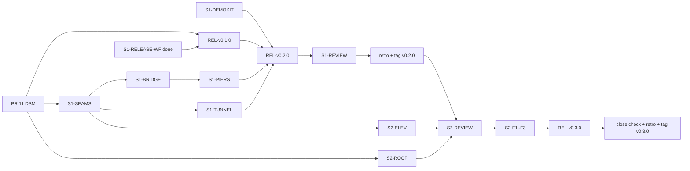
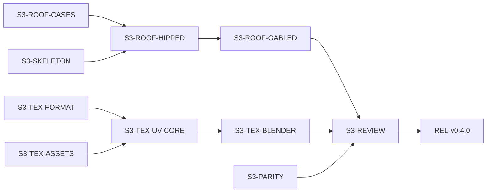

# map-builder v2 roadmap

Owner: Design role. Status of every task is in [tasks/README.md](tasks/README.md); this file
holds the approach, the sprints/releases and the decision record.

## Goal

v2: **a drone can fly under bridges, through tunnels and beneath elevated building parts** of a
real ~1 × 1 km map, and the simulator Core can verify that from the package alone
(`passage_probes` checked against `.mbcol`). Roof shapes get richer on the way. The package
format stays 2.x (format 2.0 already carries the `bridge`/`tunnel`/`structure` classes, the
tube rule and passage probes).

## Approach

1. **Generate structures, not exceptions.** Bridge decks, tunnel tubes and passages become real
   collision objects of the kinds the format already defines:
   * bridge deck (and piers) → class `bridge`, kind *solid* (closed, positive volume);
   * tunnel → class `tunnel`, kind *tube* (inward, open at its portals);
   * tunnel portal headwalls → class `structure`, kind *solid*;
   * elevated parts and building passages → class `building` (solids that leave free space).
2. **Every generated passage carries a probe.** The generator emits a `passage_probes[]` entry
   for each passage it creates and checks it against the plan's own collision before emitting
   (plan-time check, shared helper). A probe that the generator knows is blocked is not
   emitted; it is reported in `report.json` instead (D21). The validator re-checks after
   export, so Blender edits that block a passage surface as warnings.
3. **Clearance comes from corrected ground.** Bridge clearance and tunnel cover are measured
   against the DSM-corrected terrain from PR #11 (D15).
4. **One seam, then parallel features (D18).** `core/generate.py` (≈1.8 k lines) and
   `core/osm.py` are hot spots. S1-SEAMS adds a thin seam: classification routes
   bridge/tunnel/passage features into their own lists, `build_plan` calls one stage function
   per structure kind, and a shared sweep/probe helper lives in its own module. Feature
   tasks then live mostly in their own modules (`core/bridges.py`, `core/tunnels.py`,
   `core/passages.py`, `core/roofs.py`) and touch `generate.py` only at their hook.
5. **No format bump unless semantics change (D12, D19).** Emitting classes and probes the
   format already defines is not a semantic change. New `report.json` keys are additive and
   documented in PACKAGE_FORMAT.md; they do not bump `schema_version`.
6. **Keep it simple (SOLID without over-engineering).** Plain functions per structure kind
   with one shared helper module; no plugin registry, no class hierarchy for "structures".
7. **Agile, but cheap demos (D17, D28).** Two sprints, each ending in one user-checkable GitHub
   pre-release. The demo is one reusable command (S1-DEMOKIT) built once. A sprint closes with
   an RC PR by the release manager (CHANGELOG, user docs, flows, demo, notes), then the Design
   milestone review + test audit, the coordinator retro and the tag. No release per task.

## Sprints and releases

| Release | When | Content the user can try | Assets |
|---|---|---|---|
| `v0.1.0` (REL-v0.1.0) | after #11 merges; **released** | first full release: v1 + format 2.0 + DSM correction + release workflow (D29) | zip, sample `.mbmap` + `.glb`, renders, viewer, CHANGELOG, user docs, notes with "How to try it" |
| `v0.2.0` | end of **S1** (REL-v0.2.0 + S1-REVIEW); **released** on `4e0b0e2` | **fly under bridges and through tunnels**: decks, piers, tunnel tubes, portals, probes | zip, real-data demo `.mbmap` + `.glb`, panel screenshot, before/after renders, three.js viewer, release notes with "How to try it" |
| `v0.3.0` | end of **S2** (S2-REVIEW first, then S2-F1..F3, then one REL-v0.3.0, D48; end of v2) | elevated parts / building passages, roof shapes, full real-data v2 demo | same as v0.2.0 + a second real-data preset (S2-F2) + `docs/DEMO.md` with performance numbers |

| Sprint | Tasks | Exit criteria |
|---|---|---|
| S1 | RELEASE-WF (done, #13), REL-v0.1.0, DEMOKIT, SEAMS, BRIDGE, TUNNEL, PIERS, REL-v0.2.0, S1-REVIEW | fixture and demo-area bridges/tunnels generated, probes PASS (Python + C#), validator VALID, headless Blender PASS, review written, `v0.2.0` published |
| S2 | ELEV, ROOF (may start in S1), S1-F1, S1-F2, S2-REVIEW, S2-F1..F3, REL-v0.3.0 | elevated/passage probes PASS; new roof shapes closed and bound; real-data build ≤ 120 s; end-of-v2 review go/no-go; `v0.3.0` published |

### Suggested waves (max 3 devs)

| Wave | Tasks in parallel | Why disjoint |
|---|---|---|
| 1 | S1-DEMOKIT (now); after #11: REL-v0.1.0 alone, then S1-SEAMS, S2-ROOF | DEMOKIT adds new files only (`tools/demo/`); ROOF touches only the roof section of `build_building` (+ `core/roofs.py`), SEAMS routing, hooks and new modules |
| 2 | S1-BRIDGE, S1-TUNNEL, (S2-ROOF or S2-ELEV) | each lives in its own module and its own `build_plan` hook |
| 3 | S1-PIERS, S2-ELEV → REL-v0.2.0 → S1-REVIEW → retro → tag | PIERS only extends `core/bridges.py`; REL runs alone |
| 4 | S2-REVIEW → S2-F1, S2-F2, S2-F3 → REL-v0.3.0 → close check → retro → tag (D48) | F1 tests only, F2 a new preset + excerpt tests, F3 a new Blender check module; REL runs alone |

**Soft conflicts** (shared but mechanically resolvable, D20): `examples/synthetic_sample.mbmap`
(regenerate after rebase), `tests/fixtures/synthetic_area.osm` (append-only), the
"Recorded results" table in `docs/VALIDATION.md` (append-only) and the Limits section of
`README.md` / the unsupported list in `docs/PACKAGE_FORMAT.md` (each task edits only its own
bullet). The coordinator merges one PR at a time; the next PR rebases and regenerates the
sample.

## Cross-cutting performance targets

| Item | Target |
|---|---|
| PR CI wall time | ≤ 10 min (today ≈ 40 s); each task may add ≤ 15 s of unit-test time; release workflow runs only on tags |
| Synthetic fixture build (CLI) | ≤ +20 % wall time vs. the pre-task baseline, measured and quoted in the PR |
| Real 1 × 1 km build (excluding download) | ≤ 120 s on the dev machine, CPython 3.12 |
| Scene budget | unchanged (`MAX_SCENE_VERTICES` 3 M, `MAX_SCENE_TRIANGLES` 4 M); new objects reserve before allocating |
| Passage probes | ≤ 256 per package (format); plan-time check uses `query.capsule_hits` with object-AABB pruning and stays inside the validator's 2 M visit budget for the whole package |
| Determinism | same inputs + `--created-utc` → byte-identical package (existing guarantee) |
| Headless Blender | manual, ≤ 5 min per run; not in CI (D9) |
| Sprint demo | one command, ≤ 30 min unattended CPU rendering per sprint review |

## Decision record

Who: **U** = user, **C** = coordinator, **De** = design, **Dev** = earlier dev process
(confirmed by the coordinator).

| # | Decision | Who | Status |
|---|---|---|---|
| D1 | Standalone Blender 4.2 LTS add-on + headless CLI; outputs GLB + versioned `.mbmap` | U | final |
| D2 | No Google Maps / 3D Tiles extraction; only OSM (ODbL) + Copernicus GLO-30 | U | final |
| D3 | v1 area ≈ 1 × 1 km (50–2000 m side), no streaming/LOD | U | final |
| D4 | Collision authority is the simulator Core (250 Hz) via neutral `.mbcol`; Unity colliders not authoritative | U | final |
| D5 | QA/review uses a different model family from Dev (gpt-6.2-sol) | U | final |
| D6 | One branch + one PR per feature; squash-merge after review + CI; delete branch | U | final |
| D7 | Terrain/OSM ingestion split into its own PR (#2) | Dev | done |
| D8 | GLB/package/collision (#4) and validation (#6) separate PRs | Dev | done |
| D9 | Portable Blender 4.2.23 at `C:\tools\` for headless integration tests (manual, not CI) | Dev | final |
| D10 | Licence provisionally GPL-3.0-or-later | Dev | superseded by D13 |
| D11 | v1 real-data demo: SF FiDi 800 × 800 m | U | done |
| D12 | v2 = bridges, tunnels, elevated parts, roof shapes, DSM correction, one PR each; bump package format if semantics change | U | final |
| D13 | Split licence, option B: Blender add-on (`map_builder/blender/`, manifest) and any first-party file importing bpy GPL-3.0-or-later, with `map_builder/__init__.py` as the add-on bootstrap exception; all other first-party code, docs and tests Apache-2.0; textures CC0 and vendored three.js MIT unchanged; generated data not covered by the code licence (user decision 2026-11-20) | U | final |
| D14 | Package format 2.0 PR (#10) before bridges | C | done |
| D15 | DSM correction before bridges; clearance measured from corrected ground | C | final |
| D16 | PR #11 finished under the old process; the new team process starts from bridges | C | final |
| D17 | Agile delivery with few releases (user: "按照敏捷流程开发…最好是有一个release" and "注意不要太频繁，以免影响进度"): two sprints, S1 = bridges + tunnels → `v0.2.0`, S2 = elevated parts/passages + roofs + real-data demo → `v0.3.0`; no release per task; one reusable demo script built in S1; sprint close kept small (see D28); release workflow tag-triggered only | U + C | final (user may change) |
| D18 | Add one seam PR (S1-SEAMS) before the structure features so bridges, tunnels and passages can be built in parallel in their own modules | De | proposed |
| D19 | Emitting `bridge`/`tunnel`/`structure` and probes is not a format change; stay on 2.0.0; new `report.json` keys are additive and documented, no bump. Generator/extension version follows the sprint releases (0.2.0, 0.3.0), bumped only in sprint-review tasks | De | proposed |
| D20 | The binary sample `examples/synthetic_sample.mbmap` is a regenerated artefact: on rebase conflicts, regenerate with the documented command, never hand-merge. Feature tests use their own in-code synthetic terrain/OSM; the shared fixture is append-only | De | proposed |
| D21 | The generator never emits a probe it knows is blocked; it lists it in `report.json` `passage_probes_blocked` with the blocking `mb_id` instead | De | proposed |
| D22 | Bridge deck profile: linear between at-grade end heights, raised where needed to `layer` × 5.0 m clearance over corrected ground, ramps ≤ 8 % grade; deck 1.0 m thick (inferred) | De | proposed |
| D23 | Tunnels cut the terrain mesh only where it intersects the tube interior (no trench); gaps between the cut and the tube are closed by portal headwalls/skirts (`structure`), verified by a ray "leak" test, never left open | De | proposed |
| D24 | Building passages (`tunnel=building_passage`, `covered=yes` highways through a building) split the building into a lower part (footprint minus corridor) and an elevated upper part, reusing the existing elevated-volume code; ids use the `#k` part suffix | De | proposed |
| D25 | Scope: highway bridges/tunnels only in v2. Railway, waterway (`culvert`) and `building=bridge`/`man_made=bridge` outlines stay in `unsupported_features` | C (proposed by De) | final — decided by coordinator, user may change |
| D26 | v2 sprint demo area: Pittsburgh, Fort Pitt Bridge + Fort Pitt Tunnel (≈ 40.437 N, 80.016 W, 1200 × 1000 m) | C (proposed by De) | final — decided by coordinator, user may change |
| D27 | S1-RELEASE-WF (#13) AC1 "panel appears" is satisfied by a headless panel-registration assert after install-file + enable (`MB_PT_main` in `VIEW_3D`/`UI`, category *Map Builder*); the visual sidebar screenshot comes from S1-DEMOKIT `--panel`, checked at REL-v0.2.0 | C | final |
| D28 | Team per agile-ai-team (user: "访问 lingshf/agents repo，安装最新skill。然后按照agile-ai-team 规划"): a release manager owns `CHANGELOG.md`, `docs/user/`, `docs/flows/`, `docs/demo/<ver>/`, `docs/releases/<ver>.md` and proposes tag commits; Design owns `design/`. Sprint close order: RC PR → demo → Design milestone review + test audit → coordinator retro → tag/Release. Definition of Done in `design/tasks/README.md` | U + C | final (user may change) |
| D29 | `v0.1.0` is a full first release of everything on main (v1, format 2.0, #11 DSM, #13 release workflow) with CHANGELOG, user docs, flows, demo and notes; supersedes the "tag + zip only" baseline in D17 | C | final (user may change) |
| D30 | v0.1.0 不接受“关闭道路”的变通发布；真实数据（匹兹堡）默认内容导出必须 VALID。另开 BUG-ROAD-NORMALS 修复，v0.1.0 等它合并。（协调者决定） | C | done |
| D31 | v0.1.0 冲刺收尾 GO（产品负责人，69953fa）。新增小任务 TEST-HYGIENE：#11 遗留的 4 个超 5 秒测试缩小输入，墙钟 assertLess 改为计数/工作量上限（超时行为测试除外）；完成定义对旧测试一次性追溯。 | De + C | done (#23) |
| D32 | 每个 RC 必须带一次真实数据（匹兹堡）默认内容严格校验；发布文档中的构建耗时取 3 次中位数。 | C | final |
| D33 | 评审通过以评审员在确切 head 上的 `VERDICT: APPROVED` 评论为准（同账号无法给 GitHub APPROVED 状态）；写入完成定义。 | C | final |
| D34 | 合并只由协调者授权；开发不得自合（源自 #11 自合）。补 tools/demo/presets/pittsburgh.json，在 REL-v0.2.0 之前完成。 | C | final |
| D35 | 性能预算"夹具构建 ≤ +20%"指功能阶段自身耗时（同一输入，开/关对比），不计新增合法几何走常规管线的成本（需在 PR 中单列）；无相关标签的夹具开销 ≤ 2%。 | C | final |
| D35a | 基线 < 50 ms 的小夹具，阶段预算 = max(20% 基线, 5 ms)；D21 成品场景探针检查属正确性保证，不得推迟到校验器。 | C | final |
| D36 | S2-ELEV 接受阶段 ~7–8 ms（主要是 D21 探针检查和地形提取），条件是证明耗时随通道数线性增长、与场景大小无关；新增后续任务 PERF-PROBE-INDEX（桥、隧道、悬空结构共用的按地形网格查询的探针索引）。 | C | done |
| D37 | S1-TUNNEL 允许尝试一次按环段平面四边形求差的算法改进，结果必须精确等价；目标放宽为 1 km/50 隧道 <3 s、样例阶段 <=10 ms；做不到精确就回退，按 D36 方式接受，由 PERF-PROBE-INDEX 跟进。 | C | done (#22) |
| D38 | Actions 账单受阻期间，评审可以依据本地测试和 Blender 结果进行，但合并必须等确切 head 上 CI 全绿；恢复后先重跑 main 35d10d9 的 CI。v0.1.0 不再只打 tag 加插件包，改为完整首版，覆盖 main 上已有的全部内容（取代 D18 中的基线说明）。 | C | final |
| D39 | （协调者）S1-BRIDGE 桥下净空改为直接用导出的网格三角形计算：实际道路带三角形（含斜接、接头、端帽，地形+0.12 m）与桥面底面三角形，平面包围盒预筛后逐对做凸多边形求交，取裁剪多边形顶点上（桥底 z − 路面 z）的最小值（逐三角形为平面，结果精确）；裁剪前先按三角形对数上限检查，超过即 LimitError；桥面抬升用同一结果。起因：前 7 轮都在“重建的道路轮廓”上算，漏掉斜接外楔。 | C | done (#21) |
| D40 | （协调者）引桥豁免改为按 OSM 节点身份判定：道路只有与桥 way 在桥面端点共享端点节点时才算引桥，不再用距离邻近规则。 | C | done (#21) |
| D41 | （协调者）每个桥面端最多豁免一段：偏离直线最小、且 ≤30° 的那一条向外延续；前两名相差 5° 以内视为歧义，一律不豁免。节点 ID 通过下标溯源穿过裁剪和拆分，不按 XY 反查；裁剪新生成的顶点没有 ID。与桥不共享节点的道路不得被归类或报告为接头。 | C | done (#21) |
| D42 | （协调者）合并顺序：#22（S1-TUNNEL）先合，#21（S1-BRIDGE）后合；#21 的桥下探针改走 #22 统一的 finalize_probes（共享 2M WorkBudget、预算耗尽语义、全局 256 上限），D39 的三角形对上限保留。 | C | done |
| D43 | （用户指示，协调者执行）为解决 GitHub Actions 账单阻塞，仓库改为 public（改前已检查无密钥）；CI 恢复，阻塞解除。 | U + C | done |
| D44 | （协调者）PERF-PROBE-INDEX #25 重新设计：去掉按矩形缓存，每次 finalize_probes 只建一个全场景索引；额外峰值内存 ≤64 MiB（或文档化常数的 O(三角形)），用 tracemalloc 上限测试而非墙钟；结果完全等价、计费不变；评审工作负载（1 km、50 隧道、20 路，3 次中位数）至少 2× 提速，夹具不慢于 +5%；达不到就报数据停止，PR 关闭。 | C | superseded by D45 |
| D45 | （协调者）按 D44 关闭 #25：重新设计只有约 1.3×（目标 ≥2×），不合并，接受现有性能，删除分支。 | C | done (#25 closed) |
| D46 | （协调者）v0.2.0 发布前必须修复 C# 读取器：CapsuleCheck 线性扫描三角形，在匹兹堡包上耗尽 2M 查询预算，探针 9–12（含两条隧道孔）未检查；且端墙 mb_id 触发 6 个警告。新任务 FIX-CS-PROBE-PARITY（#27）：C# 计费与 Python 逐探针一致，加共享预算一致性测试，mb_id 正则只接受生成器实际产出的形式；RC 等它合并后重跑。 | C | done (#27) |
| D47 | （协调者）所有 PR（包括设计和纯文档 PR）都必须经协调者合并门禁授权后才能合并（源自 #29 未经授权自合）；凡改动探针或工作量计费的任务，PR 里必须用真实数据（匹兹堡包）分别跑 Python 和 C# 并附结果。 | C | final |
| D48 | v0.3.0 is not cut immediately, because v0.2.0 shipped today and the user wants infrequent releases. S2-REVIEW runs first; its findings define the remaining v0.3.0 scope; then a single REL-v0.3.0 closes v2. | C | final |
| D49 | S2-F2 uses option (a): a second real-data preset of at most 1×1 km containing elevated parts, a building passage and `roof:shape` tags. The search is time-boxed to half a day; if no candidate turns up, fall back to (c) synthetic-only evidence, and the release notes must state that limit. | C | final |
| D50 | Option A with a drift guard: `GENERATOR_VERSION` is bumped to "0.3.0" (it had stayed at "0.1.0", so v0.1.0 and v0.2.0 packages report `generator.version` 0.1.0, a known historical mislabel). A unit test asserts that it equals the `bl_info` version, so the two cannot drift again. `package_id` changes from v0.3.0 on; the CHANGELOG and release notes say so. | C | done (#38) |
| D51 | Option A: the headless Blender Pittsburgh export failure (a down-facing road sliver from Blender's double float32 rounding; pre-existing in v0.2.0) is fixed as S2-F6 before the v0.3.0 tag. REL-v0.3.0 keeps moving, lists S2-F6 as pending, then rebases, rebuilds the packages and reruns the Pittsburgh check in headless Blender. | C | done (#37; Pittsburgh `VALID` in headless Blender, #38) |
| D52 | Product owner GO for v0.3.0 at 4b73cba. The roofs result of 5/67 is accepted as a disclosed limitation (S2-F5 → v3). The doc fixes went into #39, and the tag sits on the #39 merge commit eb134a1. CLI/Blender probe parity was added as a v3 item. | De (GO), C | done (tag `v0.3.0` on eb134a1) |
| D53 | Sprint-2 retro: (1) before release, run real-data builds through both the CLI and headless Blender paths; that is what caught S2-F6. (2) Tests must go through the real production path (D39). (3) Keep a single source for the version, with a drift test (D50). (4) Check release-note wording against the code. (5) The merge gate (review commit = head, MERGEABLE, CI green, 0 behind) needed no rework. | C | active |

D30–D47 are copied verbatim from the team dashboard (coordinator, 2026-11-19); entries that
name no decider were decided by the coordinator. The dashboard numbered the "two sprints, cheap
demo" decision D18; in this record it is D17, so "D18" in D38 refers to that baseline note.

## v3: sprint 3 (v0.4.0) — non-rectangular roofs and textures

Scope chosen by the user after v0.3.0 ("非矩形屋顶，贴图") from the candidates: non-rectangular
roofs, CLI/Blender probe parity, LOD, textures and railway. LOD and railway stay later.

### Approach

* **Roofs.** A pure straight-skeleton module (`core/skeleton.py`) gives one planar face per
  footprint edge. Hipped roofs lift it directly; gabled roofs turn the skeleton's end faces into
  vertical gable walls. Rectangles keep today's analytic path (byte-identical). Acceptance is
  fixed first on a frozen Munich snapshot and counterexamples (DoD 10) and measured on the
  emitted triangles with a shared geometry checker (closed mesh, above eave, ridge height,
  vertical gable ends, independent overlap and gap checks). The roof outcome is decided in a
  preflight before budget reservation (D64).
* **Textures.** glTF 2.0 core PBR only: `TEXCOORD_0` plus embedded PNG `baseColorTexture`, kept
  multiplied with today's factor and `COLOR_0`. Package format 2.0.0 → 2.1.0 (minor, additive);
  `.mbcol` and the heightfield are unchanged. Textures are our own procedural images, generated
  offline, committed and dedicated to CC0. UVs are assigned after generation in `core/uv.py`
  per material, so the texture track does not edit `generate.py` or `roofs.py`.

### Tasks and waves (max 3 devs)

Task docs: [tasks/README.md](tasks/README.md#sprint-3-v040).

1. Wave 5a: **S3-SKELETON** ∥ **S3-TEX-FORMAT** ∥ **S3-ROOF-CASES** → **S3-TEX-ASSETS**
2. Wave 5b: **S3-ROOF-HIPPED** ∥ **S3-TEX-UV-CORE** ∥ **S3-PARITY** (½-day time box)
3. Wave 5c: **S3-ROOF-GABLED** ∥ **S3-TEX-BLENDER**
4. Close (D63): **S3-REVIEW** → S3-Fn blockers → **REL-v0.4.0** → close check → retro → tag `v0.4.0`

### Performance and test budgets

| Item | Budget |
|---|---|
| Roof stage (Munich) | ≤ +20 % vs v0.3.0, new legal geometry listed separately (D35) |
| Skeleton | ≤ 64 vertices, event counter cap `MAX_SKELETON_EVENTS`; `LimitError`, never time-based |
| Fixture build | ≤ +20 % with textures on; ≤ +2 % for untouched stages |
| Texture set | ≤ 2 MiB committed (counted test); validator cap 4 MiB per GLB |
| GLB size (Pittsburgh) | ≤ +35 % plus the fixed texture bytes, recorded in REL |
| New tests | ≤ 5 s each, no wall-clock gates (DoD); Blender checks stay out of PR CI |
| PR CI | unchanged (≤ 10 min; today ~85 s) |

### Consumer impact (drone-flight-simulator)

* **Core / collision:** none. `.mbcol` format 2 and the heightfield are unchanged; roofs change
  shape but stay class `building`, and the simulator's Core needs no code change.
* **Package reader:** 2.1.0 is a minor bump, so a 2.x reader accepts it and may ignore the new
  glTF fields. The C# example reader validates the embedded images (parity tests).
* **Unity / glTFast:** imports core PBR `baseColorTexture` with `TEXCOORD_0` natively; the
  texture is multiplied by the factor (and `COLOR_0` if the shader uses it). Samplers request
  mipmaps (REPEAT, trilinear). `UNITY_CORE_HANDOFF.md`'s materials checklist is updated by
  S3-TEX-FORMAT. `--no-textures` gives the v0.3.0 visual for consumers that want it.

### Sprint 3 decisions

| # | Decision | Who | Status |
|---|---|---|---|
| D54 | v3 = sprint 3, target `v0.4.0`: non-rectangular gabled/hipped roofs and textures/UVs. LOD and railway stay later. | U (scope), C (framing) | active |
| D55 | Gabled/hipped roofs on non-rectangular footprints use a straight skeleton in a pure module (`core/skeleton.py`). Simple polygons only, ≤ 64 vertices, no holes; otherwise the v0.3.0 fallback with a named reason. Gabled is derived from the hipped skeleton; if a gable end is not representable it falls back to hipped, not flat. Half-hipped, gambrel, mansard, round and saltbox stay rectangle-only. | De (proposed; C confirms at gate) | active |
| D56 | Textures are our own procedural images, generated offline by a seeded script, committed as package data and dedicated to CC0. No third-party, map or Google imagery (D2). | De (proposed; C confirms at gate) | active |
| D57 | Package schema 2.0.0 → 2.1.0 (minor, additive: optional UVs and embedded images in `visual/map.glb`). `.mbcol` (format 2) and heightfield (format 1) unchanged. S3-TEX-FORMAT adds read/write/validate support; S3-TEX-UV-CORE flips the default constant when packages first carry textures. A frozen v0.3.0 C# reader must accept a textured 2.1.0 package (CI), and a glTFast smoke import at the simulator's pinned version is required (proxy only by coordinator decision, disclosed). Texture provenance is recorded per D65. | De (proposed; C confirms at gate) | active |
| D58 | GLB textures use glTF 2.0 core only: `TEXCOORD_0`, embedded PNG via bufferView, one REPEAT/trilinear sampler, no required extensions. Validator (Python and C#): PNG only, power-of-two side ≤ 1024, total image bytes ≤ 4 MiB, finite UVs. | De (proposed; C confirms at gate) | active |
| D59 | UVs are assigned after generation in `core/uv.py` per material (facade tangent/height, roof slope plane, terrain/road world XY, concrete box), with one tile offset per mesh (continuous across shared edges; documented seams only, D64). The texture track does not edit `generate.py` or `roofs.py`. | De (proposed; C confirms at gate) | active |
| D60 | Textures default **on** in CLI and Blender; `--no-textures` / panel toggle reproduces the v0.3.0 GLB layout. Texture set ≤ 2 MiB; GLB growth ≤ +35 % plus texture bytes. | De (proposed; C confirms at gate) | active |
| D61 | Roof target: of the 67 tagged non-flat roofs in the frozen Munich snapshot (D64), **≥ 40** built as tagged, by geometry (v0.3.0: 5), every remaining fallback with a named reason. S3-ROOF-CASES may re-baseline it with coordinator sign-off before HIPPED starts. **Re-baselined by D82 (S3-ROOF-GABLED): 29/67 counted** (1 v0.3.0 + 11 hipped + 17 gabled; floor 29, enforced in `tests/test_roofs_munich.py`). Of the 52 eligible gabled ways, 17 are counted, 30 fall back to hipped with the named reason "gable end not representable" (ridge meets the gable edge outside it, sliver gable end, or fewer than two representable ridge ends), 4 near-rectangles stay analytic (frozen "planar" failure) and 1 is flat (roof height 0). Follow-up deferred to S4 (not implemented): vertical cuts across chamfered or angled ends and mixed gable + hip ends. | De (proposed; C confirms at gate) | active — re-baselined (D82) |
| D62 | Hygiene: S3-PARITY (CLI vs Blender probe counts, Munich 3/1, Pittsburgh 13/14), time-boxed to ½ day; a larger fix becomes its own task. | De (proposed; C confirms at gate) | active |
| D63 | Sprint 3 close order follows D48: S3-REVIEW on main first, its blockers, then REL-v0.4.0, short close check, retro, tag. | De (proposed; C confirms at gate) | active |
| D64 | Ownership and frozen inputs: S3-TEX-UV-CORE is the only S3 task that regenerates `examples/synthetic_sample.mbmap`; roof tasks keep it byte-identical and put synthetic roof cases in `tests/blender/checks_roofs.py` scratch OSM. The roof count (D61) is geometry-based on the emitted triangles over all 67 roofs of a committed Munich snapshot with heights frozen from v0.3.0; overlap and gap are checked independently. The roof outcome is fixed in a preflight (`plan_roof`) before reservation, and skeleton faces are triangulated explicitly. UVs use one tile offset per mesh. (Review of #40 round 1.) | De (proposed; C confirms at gate) | active |
| D65 | Texture provenance goes in a new optional top-level manifest field `asset_notices` (name, attribution, licence, SHA-256 per image) and an "Assets" section of `NOTICES.txt`. It is **not** a `sources[]` entry, because the v0.3.0 Python and C# readers accept only `elevation`/`features` there, while both ignore unknown top-level manifest fields. 2.1 validators require every embedded image's SHA-256 in `asset_notices`. The frozen v0.3.0 Python validator and C# reader must accept the exact full textured package (CI step on a full fixture and on the committed sample). S3-TEX-FORMAT owns every `core/package.py` edit (schema-version writing, `asset_notices`, notices) and lands before S3-TEX-UV-CORE. (Review of #40 round 2.) | De (proposed; C confirms at gate) | active |
| D66 | glTF-Validator is the CI proxy for glTFast (no Unity Editor in CI); disclosed. | C | final |
| D67 | Roof baseline 3/67. | C | superseded by D70 |
| D68 | #45 (S3-PARITY) stays tests-only. | C | final |
| D69 | S3-PARITY-FIX is a separate PR after #45: double-precision centre, Blender seed default 1, `passage_probes_dropped` appends {id, reason}, no sample regeneration. | C | final (#47) |
| D70 | Roof baseline 1/67 (replaces D67: the topology planarity check rejected 2 more v0.3.0 gables); 63 skeleton-eligible; target ≥ 40 unchanged (later re-baselined by D82). | C | final |
| D71 | The roof signature requires a slope count per shape (gabled 2, hipped 4); extra slopes, or slopes broken into single triangles, fail. Refined by D76 (hipped: ≥ 1 interior ridge arc) and D80 (counts taken on merged coplanar facets). | C | final (refined by D76, D80) |
| D72 | Not recorded on the team dashboard; number unused in design. | — | — |
| D73 | #43 round 4 is the last design iteration for the roof checker; anomalous corners become follow-ups. Triangle order must not affect the verdict (permutation test). | C | final |
| D74 | The legacy `.blend` centre fallback migration comes before re-review; bbox float32 is logged as a follow-up (S3-F6). | C | final |
| D75 | #46 round 2: paths directory entries in the static ship guard. | C | final |
| D76 | S3-ROOF-HIPPED: 8/11 skeleton roofs had valid geometry but the signature rejected them, so the checker signature changes in the same PR (hipped needs ≥ 1 interior ridge arc; a lone apex only for pyramidal or a point skeleton). The frozen v0.3.0 replay must not inflate. | C | final |
| D77 | `roof:levels=0` on a hipped/pyramidal roof uses the default roof height, only when no explicit roof height (`roof:height`) is tagged. | C | final |
| D78 | Last round for the static guard (#46); it only targets silent omissions. | C | final |
| D79 | S3-TYPING is annotations only, no behaviour change, verified with local mypy, no CI job. Avoiding the HIPPED/#46 files applied only while those PRs were open; the final stack (#54) annotates the roof files and `generate.py`. | U (request: full type annotations), C | final (#51, #52, #54) |
| D80 | The roof checker judges topology on merged coplanar facets and collinear edges, so it is invariant to midpoint subdivision. | C | final |
| D81 | Accept the #49 performance (Pittsburgh +13.8 %; tiny fixture +21–23 % from the fixed PNG deflate cost); follow-up ZIP_STORED for PNGs (S3-F5). | C | final |
| D82 | (coordinator) S3-ROOF-GABLED option (a): re-baseline D61 to the exact measured counted number (29/67, floor 29) instead of ≥ 40. The sliver gable ends are fixed locally in the gable conversion (`GABLE_MIN_HEIGHT_RATIO`) without loosening the checker; any unrepresentable end is a named fallback to hipped that passes the hipped checks; single-end L-shapes stay hipped (a gabled signature needs ≥ 2 gable ends). Deferred to S4 (follow-up, not implemented): the broader construction, i.e. vertical cuts across chamfered or angled ends and mixed gable + hip ends. | C | final |
| D83 | #52 (S3-TYPING 2/4) merges before S3-TEX-BLENDER; TEX-BLENDER rebases and annotates its new code. | C | final |
| D84 | (coordinator) `roof:direction` is the direction the slope faces (OSM semantics), so the ridge runs perpendicular to it: for gabled skeleton roofs it selects the gable-end edges whose outward normal is nearest the ridge axis (perpendicular to the tag), not a quantised bounding-box axis; the ridge bearing then follows from the footprint and the skeleton. The emitted gable ridge bearings are recorded in `prov["roof_ridge_bearing"]`. If no emitted ridge is within 10° of perpendicular to the tag, `prov["roof_direction"]` is `approximate: ridge NNN° vs tagged DDD°`, never reported as perpendicular. | C | final |
| D85 | The performance gate is the whole Generate (S3-TEX-BLENDER #53: +8.8 %), not a single stage. | C | final |
| D86 | Textures, materials and NOTICES in a package must always agree. Operative rule: the export-time Textures setting alone controls materials, UVs, embedded images, `asset_notices` and NOTICES, irrespective of the setting Generate ran with. | C | final |
| D87 | Tiny-fixture overshoot does not gate; Pittsburgh measures it (#53 Pittsburgh untextured whole Generate 12.79 → 13.64 s, +6.6 %; untextured `build_scene` stage 0.97 → 1.70 s, +75 %; the textured stage under D85 was 1.17 → 1.89 s, +62 %; stage results do not gate; follow-up S3-F4). | C | final |
| D88 | Export material identity is a parameter key (a digest of the exact material parameters), not a display name. | C | final |

## Decisions that need the user

1. **D13 licence.** Decided 2026-11-20 (option B, split GPL-3.0-or-later add-on / Apache-2.0 rest).

D25 (scope), D26 (demo area) and D49 (second real-data preset for S2-F2) were decided by the coordinator on the user's behalf; the user
may change them at any time.

## Non-goals for v2

(Textures/UVs and straight-skeleton roofs moved to v3, D54.)

Streaming/LOD, cable/suspension
bridge superstructure, multi-level interchanges beyond `layer` clearance, interior rooms.
