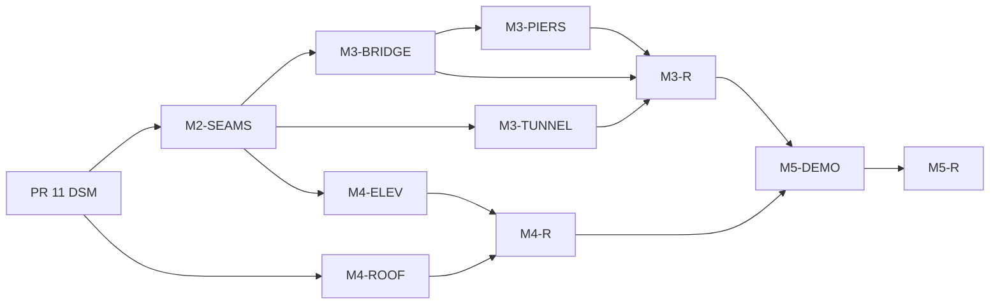

# map-builder v2 roadmap

Owner: Design role. Status of every task is in [tasks/README.md](tasks/README.md); this file
holds the approach, the milestones and the decision record.

## Goal

v2: **a drone can fly under bridges, through tunnels and beneath elevated building parts** of a
real ~1 × 1 km map, and the simulator Core can verify that from the package alone
(`passage_probes` checked against `.mbcol`). Roof shapes get richer on the way. The package
format stays 2.x (format 2.0 already carries the `bridge`/`tunnel`/`structure` classes, the
tube rule and passage probes).

## Approach

1. **Generate structures, not exceptions.** Bridge decks, tunnel tubes and passages become real
   collision objects of the kinds the format already defines:
   * bridge deck (and piers) → class `bridge`, kind *solid* (closed, positive volume);
   * tunnel → class `tunnel`, kind *tube* (inward, open at its portals);
   * tunnel portal headwalls → class `structure`, kind *solid*;
   * elevated parts and building passages → class `building` (solids that leave free space).
2. **Every generated passage carries a probe.** The generator emits a `passage_probes[]` entry
   for each passage it creates and checks it against the plan's own collision before emitting
   (plan-time check, shared helper). A probe that the generator knows is blocked is not
   emitted; it is reported in `report.json` instead (D20). The validator re-checks after
   export, so Blender edits that block a passage surface as warnings.
3. **Clearance comes from corrected ground.** Bridge clearance and tunnel cover are measured
   against the DSM-corrected terrain from PR #11 (D15).
4. **One seam, then parallel features (D17).** `core/generate.py` (≈1.8 k lines) and
   `core/osm.py` are hot spots. M2 adds a thin seam: classification routes
   bridge/tunnel/passage features into their own lists, `build_plan` calls one stage function
   per structure kind, and a shared sweep/probe helper lives in its own module. Feature
   tasks then live mostly in their own modules (`core/bridges.py`, `core/tunnels.py`,
   `core/passages.py`, `core/roofs.py`) and touch `generate.py` only at their hook.
5. **No format bump unless semantics change (D12, D18).** Emitting classes and probes the
   format already defines is not a semantic change. New `report.json` keys are additive and
   documented in PACKAGE_FORMAT.md; they do not bump `schema_version`.
6. **Keep it simple (SOLID without over-engineering).** Plain functions per structure kind
   with one shared helper module; no plugin registry, no class hierarchy for "structures".

## Milestones

| Milestone | Content | Exit criteria |
|---|---|---|
| M0 (done) | v1 (PRs #1–#9) and package format 2.0 (#10) | merged |
| M1 | DSM terrain correction (#11, old process) | #11 merged |
| M2 | Structure seams: routing, stage hooks, sweep + probe helper, Blender collections, split integration harness | sample package byte-identical; CI green |
| M3 | Bridges (decks, then piers) and tunnels (tube, terrain cut, headwalls) | fixture bridges/tunnels generated, probes pass, validator VALID, headless Blender PASS; M3-R done |
| M4 | Elevated parts + building passages; richer roof shapes | elevated/passage probes pass; new roof shapes closed and bound; M4-R done |
| M5 | Real-data re-demo with bridges and tunnels; generator 0.2.0; end-of-v2 review | demo renders + viewer delivered; M5-R done |

### Suggested waves (max 3 devs)

| Wave | Tasks in parallel | Why disjoint |
|---|---|---|
| 1 | M2-SEAMS, M4-ROOF | ROOF touches only the roof section of `build_building` (+ new `core/roofs.py`); SEAMS touches routing, `build_plan` hooks and new modules |
| 2 | M3-BRIDGE, M3-TUNNEL, M4-ELEV | each lives in its own module and its own `build_plan` hook |
| 3 | M3-PIERS, then reviews M3-R / M4-R | PIERS only extends `core/bridges.py` |
| 4 | M5-DEMO, then M5-R | needs all features |

**Soft conflicts** (shared but mechanically resolvable, D19): `examples/synthetic_sample.mbmap`
(regenerate after rebase), `tests/fixtures/synthetic_area.osm` (append-only), the
"Recorded results" table in `docs/VALIDATION.md` (append-only) and the Limits section of
`README.md` / the unsupported list in `docs/PACKAGE_FORMAT.md` (each task edits only its own
bullet). The coordinator merges one PR at a time; the next PR rebases and regenerates the
sample.

## Cross-cutting performance targets

| Item | Target |
|---|---|
| PR CI wall time | ≤ 10 min (today ≈ 40 s); each task may add ≤ 15 s of unit-test time |
| Synthetic fixture build (CLI) | ≤ +20 % wall time vs. the pre-task baseline, measured and quoted in the PR |
| Real 1 × 1 km build (M5, excluding download) | ≤ 120 s on the dev machine, CPython 3.12 |
| Scene budget | unchanged (`MAX_SCENE_VERTICES` 3 M, `MAX_SCENE_TRIANGLES` 4 M); new objects reserve before allocating |
| Passage probes | ≤ 256 per package (format); plan-time check uses `query.capsule_hits` with object-AABB pruning and stays inside the validator's 2 M visit budget for the whole package |
| Determinism | same inputs + `--created-utc` → byte-identical package (existing guarantee) |
| Headless Blender | manual, ≤ 5 min per run; not in CI (D9) |

## Decision record

Who: **U** = user, **C** = coordinator, **De** = design, **Dev** = earlier dev process
(confirmed by the coordinator).

| # | Decision | Who | Status |
|---|---|---|---|
| D1 | Standalone Blender 4.2 LTS add-on + headless CLI; outputs GLB + versioned `.mbmap` | U | final |
| D2 | No Google Maps / 3D Tiles extraction; only OSM (ODbL) + Copernicus GLO-30 | U | final |
| D3 | v1 area ≈ 1 × 1 km (50–2000 m side), no streaming/LOD | U | final |
| D4 | Collision authority is the simulator Core (250 Hz) via neutral `.mbcol`; Unity colliders not authoritative | U | final |
| D5 | QA/review uses a different model family from Dev (gpt-6.2-sol) | U | final |
| D6 | One branch + one PR per feature; squash-merge after review + CI; delete branch | U | final |
| D7 | Terrain/OSM ingestion split into its own PR (#2) | Dev | done |
| D8 | GLB/package/collision (#4) and validation (#6) separate PRs | Dev | done |
| D9 | Portable Blender 4.2.23 at `C:\tools\` for headless integration tests (manual, not CI) | Dev | final |
| D10 | Licence provisionally GPL-3.0-or-later | Dev | provisional (see D13) |
| D11 | v1 real-data demo: SF FiDi 800 × 800 m | U | done |
| D12 | v2 = bridges, tunnels, elevated parts, roof shapes, DSM correction, one PR each; bump package format if semantics change | U | final |
| D13 | Licence confirmation deferred by the user | U | open (user) |
| D14 | Package format 2.0 PR (#10) before bridges | C | done |
| D15 | DSM correction before bridges; clearance measured from corrected ground | C | final |
| D16 | PR #11 finished under the old process; the new team process starts from bridges | C | final |
| D17 | Add one seam PR (M2-SEAMS) before the structure features so bridges, tunnels and passages can be built in parallel in their own modules | De | proposed |
| D18 | Emitting `bridge`/`tunnel`/`structure` and probes is not a format change; stay on 2.0.0; new `report.json` keys are additive and documented, no bump. Generator version → 0.2.0 at M5 | De | proposed |
| D19 | The binary sample `examples/synthetic_sample.mbmap` is a regenerated artefact: on rebase conflicts, regenerate with the documented command, never hand-merge. Feature tests use their own in-code synthetic terrain/OSM; the shared fixture is append-only | De | proposed |
| D20 | The generator never emits a probe it knows is blocked; it lists it in `report.json` `passage_probes_blocked` with the blocking `mb_id` instead | De | proposed |
| D21 | Bridge deck profile: linear between at-grade end heights, raised where needed to `layer` × 5.0 m clearance over corrected ground, ramps ≤ 8 % grade; deck 1.0 m thick (inferred) | De | proposed |
| D22 | Tunnels cut the terrain mesh only where it intersects the tube interior (no trench); gaps between the cut and the tube are closed by portal headwalls/skirts (`structure`), verified by a ray "leak" test, never left open | De | proposed |
| D23 | Building passages (`tunnel=building_passage`, `covered=yes` highways through a building) split the building into a lower part (footprint minus corridor) and an elevated upper part, reusing the existing elevated-volume code; ids use the `#k` part suffix | De | proposed |
| D24 | Scope: highway bridges/tunnels only. Railway, waterway (`culvert`) and `building=bridge`/`man_made=bridge` outlines stay in `unsupported_features` | De | proposed, **user may extend** |
| D25 | v2 demo area: Pittsburgh, Fort Pitt Bridge + Fort Pitt Tunnel (≈ 40.437 N, 80.016 W, 1200 × 1000 m) | De | proposed, **needs user** |

## Decisions that need the user

1. **D25 demo area.** Proposed: Pittsburgh (Fort Pitt Bridge, Fort Pitt Tunnel, several river
   bridges, real relief). Alternative: stay in San Francisco around the Stockton Tunnel and the
   Bay Bridge approach viaducts (weaker relief, larger box).
2. **D24 scope.** Railway bridges/tunnels are out of scope for v2 by default (railways are not
   generated at all yet). Say if they should be added as a task.
3. **D13 licence.** Still deferred; nothing in v2 depends on it.

## Non-goals for v2

Streaming/LOD, textures/UVs, straight-skeleton roofs on arbitrary footprints, cable/suspension
bridge superstructure, multi-level interchanges beyond `layer` clearance, interior rooms.
