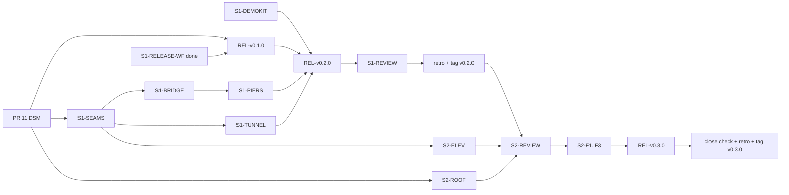
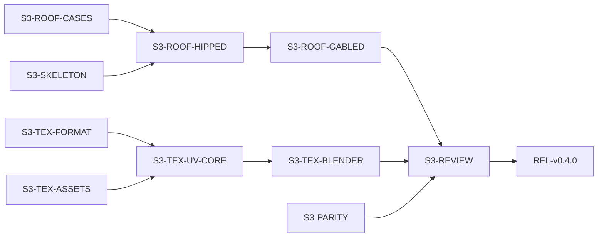

# map-builder v2 roadmap

Owner: Design role. Status of every task is in [tasks/README.md](tasks/README.md); this file
holds the approach, the sprints/releases and the decision record.

## Goal

v2: **a drone can fly under bridges, through tunnels and beneath elevated building parts** of a
real ~1 × 1 km map, and the simulator Core can verify that from the package alone
(`passage_probes` checked against `.mbcol`). Roof shapes get richer on the way. The package
format stays 2.x (format 2.0 already carries the `bridge`/`tunnel`/`structure` classes, the
tube rule and passage probes).

## Approach

1. **Generate structures, not exceptions.** Bridge decks, tunnel tubes and passages become real
   collision objects of the kinds the format already defines:
   * bridge deck (and piers) → class `bridge`, kind *solid* (closed, positive volume);
   * tunnel → class `tunnel`, kind *tube* (inward, open at its portals);
   * tunnel portal headwalls → class `structure`, kind *solid*;
   * elevated parts and building passages → class `building` (solids that leave free space).
2. **Every generated passage carries a probe.** The generator emits a `passage_probes[]` entry
   for each passage it creates and checks it against the plan's own collision before emitting
   (plan-time check, shared helper). A probe that the generator knows is blocked is not
   emitted; it is reported in `report.json` instead (D21). The validator re-checks after
   export, so Blender edits that block a passage surface as warnings.
3. **Clearance comes from corrected ground.** Bridge clearance and tunnel cover are measured
   against the DSM-corrected terrain from PR #11 (D15).
4. **One seam, then parallel features (D18).** `core/generate.py` (≈1.8 k lines) and
   `core/osm.py` are hot spots. S1-SEAMS adds a thin seam: classification routes
   bridge/tunnel/passage features into their own lists, `build_plan` calls one stage function
   per structure kind, and a shared sweep/probe helper lives in its own module. Feature
   tasks then live mostly in their own modules (`core/bridges.py`, `core/tunnels.py`,
   `core/passages.py`, `core/roofs.py`) and touch `generate.py` only at their hook.
5. **No format bump unless semantics change (D12, D19).** Emitting classes and probes the
   format already defines is not a semantic change. New `report.json` keys are additive and
   documented in PACKAGE_FORMAT.md; they do not bump `schema_version`.
6. **Keep it simple (SOLID without over-engineering).** Plain functions per structure kind
   with one shared helper module; no plugin registry, no class hierarchy for "structures".
7. **Agile, but cheap demos (D17, D28).** Two sprints, each ending in one user-checkable GitHub
   pre-release. The demo is one reusable command (S1-DEMOKIT) built once. A sprint closes with
   an RC PR by the release manager (CHANGELOG, user docs, flows, demo, notes), then the Design
   milestone review + test audit, the coordinator retro and the tag. No release per task.

## Sprints and releases

| Release | When | Content the user can try | Assets |
|---|---|---|---|
| `v0.1.0` (REL-v0.1.0) | after #11 merges; **released** | first full release: v1 + format 2.0 + DSM correction + release workflow (D29) | zip, sample `.mbmap` + `.glb`, renders, viewer, CHANGELOG, user docs, notes with "How to try it" |
| `v0.2.0` | end of **S1** (REL-v0.2.0 + S1-REVIEW); **released** on `4e0b0e2` | **fly under bridges and through tunnels**: decks, piers, tunnel tubes, portals, probes | zip, real-data demo `.mbmap` + `.glb`, panel screenshot, before/after renders, three.js viewer, release notes with "How to try it" |
| `v0.3.0` | end of **S2** (S2-REVIEW first, then S2-F1..F3, then one REL-v0.3.0, D48; end of v2) | elevated parts / building passages, roof shapes, full real-data v2 demo | same as v0.2.0 + a second real-data preset (S2-F2) + `docs/DEMO.md` with performance numbers |

| Sprint | Tasks | Exit criteria |
|---|---|---|
| S1 | RELEASE-WF (done, #13), REL-v0.1.0, DEMOKIT, SEAMS, BRIDGE, TUNNEL, PIERS, REL-v0.2.0, S1-REVIEW | fixture and demo-area bridges/tunnels generated, probes PASS (Python + C#), validator VALID, headless Blender PASS, review written, `v0.2.0` published |
| S2 | ELEV, ROOF (may start in S1), S1-F1, S1-F2, S2-REVIEW, S2-F1..F3, REL-v0.3.0 | elevated/passage probes PASS; new roof shapes closed and bound; real-data build ≤ 120 s; end-of-v2 review go/no-go; `v0.3.0` published |



### Suggested waves (max 3 devs)

| Wave | Tasks in parallel | Why disjoint |
|---|---|---|
| 1 | S1-DEMOKIT (now); after #11: REL-v0.1.0 alone, then S1-SEAMS, S2-ROOF | DEMOKIT adds new files only (`tools/demo/`); ROOF touches only the roof section of `build_building` (+ `core/roofs.py`), SEAMS routing, hooks and new modules |
| 2 | S1-BRIDGE, S1-TUNNEL, (S2-ROOF or S2-ELEV) | each lives in its own module and its own `build_plan` hook |
| 3 | S1-PIERS, S2-ELEV → REL-v0.2.0 → S1-REVIEW → retro → tag | PIERS only extends `core/bridges.py`; REL runs alone |
| 4 | S2-REVIEW → S2-F1, S2-F2, S2-F3 → REL-v0.3.0 → close check → retro → tag (D48) | F1 tests only, F2 a new preset + excerpt tests, F3 a new Blender check module; REL runs alone |

**Soft conflicts** (shared but mechanically resolvable, D20): `examples/synthetic_sample.mbmap`
(regenerate after rebase), `tests/fixtures/synthetic_area.osm` (append-only), the
"Recorded results" table in `docs/VALIDATION.md` (append-only) and the Limits section of
`README.md` / the unsupported list in `docs/PACKAGE_FORMAT.md` (each task edits only its own
bullet). The coordinator merges one PR at a time; the next PR rebases and regenerates the
sample.

## Cross-cutting performance targets

| Item | Target |
|---|---|
| PR CI wall time | ≤ 10 min (today ≈ 40 s); each task may add ≤ 15 s of unit-test time; release workflow runs only on tags |
| Synthetic fixture build (CLI) | ≤ +20 % wall time vs. the pre-task baseline, measured and quoted in the PR |
| Real 1 × 1 km build (excluding download) | ≤ 120 s on the dev machine, CPython 3.12 |
| Scene budget | unchanged (`MAX_SCENE_VERTICES` 3 M, `MAX_SCENE_TRIANGLES` 4 M); new objects reserve before allocating |
| Passage probes | ≤ 256 per package (format); plan-time check uses `query.capsule_hits` with object-AABB pruning and stays inside the validator's 2 M visit budget for the whole package |
| Determinism | same inputs + `--created-utc` → byte-identical package (existing guarantee) |
| Headless Blender | manual, ≤ 5 min per run; not in CI (D9) |
| Sprint demo | one command, ≤ 30 min unattended CPU rendering per sprint review |

## Decision record

Who: **U** = user, **C** = coordinator, **De** = design, **Dev** = earlier dev process
(confirmed by the coordinator).

| # | Decision | Who | Status |
|---|---|---|---|
| D1 | Standalone Blender 4.2 LTS add-on + headless CLI; outputs GLB + versioned `.mbmap` | U | final |
| D2 | No Google Maps / 3D Tiles extraction; only OSM (ODbL) + Copernicus GLO-30 | U | final |
| D3 | v1 area ≈ 1 × 1 km (50–2000 m side), no streaming/LOD | U | final |
| D4 | Collision authority is the simulator Core (250 Hz) via neutral `.mbcol`; Unity colliders not authoritative | U | final |
| D5 | QA/review uses a different model family from Dev (gpt-6.2-sol) | U | final |
| D6 | One branch + one PR per feature; squash-merge after review + CI; delete branch | U | final |
| D7 | Terrain/OSM ingestion split into its own PR (#2) | Dev | done |
| D8 | GLB/package/collision (#4) and validation (#6) separate PRs | Dev | done |
| D9 | Portable Blender 4.2.23 at `C:\tools\` for headless integration tests (manual, not CI) | Dev | final |
| D10 | Licence provisionally GPL-3.0-or-later | Dev | superseded by D13 |
| D11 | v1 real-data demo: SF FiDi 800 × 800 m | U | done |
| D12 | v2 = bridges, tunnels, elevated parts, roof shapes, DSM correction, one PR each; bump package format if semantics change | U | final |
| D13 | Split licence, option B: Blender add-on (`map_builder/blender/`, manifest) and any first-party file importing bpy GPL-3.0-or-later, with `map_builder/__init__.py` as the add-on bootstrap exception; all other first-party code, docs and tests Apache-2.0; textures CC0 and vendored three.js MIT unchanged; generated data not covered by the code licence (user decision 2026-11-20) | U | final |
| D14 | Package format 2.0 PR (#10) before bridges | C | done |
| D15 | DSM correction before bridges; clearance measured from corrected ground | C | final |
| D16 | PR #11 finished under the old process; the new team process starts from bridges | C | final |
| D17 | Agile delivery with few releases (user: "按照敏捷流程开发…最好是有一个release" and "注意不要太频繁，以免影响进度"): two sprints, S1 = bridges + tunnels → `v0.2.0`, S2 = elevated parts/passages + roofs + real-data demo → `v0.3.0`; no release per task; one reusable demo script built in S1; sprint close kept small (see D28); release workflow tag-triggered only | U + C | final (user may change) |
| D18 | Add one seam PR (S1-SEAMS) before the structure features so bridges, tunnels and passages can be built in parallel in their own modules | De | proposed |
| D19 | Emitting `bridge`/`tunnel`/`structure` and probes is not a format change; stay on 2.0.0; new `report.json` keys are additive and documented, no bump. Generator/extension version follows the sprint releases (0.2.0, 0.3.0), bumped only in sprint-review tasks | De | proposed |
| D20 | The binary sample `examples/synthetic_sample.mbmap` is a regenerated artefact: on rebase conflicts, regenerate with the documented command, never hand-merge. Feature tests use their own in-code synthetic terrain/OSM; the shared fixture is append-only | De | proposed |
| D21 | The generator never emits a probe it knows is blocked; it lists it in `report.json` `passage_probes_blocked` with the blocking `mb_id` instead | De | proposed |
| D22 | Bridge deck profile: linear between at-grade end heights, raised where needed to `layer` × 5.0 m clearance over corrected ground, ramps ≤ 8 % grade; deck 1.0 m thick (inferred) | De | proposed |
| D23 | Tunnels cut the terrain mesh only where it intersects the tube interior (no trench); gaps between the cut and the tube are closed by portal headwalls/skirts (`structure`), verified by a ray "leak" test, never left open | De | proposed |
| D24 | Building passages (`tunnel=building_passage`, `covered=yes` highways through a building) split the building into a lower part (footprint minus corridor) and an elevated upper part, reusing the existing elevated-volume code; ids use the `#k` part suffix | De | proposed |
| D25 | Scope: highway bridges/tunnels only in v2. Railway, waterway (`culvert`) and `building=bridge`/`man_made=bridge` outlines stay in `unsupported_features` | C (proposed by De) | final — decided by coordinator, user may change |
| D26 | v2 sprint demo area: Pittsburgh, Fort Pitt Bridge + Fort Pitt Tunnel (≈ 40.437 N, 80.016 W, 1200 × 1000 m) | C (proposed by De) | final — decided by coordinator, user may change |
| D27 | S1-RELEASE-WF (#13) AC1 "panel appears" is satisfied by a headless panel-registration assert after install-file + enable (`MB_PT_main` in `VIEW_3D`/`UI`, category *Map Builder*); the visual sidebar screenshot comes from S1-DEMOKIT `--panel`, checked at REL-v0.2.0 | C | final |
| D28 | Team per agile-ai-team (user: "访问 lingshf/agents repo，安装最新skill。然后按照agile-ai-team 规划"): a release manager owns `CHANGELOG.md`, `docs/user/`, `docs/flows/`, `docs/demo/<ver>/`, `docs/releases/<ver>.md` and proposes tag commits; Design owns `design/`. Sprint close order: RC PR → demo → Design milestone review + test audit → coordinator retro → tag/Release. Definition of Done in `design/tasks/README.md` | U + C | final (user may change) |
| D29 | `v0.1.0` is a full first release of everything on main (v1, format 2.0, #11 DSM, #13 release workflow) with CHANGELOG, user docs, flows, demo and notes; supersedes the "tag + zip only" baseline in D17 | C | final (user may change) |
| D30 | v0.1.0 不接受“关闭道路”的变通发布；真实数据（匹兹堡）默认内容导出必须 VALID。另开 BUG-ROAD-NORMALS 修复，v0.1.0 等它合并。（协调者决定） | C | done |
| D31 | v0.1.0 冲刺收尾 GO（产品负责人，69953fa）。新增小任务 TEST-HYGIENE：#11 遗留的 4 个超 5 秒测试缩小输入，墙钟 assertLess 改为计数/工作量上限（超时行为测试除外）；完成定义对旧测试一次性追溯。 | De + C | done (#23) |
| D32 | 每个 RC 必须带一次真实数据（匹兹堡）默认内容严格校验；发布文档中的构建耗时取 3 次中位数。 | C | final |
| D33 | 评审通过以评审员在确切 head 上的 `VERDICT: APPROVED` 评论为准（同账号无法给 GitHub APPROVED 状态）；写入完成定义。 | C | final |
| D34 | 合并只由协调者授权；开发不得自合（源自 #11 自合）。补 tools/demo/presets/pittsburgh.json，在 REL-v0.2.0 之前完成。 | C | final |
| D35 | 性能预算"夹具构建 ≤ +20%"指功能阶段自身耗时（同一输入，开/关对比），不计新增合法几何走常规管线的成本（需在 PR 中单列）；无相关标签的夹具开销 ≤ 2%。 | C | final |
| D35a | 基线 < 50 ms 的小夹具，阶段预算 = max(20% 基线, 5 ms)；D21 成品场景探针检查属正确性保证，不得推迟到校验器。 | C | final |
| D36 | S2-ELEV 接受阶段 ~7–8 ms（主要是 D21 探针检查和地形提取），条件是证明耗时随通道数线性增长、与场景大小无关；新增后续任务 PERF-PROBE-INDEX（桥、隧道、悬空结构共用的按地形网格查询的探针索引）。 | C | done |
| D37 | S1-TUNNEL 允许尝试一次按环段平面四边形求差的算法改进，结果必须精确等价；目标放宽为 1 km/50 隧道 <3 s、样例阶段 <=10 ms；做不到精确就回退，按 D36 方式接受，由 PERF-PROBE-INDEX 跟进。 | C | done (#22) |
| D38 | Actions 账单受阻期间，评审可以依据本地测试和 Blender 结果进行，但合并必须等确切 head 上 CI 全绿；恢复后先重跑 main 35d10d9 的 CI。v0.1.0 不再只打 tag 加插件包，改为完整首版，覆盖 main 上已有的全部内容（取代 D18 中的基线说明）。 | C | final |
| D39 | （协调者）S1-BRIDGE 桥下净空改为直接用导出的网格三角形计算：实际道路带三角形（含斜接、接头、端帽，地形+0.12 m）与桥面底面三角形，平面包围盒预筛后逐对做凸多边形求交，取裁剪多边形顶点上（桥底 z − 路面 z）的最小值（逐三角形为平面，结果精确）；裁剪前先按三角形对数上限检查，超过即 LimitError；桥面抬升用同一结果。起因：前 7 轮都在“重建的道路轮廓”上算，漏掉斜接外楔。 | C | done (#21) |
| D40 | （协调者）引桥豁免改为按 OSM 节点身份判定：道路只有与桥 way 在桥面端点共享端点节点时才算引桥，不再用距离邻近规则。 | C | done (#21) |
| D41 | （协调者）每个桥面端最多豁免一段：偏离直线最小、且 ≤30° 的那一条向外延续；前两名相差 5° 以内视为歧义，一律不豁免。节点 ID 通过下标溯源穿过裁剪和拆分，不按 XY 反查；裁剪新生成的顶点没有 ID。与桥不共享节点的道路不得被归类或报告为接头。 | C | done (#21) |
| D42 | （协调者）合并顺序：#22（S1-TUNNEL）先合，#21（S1-BRIDGE）后合；#21 的桥下探针改走 #22 统一的 finalize_probes（共享 2M WorkBudget、预算耗尽语义、全局 256 上限），D39 的三角形对上限保留。 | C | done |
| D43 | （用户指示，协调者执行）为解决 GitHub Actions 账单阻塞，仓库改为 public（改前已检查无密钥）；CI 恢复，阻塞解除。 | U + C | done |
| D44 | （协调者）PERF-PROBE-INDEX #25 重新设计：去掉按矩形缓存，每次 finalize_probes 只建一个全场景索引；额外峰值内存 ≤64 MiB（或文档化常数的 O(三角形)），用 tracemalloc 上限测试而非墙钟；结果完全等价、计费不变；评审工作负载（1 km、50 隧道、20 路，3 次中位数）至少 2× 提速，夹具不慢于 +5%；达不到就报数据停止，PR 关闭。 | C | superseded by D45 |
| D45 | （协调者）按 D44 关闭 #25：重新设计只有约 1.3×（目标 ≥2×），不合并，接受现有性能，删除分支。 | C | done (#25 closed) |
| D46 | （协调者）v0.2.0 发布前必须修复 C# 读取器：CapsuleCheck 线性扫描三角形，在匹兹堡包上耗尽 2M 查询预算，探针 9–12（含两条隧道孔）未检查；且端墙 mb_id 触发 6 个警告。新任务 FIX-CS-PROBE-PARITY（#27）：C# 计费与 Python 逐探针一致，加共享预算一致性测试，mb_id 正则只接受生成器实际产出的形式；RC 等它合并后重跑。 | C | done (#27) |
| D47 | （协调者）所有 PR（包括设计和纯文档 PR）都必须经协调者合并门禁授权后才能合并（源自 #29 未经授权自合）；凡改动探针或工作量计费的任务，PR 里必须用真实数据（匹兹堡包）分别跑 Python 和 C# 并附结果。 | C | final |
| D48 | v0.3.0 is not cut immediately, because v0.2.0 shipped today and the user wants infrequent releases. S2-REVIEW runs first; its findings define the remaining v0.3.0 scope; then a single REL-v0.3.0 closes v2. | C | final |
| D49 | S2-F2 uses option (a): a second real-data preset of at most 1×1 km containing elevated parts, a building passage and `roof:shape` tags. The search is time-boxed to half a day; if no candidate turns up, fall back to (c) synthetic-only evidence, and the release notes must state that limit. | C | final |
| D50 | Option A with a drift guard: `GENERATOR_VERSION` is bumped to "0.3.0" (it had stayed at "0.1.0", so v0.1.0 and v0.2.0 packages report `generator.version` 0.1.0, a known historical mislabel). A unit test asserts that it equals the `bl_info` version, so the two cannot drift again. `package_id` changes from v0.3.0 on; the CHANGELOG and release notes say so. | C | done (#38) |
| D51 | Option A: the headless Blender Pittsburgh export failure (a down-facing road sliver from Blender's double float32 rounding; pre-existing in v0.2.0) is fixed as S2-F6 before the v0.3.0 tag. REL-v0.3.0 keeps moving, lists S2-F6 as pending, then rebases, rebuilds the packages and reruns the Pittsburgh check in headless Blender. | C | done (#37; Pittsburgh `VALID` in headless Blender, #38) |
| D52 | Product owner GO for v0.3.0 at 4b73cba. The roofs result of 5/67 is accepted as a disclosed limitation (S2-F5 → v3). The doc fixes went into #39, and the tag sits on the #39 merge commit eb134a1. CLI/Blender probe parity was added as a v3 item. | De (GO), C | done (tag `v0.3.0` on eb134a1) |
| D53 | Sprint-2 retro: (1) before release, run real-data builds through both the CLI and headless Blender paths; that is what caught S2-F6. (2) Tests must go through the real production path (D39). (3) Keep a single source for the version, with a drift test (D50). (4) Check release-note wording against the code. (5) The merge gate (review commit = head, MERGEABLE, CI green, 0 behind) needed no rework. | C | active |

D30–D47 are copied verbatim from the team dashboard (coordinator, 2026-11-19); entries that
name no decider were decided by the coordinator. The dashboard numbered the "two sprints, cheap
demo" decision D18; in this record it is D17, so "D18" in D38 refers to that baseline note.

## v3: sprint 3 (v0.4.0) — non-rectangular roofs and textures

Scope chosen by the user after v0.3.0 ("非矩形屋顶，贴图") from the candidates: non-rectangular
roofs, CLI/Blender probe parity, LOD, textures and railway. LOD and railway stay later.

### Approach

* **Roofs.** A pure straight-skeleton module (`core/skeleton.py`) gives one planar face per
  footprint edge. Hipped roofs lift it directly; gabled roofs turn the skeleton's end faces into
  vertical gable walls. Rectangles keep today's analytic path (byte-identical). Acceptance is
  fixed first on a frozen Munich snapshot and counterexamples (DoD 10) and measured on the
  emitted triangles with a shared geometry checker (closed mesh, above eave, ridge height,
  vertical gable ends, independent overlap and gap checks). The roof outcome is decided in a
  preflight before budget reservation (D64).
* **Textures.** glTF 2.0 core PBR only: `TEXCOORD_0` plus embedded PNG `baseColorTexture`, kept
  multiplied with today's factor and `COLOR_0`. Package format 2.0.0 → 2.1.0 (minor, additive);
  `.mbcol` and the heightfield are unchanged. Textures are our own procedural images, generated
  offline, committed and dedicated to CC0. UVs are assigned after generation in `core/uv.py`
  per material, so the texture track does not edit `generate.py` or `roofs.py`.

### Tasks and waves (max 3 devs)

Task docs: [tasks/README.md](tasks/README.md#sprint-3-v040).

1. Wave 5a: **S3-SKELETON** ∥ **S3-TEX-FORMAT** ∥ **S3-ROOF-CASES** → **S3-TEX-ASSETS**
2. Wave 5b: **S3-ROOF-HIPPED** ∥ **S3-TEX-UV-CORE** ∥ **S3-PARITY** (½-day time box)
3. Wave 5c: **S3-ROOF-GABLED** ∥ **S3-TEX-BLENDER**
4. Close (D63): **S3-REVIEW** → S3-Fn blockers → **REL-v0.4.0** → close check → retro → tag `v0.4.0`



### Performance and test budgets

| Item | Budget |
|---|---|
| Roof stage (Munich) | ≤ +20 % vs v0.3.0, new legal geometry listed separately (D35) |
| Skeleton | ≤ 64 vertices, event counter cap `MAX_SKELETON_EVENTS`; `LimitError`, never time-based |
| Fixture build | ≤ +20 % with textures on; ≤ +2 % for untouched stages |
| Texture set | ≤ 2 MiB committed (counted test); validator cap 4 MiB per GLB |
| GLB size (Pittsburgh) | ≤ +35 % plus the fixed texture bytes, recorded in REL |
| New tests | ≤ 5 s each, no wall-clock gates (DoD); Blender checks stay out of PR CI |
| PR CI | unchanged (≤ 10 min; today ~85 s) |

### Consumer impact (drone-flight-simulator)

* **Core / collision:** none. `.mbcol` format 2 and the heightfield are unchanged; roofs change
  shape but stay class `building`, and the simulator's Core needs no code change.
* **Package reader:** 2.1.0 is a minor bump, so a 2.x reader accepts it and may ignore the new
  glTF fields. The C# example reader validates the embedded images (parity tests).
* **Unity / glTFast:** imports core PBR `baseColorTexture` with `TEXCOORD_0` natively; the
  texture is multiplied by the factor (and `COLOR_0` if the shader uses it). Samplers request
  mipmaps (REPEAT, trilinear). `UNITY_CORE_HANDOFF.md`'s materials checklist is updated by
  S3-TEX-FORMAT. `--no-textures` gives the v0.3.0 visual for consumers that want it.

### Sprint 3 decisions

| # | Decision | Who | Status |
|---|---|---|---|
| D54 | v3 = sprint 3, target `v0.4.0`: non-rectangular gabled/hipped roofs and textures/UVs. LOD and railway stay later. | U (scope), C (framing) | active |
| D55 | Gabled/hipped roofs on non-rectangular footprints use a straight skeleton in a pure module (`core/skeleton.py`). Simple polygons only, ≤ 64 vertices, no holes; otherwise the v0.3.0 fallback with a named reason. Gabled is derived from the hipped skeleton; if a gable end is not representable it falls back to hipped, not flat. Half-hipped, gambrel, mansard, round and saltbox stay rectangle-only. | De (proposed; C confirms at gate) | active |
| D56 | Textures are our own procedural images, generated offline by a seeded script, committed as package data and dedicated to CC0. No third-party, map or Google imagery (D2). | De (proposed; C confirms at gate) | active |
| D57 | Package schema 2.0.0 → 2.1.0 (minor, additive: optional UVs and embedded images in `visual/map.glb`). `.mbcol` (format 2) and heightfield (format 1) unchanged. S3-TEX-FORMAT adds read/write/validate support; S3-TEX-UV-CORE flips the default constant when packages first carry textures. A frozen v0.3.0 C# reader must accept a textured 2.1.0 package (CI), and a glTFast smoke import at the simulator's pinned version is required (proxy only by coordinator decision, disclosed). Texture provenance is recorded per D65. | De (proposed; C confirms at gate) | active |
| D58 | GLB textures use glTF 2.0 core only: `TEXCOORD_0`, embedded PNG via bufferView, one REPEAT/trilinear sampler, no required extensions. Validator (Python and C#): PNG only, power-of-two side ≤ 1024, total image bytes ≤ 4 MiB, finite UVs. | De (proposed; C confirms at gate) | active |
| D59 | UVs are assigned after generation in `core/uv.py` per material (facade tangent/height, roof slope plane, terrain/road world XY, concrete box), with one tile offset per mesh (continuous across shared edges; documented seams only, D64). The texture track does not edit `generate.py` or `roofs.py`. | De (proposed; C confirms at gate) | active |
| D60 | Textures default **on** in CLI and Blender; `--no-textures` / panel toggle reproduces the v0.3.0 GLB layout. Texture set ≤ 2 MiB; GLB growth ≤ +35 % plus texture bytes. | De (proposed; C confirms at gate) | active |
| D61 | Roof target: of the 67 tagged non-flat roofs in the frozen Munich snapshot (D64), **≥ 40** built as tagged, by geometry (v0.3.0: 5), every remaining fallback with a named reason. S3-ROOF-CASES may re-baseline it with coordinator sign-off before HIPPED starts. **Re-baselined by D82 (S3-ROOF-GABLED): 29/67 counted** (1 v0.3.0 + 11 hipped + 17 gabled; floor 29, enforced in `tests/test_roofs_munich.py`). Of the 52 eligible gabled ways, 17 are counted, 30 fall back to hipped with the named reason "gable end not representable" (ridge meets the gable edge outside it, sliver gable end, or fewer than two representable ridge ends), 4 near-rectangles stay analytic (frozen "planar" failure) and 1 is flat (roof height 0). Follow-up deferred to S4 (not implemented): vertical cuts across chamfered or angled ends and mixed gable + hip ends. | De (proposed; C confirms at gate) | active — re-baselined (D82) |
| D62 | Hygiene: S3-PARITY (CLI vs Blender probe counts, Munich 3/1, Pittsburgh 13/14), time-boxed to ½ day; a larger fix becomes its own task. | De (proposed; C confirms at gate) | active |
| D63 | Sprint 3 close order follows D48: S3-REVIEW on main first, its blockers, then REL-v0.4.0, short close check, retro, tag. | De (proposed; C confirms at gate) | active |
| D64 | Ownership and frozen inputs: S3-TEX-UV-CORE is the only S3 task that regenerates `examples/synthetic_sample.mbmap`; roof tasks keep it byte-identical and put synthetic roof cases in `tests/blender/checks_roofs.py` scratch OSM. The roof count (D61) is geometry-based on the emitted triangles over all 67 roofs of a committed Munich snapshot with heights frozen from v0.3.0; overlap and gap are checked independently. The roof outcome is fixed in a preflight (`plan_roof`) before reservation, and skeleton faces are triangulated explicitly. UVs use one tile offset per mesh. (Review of #40 round 1.) | De (proposed; C confirms at gate) | active |
| D65 | Texture provenance goes in a new optional top-level manifest field `asset_notices` (name, attribution, licence, SHA-256 per image) and an "Assets" section of `NOTICES.txt`. It is **not** a `sources[]` entry, because the v0.3.0 Python and C# readers accept only `elevation`/`features` there, while both ignore unknown top-level manifest fields. 2.1 validators require every embedded image's SHA-256 in `asset_notices`. The frozen v0.3.0 Python validator and C# reader must accept the exact full textured package (CI step on a full fixture and on the committed sample). S3-TEX-FORMAT owns every `core/package.py` edit (schema-version writing, `asset_notices`, notices) and lands before S3-TEX-UV-CORE. (Review of #40 round 2.) | De (proposed; C confirms at gate) | active |
| D66 | glTF-Validator is the CI proxy for glTFast (no Unity Editor in CI); disclosed. | C | final |
| D67 | Roof baseline 3/67. | C | superseded by D70 |
| D68 | #45 (S3-PARITY) stays tests-only. | C | final |
| D69 | S3-PARITY-FIX is a separate PR after #45: double-precision centre, Blender seed default 1, `passage_probes_dropped` appends {id, reason}, no sample regeneration. | C | final (#47) |
| D70 | Roof baseline 1/67 (replaces D67: the topology planarity check rejected 2 more v0.3.0 gables); 63 skeleton-eligible; target ≥ 40 unchanged (later re-baselined by D82). | C | final |
| D71 | The roof signature requires a slope count per shape (gabled 2, hipped 4); extra slopes, or slopes broken into single triangles, fail. Refined by D76 (hipped: ≥ 1 interior ridge arc) and D80 (counts taken on merged coplanar facets). | C | final (refined by D76, D80) |
| D72 | Not recorded on the team dashboard; number unused in design. | — | — |
| D73 | #43 round 4 is the last design iteration for the roof checker; anomalous corners become follow-ups. Triangle order must not affect the verdict (permutation test). | C | final |
| D74 | The legacy `.blend` centre fallback migration comes before re-review; bbox float32 is logged as a follow-up (S3-F6). | C | final |
| D75 | #46 round 2: paths directory entries in the static ship guard. | C | final |
| D76 | S3-ROOF-HIPPED: 8/11 skeleton roofs had valid geometry but the signature rejected them, so the checker signature changes in the same PR (hipped needs ≥ 1 interior ridge arc; a lone apex only for pyramidal or a point skeleton). The frozen v0.3.0 replay must not inflate. | C | final |
| D77 | `roof:levels=0` on a hipped/pyramidal roof uses the default roof height, only when no explicit roof height (`roof:height`) is tagged. | C | final |
| D78 | Last round for the static guard (#46); it only targets silent omissions. | C | final |
| D79 | S3-TYPING is annotations only, no behaviour change, verified with local mypy, no CI job. Avoiding the HIPPED/#46 files applied only while those PRs were open; the final stack (#54) annotates the roof files and `generate.py`. | U (request: full type annotations), C | final (#51, #52, #54) |
| D80 | The roof checker judges topology on merged coplanar facets and collinear edges, so it is invariant to midpoint subdivision. | C | final |
| D81 | Accept the #49 performance (Pittsburgh +13.8 %; tiny fixture +21–23 % from the fixed PNG deflate cost); follow-up ZIP_STORED for PNGs (S3-F5). | C | final |
| D82 | (coordinator) S3-ROOF-GABLED option (a): re-baseline D61 to the exact measured counted number (29/67, floor 29) instead of ≥ 40. The sliver gable ends are fixed locally in the gable conversion (`GABLE_MIN_HEIGHT_RATIO`) without loosening the checker; any unrepresentable end is a named fallback to hipped that passes the hipped checks; single-end L-shapes stay hipped (a gabled signature needs ≥ 2 gable ends). Deferred to S4 (follow-up, not implemented): the broader construction, i.e. vertical cuts across chamfered or angled ends and mixed gable + hip ends. | C | final |
| D83 | #52 (S3-TYPING 2/4) merges before S3-TEX-BLENDER; TEX-BLENDER rebases and annotates its new code. | C | final |
| D84 | (coordinator) `roof:direction` is the direction the slope faces (OSM semantics), so the ridge runs perpendicular to it: for gabled skeleton roofs it selects the gable-end edges whose outward normal is nearest the ridge axis (perpendicular to the tag), not a quantised bounding-box axis; the ridge bearing then follows from the footprint and the skeleton. The emitted gable ridge bearings are recorded in `prov["roof_ridge_bearing"]`. If no emitted ridge is within 10° of perpendicular to the tag, `prov["roof_direction"]` is `approximate: ridge NNN° vs tagged DDD°`, never reported as perpendicular. | C | final |
| D85 | The performance gate is the whole Generate (S3-TEX-BLENDER #53: +8.8 %), not a single stage. | C | final |
| D86 | Textures, materials and NOTICES in a package must always agree. Operative rule: the export-time Textures setting alone controls materials, UVs, embedded images, `asset_notices` and NOTICES, irrespective of the setting Generate ran with. | C | final |
| D87 | Tiny-fixture overshoot does not gate; Pittsburgh measures it (#53 Pittsburgh untextured whole Generate 12.79 → 13.64 s, +6.6 %; untextured `build_scene` stage 0.97 → 1.70 s, +75 %; the textured stage under D85 was 1.17 → 1.89 s, +62 %; stage results do not gate; follow-up S3-F4). | C | final |
| D88 | Export material identity is a parameter key (a digest of the exact material parameters), not a display name. | C | final |
| D89 | Review rounds are capped at 3 per PR. After round 3 the coordinator rules, and the remaining non-blocking findings become follow-up tasks. A task spec lists its acceptance cases and checker up front, so review measures against them instead of discovering new criteria (retro v0.4.0: #53, #43/#46). | De (proposed), C | final |
| D90 | A numeric acceptance target is set only after a same-checker baseline has been measured (spike or frozen replay under the final checker). It is stated as a **floor** (must) plus a **stretch** (aim), and the task doc records the baseline and how it was measured (retro v0.4.0: roof target ≥ 40 was set before measurement and against a 5/67 from a different checker). | De (proposed), C | final |
| D91 | The performance gate is the whole Generate (CLI and headless Blender) on the real-data presets against the previous release, measured on the same host with the pinned setup (sprint-4 baselines). Whole Generate **includes acquisition** served from the frozen cache with network access blocked by the offline guard (a run with any network attempt is invalid); for the CLI it runs through package write and strict validation. Blender is reported as Generate and as Generate+Export separately, because package writing and strict validation run in Export. Stage-level growth is reported as information and turned into follow-ups, never a gate, and no unit test asserts a duration (generalises D85, D87). | De (proposed), C | final |
| D92 | The C# parity tests are hermetic: a repo-local `NuGet.config` (`<clear/>` + nuget.org), one prebuild per test run under a lock, and restore audit warnings such as NU1900 not treated as errors in test builds. Removes the CS2012 parallel-run race and the host-feed dependency. | De (proposed), C | final |
| D93 | Sprint 4 (`v0.5.0`) theme: **quality closeout + publishing readiness**. | C | final |

## v4: sprint 4 (v0.5.0) — quality closeout and publishing readiness

Theme chosen by the coordinator (D93). Sprint 4 closes the S3 follow-ups that affect output quality, makes
the build and the tests reproducible, and prepares, without doing, the two publishing steps the user owns:
a Blender Extensions platform submission and a v1.0 commitment. No new feature class. LOD and railway stay
later.

### Approach

* **Measure first (D90).** Every numeric target below comes from a baseline measured on f8bedf6 with the
  checker that will judge it (table below). Where no baseline exists yet (the roof stretch), a time-boxed
  spike measures it before the implementation starts. Where a task's numeric target has no baseline yet
  (the Blender bbox error, the roof reservation margin), the task's first step measures it on f8bedf6 and
  records it in the PR before any change.
* **Roofs: name every fallback, then build more.** First make every uncounted Munich roof carry a
  named reason and fix the reference-plane warp (S3-F1, F7, F8, F9). Then add the S4 construction for
  chamfered and angled gable ends, mixed gable + hip ends and concave pyramidal roofs (S3-F10). Floor 29/67;
  stretch **TBD after the final-checker replay in S4-ROOF-SPIKE** (D95).
* **Output quality.** Fewer degenerate collision triangles from both paths without silently changing query
  results (S3-F12, D98). A river that reads as water with textures on (S3-F13).
* **Performance that does not change bytes.** Strict validation is 9.45 s of the 24.3 s Pittsburgh CLI build.
  `_zinfo` deflates every member once only to test the ratio, and `zipfile` then deflates it again. The
  `assign_uvs` cost is S3-F4. Performance tasks must keep every package byte-identical (D97), so they are
  safe to run in parallel with anything that does not touch their files.
* **Hermetic tests (D92) and a reproducible extension zip.** Today the zip is byte-identical only when the
  file mtimes match.
* **Publishing readiness.** A manifest that passes `blender --command extension validate` and the platform
  rules, a submission checklist for the user, a written `.mbmap` format-stability policy, and a draft of the
  v1.0 exit criteria for the user to confirm.

### Measured baselines (main f8bedf6, this host, Python 3.12)

**Pinned timing setup (D91).** Windows host, Python 3.12 for the CLI, portable Blender 4.2.23 for headless runs,
one build at a time (no parallel load). Inputs are the frozen RC caches of v0.3.0 / RC #56 (`cache-munich`,
`cache-pittsburgh`), copied fresh for each run. **Offline is enforced, not inferred:** both harnesses install
`design/bench/offline_guard.py`, which replaces `socket.getaddrinfo`, `gethostbyname`, `create_connection`,
`socket.connect` and `connect_ex` with functions that raise and record the attempt; each harness fails unless
the attempt list is empty (every baseline run below: 0 attempts). The CLI also passes a `NoNetwork` client that
raises on any cache miss. Areas: Munich 48.1395, 11.5764, 400×400 m; Pittsburgh 40.437, −80.016,
1200×1000 m. Settings: textures on, seed 1, DSM correction on, terrain spacing 10 m, heightfield spacing 2 m.
Blender: `blender --background --factory-startup --online-mode --python-exit-code 1 --python
design/bench/bl_time.py -- <tree> <tag> <cache> <out>`. CLI: `MB_CACHES=<caches> MB_OUT=<scratch> MB_TAG=<tag>
PYTHONPATH=<tree> python design/bench/cli_time.py munich pittsburgh`. **Whole Generate (D91) starts at
acquisition:** reading and parsing the frozen cache (DEM, OSM), then the plan; for the CLI it also includes the
package write and strict validation (`generate_plan` + `plan_to_package`, the same calls as `build_package`).
In Blender, **Generate** (the operator, which acquires from the cache) ends when the scene exists; package
writing and strict validation are **Export**, timed separately. The v0.4.0 tree is `git archive 18f0822`.

| Item | Baseline | How measured |
|---|---|---|
| Munich roofs built as tagged | **29/67**. Of the 38 uncounted, **34** carry a named reason; the 4 analytic near-rectangle gables carry none (S3-F1) | `tests.test_roofs_munich`, frozen snapshot (S3-REVIEW §1.1) |
| Uncounted roofs by reason | 21 ridge meets the gable edge outside it · 9 sliver gable end · 4 analytic `planar` failure (unnamed) · 1 courtyard · 1 quadruple_saltbox · 1 roof height 0 · 1 concave pyramidal | same |
| `.mbcol` degenerate triangles (validator warning) | sample 2 · Munich CLI 59 / Blender 58 · Pittsburgh CLI 76 / Blender 78 | RC #56 evidence, `tools/mbmap_cli.py validate` |
| River colour, Pittsburgh overview (mean RGB of pixels x 600–700, y 500–540) | textured **(124, 162, 144)**, G > B · untextured (132, 166, 198) | `docs/demo/v0.4.0/pittsburgh-overview-v040{,-notex}.png` |
| Root cause of the green river | one `MB Terrain` material with `terrain_grass.png` for every landcover class, including water | `core/textures.py:33`, `core/uv.py:68` |
| CLI whole Generate (acquire + plan + package), textured, offline, median of 3: v0.4.0 (18f0822) | Munich **5.84 s** (acquire + plan 3.02, package 2.83) · Pittsburgh **24.30 s** (9.07, 15.23) | `design/bench/cli_time.py`, same host, sequential runs, 0 network attempts |
| Same, main f8bedf6 | Munich 5.95 s (3.07, 2.87) · Pittsburgh 24.55 s (9.22, 15.33), within noise of v0.4.0 | same |
| Headless Blender **Generate** (acquire from cache + scene), median of 3: v0.4.0 / main | Munich **4.17 s** / 4.14 s · Pittsburgh **13.18 s** / 13.20 s | `design/bench/bl_time.py` (timer around `map_builder.generate` only), 0 network attempts |
| Headless Blender **Export** (package write + strict validation), median of 3: v0.4.0 / main | Munich 5.11 s / 5.20 s · Pittsburgh 29.83 s / 29.23 s | same (timer around `map_builder.export` only) |
| Headless Blender **Generate+Export**, median of 3: v0.4.0 / main | Munich **9.35 s** / 9.47 s · Pittsburgh **42.93 s** / 42.34 s; every run VALID | same |
| Strict validation of the Pittsburgh package, median of 3 | **9.45 s**; top costs `_correspondence`, `match_one_to_one`, `match_winding`, `_dist`, `find_secrets` | `validate_package(strict=True)`, cProfile |
| `build_plan` Pittsburgh | 5.31 s | unprofiled |
| Deflate passes per package member | **2** (`_zinfo` ratio test, then `zipfile`) | `core/package.py:1130–1141` |
| PNG storage | PNGs are embedded in `visual/map.glb`, not separate ZIP members, so ZIP_STORED for PNGs (S3-F5) is not possible without a format change (D96) | package listing |
| Extension zip | `extension validate` passes; two builds from the same tree are byte-identical (892,653 B); after touching mtimes the SHA-256 changes | Blender 4.2.23 |
| Manifest gaps for the platform | no `website`; `maintainer` is "map-builder contributors" with no contact | `map_builder/blender_manifest.toml` |
| C# parity tests on this host | 2 `setUpClass` errors (NU1900 from a private user-level feed); CS2012 when two suites run in parallel | full suite, PO review of #56 |
| Slowest test | 3.31 s locally; the 45° bridge crossing 2.82–5.47 s depending on the host (S3-F3) | `--durations`, S3-REVIEW §2 |
| Finalizer ResourceWarning | 1 (`tests/test_demo_bundle.py:53`) | S3-F2 |
| Suite | 698 run, 1 skipped (+2 host errors above), 126–135 s locally; PR CI 36 s / 1m01 / 1m32 | local, CI on #56 |

### Tasks and waves (max 3 devs)

Task docs: [tasks/README.md](tasks/README.md#sprint-4-v050).

| Lane | Tasks in order |
|---|---|
| A: roofs | **S4-ROOF-SPIKE** (½ day) → **S4-ROOF-NAMED** → **S4-ROOF-ENDS** |
| B: package and collision | **S4-PERF-PKG** → **S4-BLENDER-HYGIENE** → **S4-COL-DEGEN** → **S4-WATER-SURFACE** (D112) |
| C: textures, tests, publishing | **S4-TEX-WATER** → **S4-PERF-UV** → **S4-TEST-HYGIENE** → **S4-FORMAT-POLICY** (hard edge) → **S4-EXT-READY** |
| Close (D104, D133, D135) | **S4-REVIEW** → S4-WATER-BANK → **S4-COL-FLOAT** → **S4-COL-FLOAT-2** → **S4-MYPY** → **REL-v0.5.0** → close check → retro → tag `v0.5.0` (user decision) |

Hard dependencies are only the arrows in the graph; the lane order otherwise just balances three devs.
The lane-A dev runs the spike first (it merges nothing). The stretch is recorded only after the final-checker
replay (D95), before S4-ROOF-ENDS starts. S4-EXT-READY has no dependencies and can fill any free lane.

```mermaid
graph LR
  SP[S4-ROOF-SPIKE] --> RP[stretch replay under the final checker, D95]
  NA[S4-ROOF-NAMED] --> RP
  RP --> EN[S4-ROOF-ENDS]
  NA --> EN
  PK[S4-PERF-PKG] -. only if package.py edit .-> FP[S4-FORMAT-POLICY]
  TH[S4-TEST-HYGIENE] --> FP
  TW[S4-TEX-WATER] --> UV[S4-PERF-UV]
  BH[S4-BLENDER-HYGIENE] --> CD[S4-COL-DEGEN]
  EX[S4-EXT-READY]
  CD --> WS[S4-WATER-SURFACE]
  EN --> REV[S4-REVIEW]
  WS --> REV
  FP --> REV
  UV --> REV
  EX --> REV
  REV --> WB[S4-WATER-BANK]
  WB --> CF[S4-COL-FLOAT]
  CF --> CF2[S4-COL-FLOAT-2]
  CF2 --> MY[S4-MYPY]
  MY --> REL[REL-v0.5.0]
```

Why the edges: ROOF-NAMED and ROOF-ENDS share `core/roofs.py`. If ROOF-NAMED changes the checker's reference
plane, the spike's count is replayed under the final checker before the stretch is set (replay node, D95).
TEX-WATER and PERF-UV share `core/uv.py` (the mean-albedo table). BLENDER-HYGIENE and COL-DEGEN share
`blender/bake.py` and `blender/export.py`; WATER-SURFACE (added by D112 from the user's river request) shares
them too, and also holds `core/generate.py` (terrain section) and `core/bridges.py` alone. **TEST-HYGIENE → FORMAT-POLICY is a hard edge:** FORMAT-POLICY's
positive future-minor fixture runs through the frozen C# reader (D101), which uses the C# build harness,
`tests/test_csharp_parity.py` and the reader project that TEST-HYGIENE rewrites (D92). FORMAT-POLICY may also need a
`core/package.py` edit, which PERF-PKG owns first (dotted, conditional).

**Sample slot (D103).** `examples/synthetic_sample.mbmap` is one binary with one writer at a time. The
output-changing PRs (S4-TEX-WATER, S4-COL-DEGEN, S4-WATER-SURFACE, and S4-ROOF-NAMED / S4-ROOF-ENDS only if the fixture's roofs
change) take a single, exclusive **merge-time sample slot** from the coordinator. The slot holder rebases on
main, regenerates the sample, gets green CI and the gate, and merges. The slot is then released, and the next
holder starts its rebase only after that merge. Only the slot holder may push a sample change; other PRs
keep the sample bytes of main. Rebasing alone does not serialise the writers.

### Performance and test budgets

| Item | Floor (must) | Stretch (aim) |
|---|---|---|
| CLI whole Generate (acquire + plan + package), both presets, median of 3 (D91) | ≤ +5 % vs the same-host v0.4.0 median: Munich ≤ 6.13 s, Pittsburgh ≤ 25.52 s | Pittsburgh ≤ 19.0 s (strict validation ≥ 2× faster, single deflate pass) |
| Headless Blender **Generate**, both presets (D91) | ≤ +5 % vs v0.4.0: Munich ≤ 4.38 s, Pittsburgh ≤ 13.84 s | lower than v0.4.0 (S4-PERF-UV) |
| Headless Blender **Generate+Export**, both presets (D91) | ≤ +5 % vs v0.4.0: Munich ≤ 9.82 s, Pittsburgh ≤ 45.08 s | Pittsburgh ≤ 37 s (Export carries the writer and validator speed-up of S4-PERF-PKG) |
| Timing evidence | measured with the pinned setup above (offline guard, 0 network attempts) and quoted in the PR; stage timings are information only; **no timing assertion in any unit test** | — |
| Byte identity of perf tasks (D97) | sample, Munich and Pittsburgh frozen builds byte-identical before/after | — |
| Munich roofs counted | must: ≥ 29/67 under the final checker, and **every** remaining uncounted roof has a named reason (baseline 34 of 38) | **TBD after the final-checker replay in S4-ROOF-SPIKE** (D95); no number until measured |
| Degenerate `.mbcol` triangles | must: fewer than the baseline in every package and path, and **no** changed hit on the D98 probe set; any triangle kept to preserve a hit is listed | 0 in the sample and both presets, both paths, with the probe set unchanged |
| River colour (textured) | B ≥ G, and each channel within 30 of the untextured render | within 15 |
| New tests | ≤ 5 s each, no wall-clock gates (DoD) | — |
| PR CI | ≤ 10 min (today about 1m32 for the slowest job); a C# prebuild may add ≤ 30 s | — |
| Floating collision (D126) | `tools/floating_audit.py` at 0.2 m: 0 floating, 0 `water_above_bank`, 0 `water_buried` regions in the sample, Munich and Pittsburgh, CLI and Blender | — |
| mypy (D128) | 0 errors, enforced in CI; the step adds ≤ 60 s to one job | — |
| Local suite | 0 host-dependent errors with a private user-level NuGet feed configured (D92) | — |

### Consumer impact (drone-flight-simulator, read-only)

* **Collision (`.mbcol` format 2, unchanged).** The validator's degenerate predicate (`is_degenerate`, an area
  epsilon) is not the query's definition of a miss: a 1 mm right triangle is classified degenerate, yet the
  watertight ray through its interior hits it at t = 1.0 (review of #59). S4-COL-DEGEN therefore removes
  zero-area triangles at the source (re-triangulating without collinear or duplicate vertices, so the covered
  surface is unchanged) and proves **measured hit equivalence** on a fixed probe set (D98). Any triangle whose
  removal would change a hit is kept and disclosed, unless the coordinator explicitly accepts the change.
  Triangle counts and offsets change. Roof changes keep class `building`. No simulator code change.
* **What is checked here and what is not.** In this repo, the reference C# reader replays the probe set and the
  passage probes (D47). The simulator repo stays read-only. Its own import and visual check of the released
  packages is a user/simulator-owner action, reported separately and never claimed from the C# replay.
* **Visual (GLB).** S4-TEX-WATER replaces the terrain image (same name slot, new SHA-256 in
  `asset_notices`). Roofs change shape. glTFast imports as before.
* **Format.** Schema stays **2.1.0** (the writer default since #49). S4-FORMAT-POLICY publishes what a 2.x
  reader may rely on within today's container and glTF limits (D101), so the simulator can pin "major 2, any
  minor".
* `package_id` changes for every package (generator 0.5.0 and the output changes above).

### Draft v1.0 exit criteria (D102, for the user to confirm)

1. **Format frozen per the stability policy** (D101): 2.x published, the previous-minor frozen reader in CI.
2. **Real data:** both presets VALID through the CLI and headless Blender, probe parity, 0 validator
   warnings. This is **stricter than the v0.5.0 release bar**, which allows degenerate-triangle warnings for
   triangles kept under D98 when they are listed and disclosed; the user decides at v1.0 whether that
   exception stays.
3. **Roofs:** every tagged roof is built as tagged or carries a named reason; the v0.5.0 floor holds.
4. **Consumer:** glTF-Validator clean; the simulator owner confirms one import of the released packages
   (a user action, outside this repo).
5. **Extension:** `extension validate` passes, the zip is reproducible from the tag, the platform checklist
   is complete, and the user has either submitted or deliberately deferred submission.
6. **Licence final** (D13, done).
7. **Docs:** install, generate, export, validate and the CLI are documented with known limitations.
8. **No open gap of medium or higher severity.**
9. **Performance:** a 1.2 × 1 km area builds in ≤ 120 s through each path (met today).

### Sprint 4 decisions

| # | Decision | Who | Status |
|---|---|---|---|
| D94 | Sprint 4 = `v0.5.0`, scope as above. Excluded: LOD, railway, new structure classes. S3-F1–F13 are either scheduled here or closed with a reason (D96). | De (proposed; C confirms at gate) | proposed |
| D95 | Roof target per D90. **Floor (must):** ≥ 29/67 counted under the final checker, and every roof that is still uncounted carries a named reason (baseline 34 of 38). **Stretch (aim): TBD after the final-checker replay in S4-ROOF-SPIKE.** The spike (½ day, nothing merged) counts on the frozen snapshot how many of the gable-end fallbacks and analytic gables the S4 construction would build. If S4-ROOF-NAMED then changes the checker (reference plane only), both the floor baseline and the spike count are replayed under that final checker, and the coordinator records the stretch as a D-number before S4-ROOF-ENDS starts. No provisional number is published. The checker is not loosened. | De (proposed; C confirms at gate) | proposed |
| D96 | S3-F5 (ZIP_STORED for PNGs) is closed as stated: the PNGs live inside `visual/map.glb`. It is replaced by single-pass deflate in `_zinfo` (S4-PERF-PKG), which keeps the archive bytes identical. | De (proposed; C confirms at gate) | proposed |
| D97 | Performance tasks (S4-PERF-PKG, S4-PERF-UV) must keep the committed sample and the frozen Munich and Pittsburgh builds byte-identical, and the validator verdicts and messages identical on every positive and negative fixture. A speed-up that changes bytes is a separate, reviewed behaviour change. | De (proposed; C confirms at gate) | proposed |
| D98 | Degenerate collision triangles. The validator's `is_degenerate` (area epsilon) is not the query's miss predicate: a validator-degenerate 1 mm triangle can still be hit (watertight ray at t = 1.0). So: (1) remove degenerate triangles **at the source**, by dropping collinear and duplicate ring vertices before triangulation and re-triangulating, so the covered surface is unchanged; (2) acceptance is **measured hit equivalence** before and after, in Python and the C# reader, on a fixed probe set: the passage probes, a deterministic ray and capsule grid, and one ray through the centroid of every triangle that was validator-degenerate before; (3) a triangle that cannot be removed without changing a hit stays and is listed, unless the coordinator explicitly accepts a disclosed query change. The validator keeps the degenerate-triangle **warning** (not an error) for third-party packages. | De (proposed; C confirms at gate) | proposed |
| D99 | The green river is fixed by replacing the grass pattern with a neutral, luminance-only terrain-detail texture (our own procedural CC0 image) so the landcover vertex colours carry the hue. The terrain is not split by landcover, and the geometry does not change. | De (proposed; C confirms at gate) | proposed |
| D100 | Extension reproducibility: the release workflow sets every source file's mtime to the tag commit time before `extension build`, so two clean builds from the tag are byte-identical. The platform submission itself is a user action; Dev only prepares `docs/PLATFORM_SUBMISSION.md`. The maintainer contact and the website are user-owned fields (no personal data is invented). | De (proposed; C confirms at gate) | proposed |
| D101 | Draft `.mbmap` format-stability policy (for user confirmation at v1.0). **Patch** = clarifications, no file change. **Minor** = additive optional content that the frozen previous-minor Python **and C#** readers load unchanged, within today's limits, which are themselves not relaxed in a minor: every ZIP member **other than `manifest.json`** listed in `files[]` with its SHA-256, one-to-one (unlisted files are an error in both readers; the manifest is not hashed in `files[]`, it is identified by `package_id`, `docs/PACKAGE_FORMAT.md:44–49`); ≤ 64 entries, ≤ 1.5 GiB uncompressed, manifest ≤ 32 MiB, compression ratio ≤ 200, names ≤ 255 bytes; one GLB-stored buffer, no external or data-URI buffers, no `extensionsRequired` (an error in both readers), glTF content within the C# caps (GLB ≤ 1 GiB, ≤ 8 M visual triangles, ≤ 1 M nodes, depth ≤ 64); every embedded image listed in `asset_notices[]`. Optional glTF content may use `extras`, or an `extensionsUsed`-only extension, only where the positive fixture below shows that both frozen readers ignore it. A future minor is accepted only with a **positive frozen-reader fixture**: a 2.(n+1).0 package with the new content loads in the frozen Python and C# readers in CI (as D57/D65). **Major** = any removal, rename or semantic change of an existing field, collision class or kind, coordinate frame, units, the open-tube rule, a limit above, or a `.mbcol`/`.mbhf` format number the current readers cannot read. Readers accept the same major with any minor and reject another major with a clear error (current behaviour, `core/package.py:1436`). A field is deprecated for at least one minor before removal in the next major. The current writer default stays 2.1.0. | De (proposed; U confirms at v1.0) | draft |
| D102 | Draft v1.0 exit criteria as listed above, for the user to confirm. | De (proposed; U confirms) | draft |
| D103 | Sample ownership. Output-changing tasks (S4-TEX-WATER, S4-COL-DEGEN, and S4-ROOF-NAMED / S4-ROOF-ENDS only if the fixture's roofs change) regenerate `examples/synthetic_sample.mbmap` only while holding the single exclusive **merge-time sample slot** granted by the coordinator: rebase on main, regenerate, green CI and gate, merge, release the slot. Other PRs keep main's sample bytes. The PR lists the byte change. Perf tasks never change it (D97). Comparisons against v0.4.0 use frozen inputs: the committed Munich roof snapshot, the RC #56 caches by acquisition SHA-256, and the unchanged sample input. | De (proposed; C confirms at gate) | proposed |
| D104 | Sprint 4 close order follows D48 and D63: S4-REVIEW on main first; its findings define the remaining v0.5.0 scope; then REL-v0.5.0 (version 0.5.0 via the D50 guard), the close check, the retro and the tag. | De (proposed; C confirms at gate) | proposed |
| D105 | The D95 stretch is **45/67**, and the roof checker (`tests/roof_checks.py`) stays unchanged in sprint 4; the S3-F7 reference-plane change is not made. Met by #67 (33 → 45/67). Sources: #60, #62, #67, `tests/test_roofs_munich.py:38`. | C (coordinator) | decided |
| D106 | D91 measurement method: an independent, same-host, offline replay with alternating base/head runs (at least three per revision and preset), comparing medians of whole Generate. A single pair is only a sanity check. Sources: #63, #64, #67. | C (coordinator) | decided |
| D107 | Gabled roofs with no usable height (for example `roof:levels=0`) stay flat with a named reason; no D77 height is invented for them (no change to the height policy). Source: #62, `core/generate.py:529`. | C (coordinator) | decided |
| D108 | The bbox fields become exact text (S3-F6). Saved float values in an old `.blend` migrate once, on load or the first Generate, as the `repr` of the stored float; the legacy float properties stay registered but hidden. Source: #66. | C (coordinator) | decided |
| D109 | A stage-level slowdown (Munich roof stage, about 30 ms in S4-ROOF-ENDS) is accepted when whole Generate stays within the D91 +5 % limit (as D85 and D91). Source: #67. | C (coordinator) | decided |
| D110 | Amends D101: a minor version adds **no package members** (no new path or role), because both the current and the frozen v0.3.0 C# readers reject an unknown member path even when it is listed and hashed in `files[]` ("unknown package member"), while the Python validator only warns. The positive fixture (`tests/test_format_policy.py`) pins this with a listed, hashed unknown path (it does not test an unlisted ZIP entry, which is a separate error in both readers). | C (coordinator) | decided |
| D111 | S4-COL-DEGEN: the D98 probe invariance outranks AC3 (the degenerate-count target). If removing a degenerate triangle would change a probe result, the triangle is kept and listed. | C (coordinator) | decided |
| D112 | User's river request: S4-WATER-SURFACE ships in **v0.5.0**. It runs right after S4-COL-DEGEN and before S4-REVIEW, because the user asked for it directly and prefers infrequent releases. | C (coordinator, for the user) | decided |
| D113 | Water inputs stay within the current Overpass selectors, because the query text is in the frozen-cache key. Surfaces: the validated `area_class == "water"` polygons (holes kept, clipped), plus closed `waterway=riverbank` ways, recognised only in the water-body assembly through `_is_riverbank` (D118); `area_class`, `_area_family`, DSM classification, outer suppression and all reports are byte-identical. Centrelines: `waterway=river|canal` polylines kept in `ClassifiedOSM.waterways`, with an unchanged unsupported report. Standalone `water=*`, riverbank relations and coastline are later work. Each built body is one `water:<osm-id>` surface mesh, class `water`. Spec: [tasks/S4-WATER-SURFACE.md](tasks/S4-WATER-SURFACE.md). | De (proposed; C confirms at gate) | proposed |
| D114 | Water level: p20 of pre-carve corrected-DEM shore samples, taken every 5 m at 0.5–2 cell outward offsets, with N_min = 8; if short, widen once to 4 cells, then `fallback(no shore samples)`. Exactly one consistent centreline chain ≥ 300 m gives a profile: 100 m stations, short stations merged downstream, isotonic non-increasing. A local slope cap of 1 % makes the body flat. Zero or competing chains give a flat body. The sanity window is per body or per pooled block. Every area has one named outcome; a fallback keeps today's painted cells. AC0 record (Pittsburgh, base 70d93c7): bed spread 8.56 m (Mon), 5.94 m (Emsworth), 0.80 m (pool); staircase 2.29 / 2.03 / 1.40 m; shore p5..p50 of the Mon 213.00 / 214.15 (p20) / 218.25 m. Nothing argued for moving the percentile, so p20 is kept. | De (proposed; C confirms at gate) | p20 kept after AC0 |
| D115 | Two grids: roads, buildings, bridges and clearance floors use the pre-carve ground, and only the terrain mesh is carved. Conservative carve: every vertex of a cell that overlaps water goes to ≤ Lmin(cell) − 1.5 m, with no exceptions inside the polygon. At-grade roads over water keep their mesh and are reported. The bank blend (1 cell, lowering only) skips roads, buildings and abutments. The invariant is enforced exactly on the final terrain/water triangle overlaps, with a bounded remedy (2 passes) and then `fallback(carve invariant)`. After any fallback, the grid and every surviving body's remedy are recomputed from the pre-carve ground plus the active bodies' carves and blends only (never from the carved grid), in ascending body id, at most one round per body, then the invariant is rechecked (D118). *Superseded in part (D165): since #76 (D126), roads drape on the **carved** grid (`core/generate.py:2052`); buildings, bridges and clearance floors still use the pre-carve ground.* | De (proposed; C confirms at gate) | proposed |
| D116 | Decks keep the pre-carve `_ground_max` floor, raised by the exact water maximum along the section, so they are never lowered. Piers reach the carved bed. For a probe whose capsule footprint touches water, the under-probe sits at the exact maximum of pre-carve ground and water over the whole swept footprint (segment dilated by the 1 m radius) + `ROAD_LIFT_M` + 1.5 m: at least 0.62 m clearance everywhere under the capsule. Dry probes keep today's formula in full, including `ROAD_LIFT_M` (D118). Probe checks are two replays: a fixed-query replay (frozen coordinates, Python and C#, hit/miss, distance and class; every difference in a listed change set) and a regenerated-passage replay (every base id survives unless listed as dropped with its reason; survivors passable on their new paths). Both are separate from the S4-COL-DEGEN D98 check. | De (proposed; C confirms at gate) | proposed |
| D117 | Water goes into `.mbcol` as the existing class 5 `water` surface: no format change (D101/D110). `.mbhf` stays terrain-only and shows the bed; the consumer docs say to use the `.mbcol` query over water. | De (proposed; C confirms at gate) | proposed |
| D118 | #70 review R3 (D89 cap, no R4): the three R3 points are closed by a coordinator-verified amendment. (1) Dry probes keep today's formula in full, including `ROAD_LIFT_M`; wet probes use the footprint maximum + `ROAD_LIFT_M` + 1.5 m. (2) Riverbanks are recognised only in the water-body assembly through `_is_riverbank`; `area_class`, `_area_family`, DSM classification, outer suppression and all reports are byte-identical. (3) After any fallback, every surviving body's remedy is recomputed from the pre-carve ground plus the active carves and blends, in deterministic order, at most one round per body, then the invariant is rechecked. | C | decided |
| D119 | #71: the single C# radius-0 capsule difference is rejected. Re-fanning is removed entirely: that polygon keeps its baseline fan selection after the allowed cleanup, and all five Python and C# replay comparisons show 0 differences. | C (coordinator) | decided |
| D120 | Blender Generate+Export on the final export code is re-measured at S4-REVIEW against v0.4.0 (deferred from #71). Result: −2.4 % Munich, −4.1 % Pittsburgh, as the median of per-round medians over 3 alternating rounds ([reviews/S4-REVIEW.md §1.4](reviews/S4-REVIEW.md#14-performance-d91-d97-d120-met); raw runs and aggregation in [reviews/data/S4-REVIEW-timings.md](reviews/data/S4-REVIEW-timings.md)). | C (coordinator) | decided, measured |
| D121 | #72 must close every spec AC inside the PR itself; only texturing (S4-TEX-WATER) may be deferred. | C (coordinator) | decided |
| D122 | #72 review: after three CHANGES_REQUESTED rounds (R1–R3, the D89 cap), the final coordinator ruling closed R3 with a coordinator-verified, tool-only fix: [comment](https://github.com/lingshf/map-builder/pull/72#issuecomment-7067381663), and the [compare 43340b0…de2e156](https://github.com/lingshf/map-builder/compare/43340b01ad6f...de2e15697ced) changes only `tools/water_replay.py` and `tests/test_water_replay.py`. No reviewer approved that exact head; the coordinator verified the fix and authorised the merge. | C (coordinator) | decided |
| D123 | S4-F1 (water-coloured terrain on the banks of built water bodies) is a **v0.5.0 blocker**, fixed by [S4-WATER-BANK](tasks/S4-WATER-BANK.md): colours only, `.mbcol`/`.mbhf` byte-identical. REL-v0.5.0 waits for it; once it merges the S4-REVIEW verdict becomes GO with no further review round. | De (proposed); C confirmed (S4-REVIEW gate) | decided |
| D124 | "MB Water" stays untextured in v0.5.0. A texture needs water UVs, a CC0 asset and NOTICES (D86), so it moves to S5-TEX-WATER (S4-F2). | De (proposed); C confirmed (S4-REVIEW gate) | decided |
| D125 | Dev PRs do not edit `design/`. Measurements and spec gaps go in the PR body; design or the coordinator records them in the roadmap. Specs that add an `mb_id` namespace list `core/package.py` (`_MB_ID`) in their conflict domain. | De (proposed); C confirmed (S4-REVIEW gate) | decided |
| D126 | Floating collision is a **v0.5.0 blocker** (S4-COL-FLOAT, #76): a collision surface above the visible ground stops a descending drone, because the simulator's `GroundBelow` takes the highest terrain/road/water triangle. Gate: `tools/floating_audit.py` at 0.2 m on the sample, Munich and Pittsburgh, CLI and Blender. Recorded here from #75 and #76; no task spec was written for #76. | C (coordinator) | decided (recorded from #75, #76) |
| D127 | Readability is a review criterion. A PR whose structure materially harms maintainability is blocked; the finding cites lines and suggests a focused refactor. The same standard applies to production code, tools and tests. Applied in #76 R1–R2 to `tools/floating_audit.py` (split candidate sampling from hit reduction, name the tolerances, share the render overlay and crop helpers). Applied in #77 R1 to shore strips: type each strip explicitly per transition (bank or cascade), split a mixed strip and judge each part on its own type. Sources: #76 R1–R2 and #77 R1 reviews, and coordinator guidance. | C (coordinator) | decided (wording provisional; recorded from #76, #77) |
| D128 | S4-MYPY: fix the mypy errors on main (19 in 6 files when #75 was opened) and add a CI mypy step. It starts after the COL-FLOAT work and blocks v0.5.0. Spec: [tasks/S4-MYPY.md](tasks/S4-MYPY.md). Recorded from #75. | C (coordinator) | decided (recorded from #75) |
| D129 | S4-COL-FLOAT-2 (#77) is the D126 follow-up inside v0.5.0. #76 closed road hover and explicitly left the water gaps open. #77 closes `water_above_bank` (Pittsburgh 10 regions, 380 m², max 6.28 m on 53c54d3) with terrain shore ramps and junction cascades, not with a skirt or a confined carve. Spec, written after the PR opened from its R1–R3 findings: [tasks/S4-COL-FLOAT-2.md](tasks/S4-COL-FLOAT-2.md). Recorded from #77. | C (coordinator) | decided (recorded from #77) |
| D130 | #76 §7 replay ([source](https://github.com/lingshf/map-builder/pull/76#issuecomment-7098594196)). The generic `edge_tied_roads` heuristic is removed. One edge-dependent winner swap on Pittsburgh CLI is accepted, and only through the pinned `PINNED_SHARED_EDGE_SWAPS` entry. The swap is between roads 1568643371 and 1568643374 at (458.888, 379.118). The entry applies only when both ribbons share the boundary edge at the ray XY (1e-4 m) on base and head, and the shared-edge vertices of both ribbons drop by the same delta. | C (coordinator) | decided (wording provisional; recorded from #76) |
| D131 | Amends D130 ([source](https://github.com/lingshf/map-builder/pull/76#issuecomment-7100350447)). No matched local vertex of either ribbon may rise (head Z ≤ base Z + 1e-6). Local triangles are selected from the union of base and head triangles within 1 m of the ray. The equal-delta check stays on the shared-edge vertices. | C (coordinator) | decided (wording provisional; recorded from #76) |
| D132 | Amends D130 ([source](https://github.com/lingshf/map-builder/pull/76#issuecomment-7100819205)). The pin is keyed by package, road pair and XY within a 5 cm planar distance (`math.hypot`), not by ray index. The D131 geometry checks are unchanged. | C (coordinator) | decided (wording provisional; recorded from #76) |
| D133 | v0.5.0 close order: #77 → S4-MYPY → REL-v0.5.0 → close check → retro → tag. For REL, #75 rebases, rebuilds every package, refreshes the renders and drops its `design/` hunk (D125). Publishing is a separate user decision. Until #77 merges, Dev does read-only mypy triage only. A D89 ruling limits scope and rounds only. Every PR, including a coordinator-verified correction, still merges through the current gate: an approval on the exact head, green CI, mergeability with current main, and the coordinator's authorization. D122 was a tool-only exception and is not authority to merge changed generator geometry without that gate. | De (proposed); C confirms | proposed |
| D134 | v0.5.0 closeout test budget: each new test ≤ 5 s with no wall-clock asserts, and no case is duplicated across `tests/test_water*.py`, `tests/test_shore_ramps.py` and `tests/test_floating_audit.py`. Real-data audits and replays are PR evidence, not persisted tests. PR CI stays ≤ 10 min; the mypy step runs in one job only and adds ≤ 60 s. Reviewers block duplicate or slow tests. | De (proposed); C confirms | proposed |
| D135 | Coordinator ruling on #77 (D89 cap reached at R3, head 568f4a5): R3.1–R3.3 are closed by **one coordinator-verified fix commit**, checked against [S4-COL-FLOAT-2](tasks/S4-COL-FLOAT-2.md) AC3 and AC5, with no R4 review round. Exact-head Blender D106 timing is still required: Generate and Generate+Export, three alternating offline rounds. The merge still needs the D133 gate. | C (coordinator) | decided |

## v5: sprint 5 — stylized look (after v0.5.0)

User request: the map follows the reference's stylized low-poly look. Priorities in order: looks good, then low
hardware cost, then real-map fidelity. Height and collision data must stay exact, because flight depends on
them. The user then delegated the remaining open points to the coordinator ("其他的你先尽量选择最优，推进项目，不要等我").
Spec, palette, the G0 flight-data gate, budgets, acceptance method and tasks: [tasks/S5-STYLE.md](tasks/S5-STYLE.md).
Order (D149, D156, D161, D164): S4-F8 ∥ S5-STYLE-BASE (∥ S5-F3 step 1 ∥ S5-F4, test-only, in parallel) → S5-PERF-GATE → S5-F3 fix (if any) → PALETTE (also after S5-F4's verified closure) → WATER → S5-PERF-WATER → S5-STYLE-REVIEW (GO/NO-GO), then S5-DECOR last; nothing waits on DECOR. v0.5.0 close review: [reviews/REL-v0.5.0-close.md](reviews/REL-v0.5.0-close.md).

### Milestone M-S5 "stylized look": goal baseline (D169)

**Goal.** The map has the reference's stylized low-poly look by default, with classic mode byte-identical and the
flight data exact (G0), within the low-end budgets (D137–D141). The milestone may span Sprints and is not a version.

**Closure, in sequence.** A Sprint end or a tag is **not** closure.

1. **Goal attainment.** Every **must delivery** item below (all must items except M-S5-RETRO) is `accepted`, with a
   QA verdict on its criteria; S5-STYLE-REVIEW's GO is one of them. Every **deferrable** item is `accepted` or
   explicitly deferred with an owner and a reason recorded in the Backlog.
2. **Retro.** Goal attainment unlocks [M-S5-RETRO](tasks/README.md#milestone-retros). The retro is mandatory and
   runs after step 1, never as a precondition of it. Its acceptance must be met.
3. **Milestone record closed.** The Team Leader closes the M-S5 record once the retro is accepted.

Must/deferrable classification: **user-confirmed** on 2026-11-24 (ask_user in the Team Leader's Project; D170).

| Item | Class | Acceptance (canonical criteria in the linked spec) |
|---|---|---|
| [S5-STYLE-BASE](tasks/S5-STYLE.md#s5-style-base-baselines-metrics-g0-checker-and-acceptance-harness) | must | Spec ACs; `done` also needs the Factoria ponds-camera QA verdict delivered in PALETTE step 1 (D163) |
| [S5-PERF-GATE](tasks/S5-PERF-GATE.md) | must | Spec ACs: the D153 work vector and F1–F6 rules, byte-identical output |
| [S5-F3](tasks/S5-F3.md) | must (correctness) | `water_above_bank` = 0 and `water_buried` = 0 measured by the audit on all four presets and both paths; per-region evidence; rebaseline if packages change (D161, D162) |
| [S5-F4](tasks/S5-F4.md) | must (correctness) | AC1–AC5: full headless integration suite `OK: 0 failure(s)` on merged main; positive and negative cases; pinned-clock identity (D164) |
| [S5-STYLE-PALETTE](tasks/S5-STYLE.md#s5-style-palette-style-option-default-stylized-palette-faceting-terrain-buildings-roads-and-trees) | must | Spec ACs: G0 and classic identity, per-PR budgets, CLI/Blender parity, palette evidence, ponds camera re-framed |
| [S5-STYLE-WATER](tasks/S5-STYLE.md#s5-style-water-cyan-water-terrain-side-shore-band-sandy-banks-colour-only) | must | Spec ACs: colour-only water and shore band, G0 and classic identity |
| [S5-PERF-WATER](tasks/S5-PERF-WATER.md) | must (a STYLE-REVIEW dependency, D156) | Spec ACs: byte-identical output, per-unit work targets (AC3) |
| [S5-STYLE-REVIEW](tasks/S5-STYLE.md#s5-style-review-design-milestone-review-gono-go) | must | Explicit GO with the listed evidence; a NO-GO names S5-Fn fix tasks, which join this baseline as must |
| [S5-DECOR](tasks/S5-STYLE.md#s5-decor-visual-only-decoration--03-m-last-contingent) | deferrable (contingent, D142) | Spec steps 1a/1b pass, else stop and escalate; deferral records owner and reason |
| DOC-PERF | deferrable | Usage of the D153 gate documented after S5-PERF-GATE, with owner check and QA rehearsal |
| DOC-TOOLS-F1 | deferrable | `floating_audit` output-write errors exit 2 or create parent directories; doc note updated |
| [M-S5-RETRO](tasks/README.md#milestone-retros) | must (retro; runs after goal attainment and closes the milestone record) | The retro acceptance in the Backlog (D169) |

Out of the baseline: S5-F1 and S5-F2 (deferred, need user approval or data review), DOC-USER-STRUCT (release-owned).

### Sprint 5 decisions

| # | Decision | Who | Status |
|---|---|---|---|
| D136 | Style work is sprint 5, after v0.5.0. The v0.5.0 closeout (#77 → S4-MYPY → #75, D133) continues unchanged, and S5 changes no #77 or #75 scope. **Single start gate:** #75 merged into main; tagging and publishing are separate user decisions and are not S5 gates. S5 really does share files: PALETTE and WATER overlap #77's `core/generate.py`, `core/water.py` and `core/shore.py`, S4-MYPY's typing domain after triage, and the #75 sample slot. The rule is no simultaneous edits (overlap table in the spec). | C (coordinator; user may change) | decided |
| D137 | Priority order for the visuals: (1) looks good, (2) low hardware cost, (3) real-map fidelity. Above all three sits the **G0 flight-data gate**, run in every S5 task with no waivers: `collision/map.mbcol` and `collision/terrain.mbhf` byte-identical; `manifest.georeference`, `manifest.passage_probes`, `report.passage_probes_blocked` and `report.passage_probes_dropped` exactly equal. It covers both paths and both modes under pinned settings, and its negative cases are tested. | U (priorities), De (gate) | proposed |
| D138 | The visual and collision one-to-one rule stays (`docs/PACKAGE_FORMAT.md:187–193`; the validator rejects a visible node with no collision, `core/package.py:1747`). Anything that looks solid is in collision with the same triangles, and the look comes only from vertex colours, materials, normals and welding. The only planned exception is S5-DECOR (D142), and it is contingent on its own frozen-reader fixture. | De (proposed); C confirms | proposed |
| D139 | Low-end budgets, measured and cumulative against the S5-BASE baseline: ≤ 8 material definitions; draw submissions (node instances × primitives) ≤ baseline; frame time on a labelled proxy (vendored three.js viewer, headless Chromium with SwiftShader, 1280 × 720, fixed camera, median of 300 frames) ≤ baseline + 10 %; render memory (vertex + index + texture bytes) ≤ baseline; visual triangles equal to baseline; 0 texture bytes in stylized mode; GLB ≤ baseline. S5-DECOR has its own allowances. D91 timing is reported separately for CLI whole Generate, Blender Generate and Blender Generate+Export, each ≤ +5 %. The contact-sheet render limit is about producing evidence, not a hardware budget. | De (proposed); C confirms | proposed |
| D140 | Visual acceptance: the same cameras rendered with one EEVEE setup in ≤ 2 min, on a contact sheet (reference, base, head) attached to the PR and not committed, plus an information-only palette ΔE report. S5-STYLE-REVIEW is an explicit GO/NO-GO on G0, classic identity, the cumulative budgets and the sheets. | De (proposed); C confirms | proposed |
| D141 | U1: stylized is the default. Classic stays available and, in every S5 task, is whole-archive byte-identical to main before S5 (sample, Munich, Pittsburgh; CLI and Blender). Between the modes, only the GLB, manifest hashes and `package_id`, `asset_notices`/NOTICES and the `report.json` `style` option may differ. | U | decided |
| D142 | U2: visual-only decoration ≤ 0.3 m is allowed, in the separate last task S5-DECOR, which nothing else waits on. It stays within D101/D110 (no new package members), is marked by a separate primitive with its own material `MB Decor` (normative for consumers) plus `extras.mb_decor`, and needs two proofs first: a genuine exported frozen-reader positive fixture, and a glTFast (pinned version) import showing that the decoration submesh can be hidden on its own. If either fails, DECOR stops and escalates, and Design proposes the minimal format change; no other task is blocked. Tests on the emitted triangles enforce the 0.3 m cap and keep decoration out of the designated flight corridors (dilated roads, water and banks, bridge/tunnel/structure envelopes, building footprints, and probe capsules plus 1 m clearance). | U (overrides the Design recommendation) | decided |
| D143 | U3: the shore band is colour only, on the existing terrain-side and `bank:` triangles. The water is not re-triangulated, so `.mbcol` and `.mbhf` stay byte-identical. | C (delegated by the user; user may change) | decided |
| D144 | U4: lit materials (standard metallic-roughness) first. `KHR_materials_unlit` may be revisited after S5-STYLE-REVIEW. | C (delegated by the user; user may change) | decided |
| D145 | Trees are appearance-only in S5 (colours and facet shading on today's tree mesh). No S5 task changes collision geometry. A tree shape change (S5-F1) or any geometry change needs explicit user approval plus per-object and query-equivalence criteria. | C (delegated by the user; user may change) | decided |
| D146 | **One-off coordinator exceptions to the exact-head approval gate (D133).** (a) #79: after three CHANGES_REQUESTED rounds (R1–R3, the D89 cap; no R4), GitHub has no reviewer approval on the merged head 67f644d. The coordinator verified the single R3 fix commit 62feec9 → 67f644d personally: it changed only `design/tasks/S5-STYLE.md`, made the S5-DECOR height check an exact whole-triangle overlay, and specified the straddle-over-dip fixture. With CI green and the PR mergeable and 0 commits behind, the coordinator authorised the merge (6fc2f02). (b) #77: D135 allowed **one** coordinator-verified fix commit and no R4. #77 instead took several follow-up commits (881c269, cc64598, de86d69, 5dafb48, 34dd79c, b890bae). The coordinator authorised each one separately as new defects were found, and #77 merged at db9db44 (head b890bae). The coordinator's verification evidence, including the member-by-member output-invariance comparison of exact heads 34dd79c and b890bae, is in [this comment](https://github.com/lingshf/map-builder/pull/77#issuecomment-7119763236). Neither case is ordinary compliance with D133, and neither is a precedent. D122 was a separate historical exception. D135 kept the D133 gate; these exceptions were granted case by case by the coordinator. | C (coordinator) | decided (one-off) |
| D147 | **Pass/fail metric for performance gates on a shared host.** On a shared host where wall time is unstable (up to about 40 % between identical runs; measurements on #77: [1](https://github.com/lingshf/map-builder/pull/77#issuecomment-7117144127), [2](https://github.com/lingshf/map-builder/pull/77#issuecomment-7117692252), [3](https://github.com/lingshf/map-builder/pull/77#issuecomment-7119687220), [review](https://github.com/lingshf/map-builder/pull/77#pullrequestreview-6032545938)), the pass/fail metric is **CPU time** (`time.process_time`) instead of elapsed time. The rounds increase from 3 to 5 alternating base/head rounds, judged on medians. Everything else in D91 and D106 stays: same host, exact head, the same scripts (`design/bench/cli_time.py`, `design/bench/bl_time.py`), pinned frozen-cache offline inputs with the offline guard, a warm cache, CLI whole Generate from acquisition through package write and strict validation, and Blender **Generate** and **Generate+Export** measured separately inside Blender. Elapsed wall times are still posted for the record. **Per-PR gate:** each series is within +5 % of the base CPU median. **Release floor:** the Sprint 4 v0.4.0 floors are still required, but are checked once, at the release candidate (REL-v0.5.0, #75), on matched CPU time on the same host against a v0.4.0 (18f0822) CPU baseline, because elapsed floors cannot be applied to CPU seconds. #77 deferred its floor check to #75. Applies from #77 onward and is referenced by [S4-COL-FLOAT-2 AC7](tasks/S4-COL-FLOAT-2.md). | C (coordinator) | decided |
| D148 | The Pittsburgh CLI `buried_collision` singleton (`osm:way/537242388`, class null), already present on main 6fc2f02 before #77, is outside #77's scope. It is filed as follow-up S4-F8 for investigation and does not block #77 or v0.5.0. | C (coordinator) | decided |
| D149 | REL-v0.5.0 may be GO with S4-F8 disclosed as a known issue in the release notes. It is pre-existing and 1 m²: one audit cell inside the footprint of building osm:way/537242388, where the audit's collision ray reported a hit near ground level under the roof. This is an audit finding only. No external effect has been observed, and none has been ruled out; the impact is unproven until S4-F8 step 1 (the A/B ray test in Python and C#). S4-F8 is the **first S5 task**, before S5-STYLE-BASE, because the user requires exact collision. Spec: [tasks/S4-F8.md](tasks/S4-F8.md). | C (under the user's delegation; user may change) | decided |
| D150 | The C3 v0.4.0 floors gate **textured** builds, which are the default. Untextured builds are measured and reported; an untextured build more than +5 % over v0.4.0 becomes a filed follow-up, not a NO-GO. | C (under the user's delegation; user may change) | decided |
| D151 | C3 exception for v0.5.0. Blender Generate (Pittsburgh, textured) does **+13.0 %** deterministic work (Python primitive calls) vs v0.4.0, all in the water stage: #72 water surfaces ≈ +7.4 %, #77 shore ramps and masks ≈ +5.2 %. This is legitimate new geometry, so the D35 precedent applies. CLI whole Generate (0.95×) and Blender Generate+Export (0.99×) show no measurable miss; identical code varies 0.65–1.19× on this host. Disclosed in the release notes. Evidence: [reviews/REL-v0.5.0-close.md](reviews/REL-v0.5.0-close.md#2-c3-attribution-pittsburgh-textured). | C (under the user's delegation; user may change) | decided |
| D152 | S5-PERF-WATER: faster, containment-safe mask candidate filtering with byte-identical output. The original target (water stage ≤ 3.8 % of Blender Generate, a time share) is superseded by per-unit deterministic work targets in the spec, judged under D153; the order is superseded by D154. Spec: [tasks/S5-PERF-WATER.md](tasks/S5-PERF-WATER.md). | C (under the user's delegation; user may change) | decided |
| D153 | D147 CPU time cannot resolve ±5 % on the shared host (identical code measured 0.65–1.19×). S5-PERF-GATE gates performance on a deterministic work vector (Python primitive calls per series and stage, plus bounded op counters), with a CPU-time sanity check; one run per revision, two to confirm determinism. From its merge, the work vector is the **gate** (F1–F3, with F4/F6 answered) and D147 CPU time (≤ +5 %) is the **F5 sanity check only**; before it merges, D147 stays the gate. The S5 work-vector baseline is pinned as a roadmap row by S5-STYLE-PALETTE's first step. Counters land as one isolated output-neutral commit; a comparison uses the merge-base as is when it already contains the counters (main from `796d72b` on, D182), and applies `C` only to a pre-counter merge-base in a checker-made temporary worktree (not applying cleanly is then F1); historical-tag comparisons are informational only. Order per D154. Spec: [tasks/S5-PERF-GATE.md](tasks/S5-PERF-GATE.md). **Pinned (AC6, D182):** checker at `d889d97`, counter commit `C` = `9fb0756`; main contains the counters from `796d72b` on. | C (under the user's delegation; user may change) | decided |
| D154 | Sprint 5 order: **S4-F8 → S5-PERF-GATE → S5-PERF-WATER → S5-STYLE-BASE** → PALETTE → WATER → S5-STYLE-REVIEW, then S5-DECOR. The gate goes first so that S5-PERF-WATER is judged with D153 against a matched, absolute work-count baseline (main at its merge-base) rather than a historical time share. Supersedes the order in D152 and D153. | C (coordinator; user may change) | decided |
| D155 | #82 review: the reviewer's R2 (CHANGES_REQUESTED on a3b3d8a) was the last round. To save a further review round, the coordinator personally verified the single R2 fix commit a3b3d8a → 340a2d8 (design/ only; the commit-C baseline in a temporary worktree, the honest counter-coverage limit with F5/F6, containment-safe PERF-WATER units, control characters fixed) and authorised the merge (590d91f) with CI green, mergeable and 0 commits behind. No independent approval exists on 340a2d8, so this is a one-off coordinator exception to D133, like D146; it is not D133 compliance and not a precedent. (The D89 cap did not apply: #82 closed after R2.) | C (coordinator) | decided (one-off) |
| D156 | The user asked whether the new style is implemented, so style work gets priority. New sprint 5 order, superseding D154: **S4-F8 ∥ S5-STYLE-BASE → S5-PERF-GATE → S5-STYLE-PALETTE → S5-STYLE-WATER → S5-PERF-WATER → S5-STYLE-REVIEW → S5-DECOR**. STYLE-BASE touches only new tools, tests and presets, disjoint from S4-F8 (#83, audit-only: `tools/floating_audit.py` and its test; "case A" here is shorthand, the final disposition is the edge ambiguity in D159). PERF-GATE starts after both S4-F8 and STYLE-BASE. PALETTE waits for STYLE-BASE and PERF-GATE because it shares `core/generate.py` and `blender/scene_build.py` with the counter commit. PERF-WATER follows STYLE-WATER because both edit the water stage and the style is user-visible. | C (coordinator; user may change) | decided |
| D157 | User request ("后期检验效果的时候，生成一张Bellevue， factoria，这一片的map，作为example"): a third real-data preset `bellevue-factoria`, centre 47.5790 N, 122.1790 W, 1600 × 1400 m (I-90/I-405 interchange edge, Marketplace at Factoria, residential streets and trees, the southern Mercer Slough ponds and Richards Creek). S5-STYLE-BASE adds it, acquires and freezes its caches once (acquisition SHA-256 recorded) and records the classic baseline; every later S5 task includes it in its before/after evidence; S5-STYLE-REVIEW uses it as the main visual example for the user. It must build VALID, with unsupported features (for example multi-level interchanges, a v2 non-goal) reported, not failing. Details: [tasks/S5-STYLE.md](tasks/S5-STYLE.md#acceptance-example-bellevue-factoria-d157-user-request). | U (request); C (ownership); De (area) | decided |
| D158 | #84 review: after R2 (the last round), the coordinator personally verified the single R2 fix commit db470cd → 8f0f2ff (design/ only; the five rulings applied: classic-only BASE baseline, per-PR merge-base rule, preset roles, cache custody, D91 build-time boundaries) and authorised the merge (7c02b09) with CI green, mergeable and 0 commits behind. One-off coordinator exception to D133, like D155. | C (coordinator) | decided (one-off) |
| D159 | #83 (S4-F8) review: under the review cap, the coordinator personally verified the R3 fix commit b8384c7 → e3d8009 and authorised the merge (93b8d9a). **Diagnosis:** at the Pittsburgh CLI cell centre (−551.5, 19.5) the Python ray, the C# ray and the audit's collision ray all hit **terrain** (≈ 131.15 m); only the **visual** reaches the roof of `osm:way/537242388` (≈ 139.92 m), because the float64 visual transform places the roof edge about **1.16e-5 m** past the collision roof edge (coordinator analysis). The point lies just outside the collision roof and just inside the visual footprint. So this is **not** an audit ray missing a real roof hit, and S4-F8's original case (A) criterion was not met; it is a visual/collision edge ambiguity. **Disposition (coordinator-accepted): audit-only visual/collision edge ambiguity; collision correct.** #83 classifies such cells explicitly as `edge_ambiguous_collision_visual` after corroborating them with a shifted ray into the same roof; no package producer changed, so the S5-STYLE-BASE baseline stands. Evidence: the R3 0.01 m grid on e3d8009 ([comment](https://github.com/lingshf/map-builder/pull/83#issuecomment-7140652712)) and the six-package audit report ([comment](https://github.com/lingshf/map-builder/pull/83#issuecomment-7144002885)), which reports the single Pittsburgh CLI finding moving from `buried_collision` to `edge_ambiguous_collision_visual`; other unchanged results are as stated in that report (four published textured release packages plus two main sample packages, summary keys). One-off coordinator exception to D133, like D155. The v0.5.0 release notes belong to the release manager (D28); the next release notes carry the correction of the S4-F8 known issue. | C (coordinator) | decided (one-off) |
| D160 | #87 review: after R2 (the last round), the coordinator personally verified the R2 fix commit 99e7e73 → c982f9a (charter §4 item 8 only, exactly the ruling; QA had already accepted the reading paths on 99e7e73, which this diff does not touch) and authorised the merge (7cf6f45) with CI green, mergeable and 0 commits behind. One-off coordinator exception to D133, recorded separately (charter §5). | C (coordinator) | decided (one-off) |
| D161 | New Backlog item **S5-F3**: Bellevue-Factoria water and bank audit findings on the classic build (Team Leader request): `water_above_bank` 4 (contract: 0, #77), `water_shore_step` 119 regions (max 1.548 m, above the 1.5 m + 1 mm bound, so a class D candidate), heightfield findings 5. Closing needs `water_above_bank` = 0 and `water_buried` = 0 whatever the class mix; the zero is measured by the audit on merged main, never replaced by classification; class D is judged per surface (collision and visual separately); a class-D collision change needs explicit user approval obtained by the Team Leader (G0, D145) and a rebaseline; an F audit fix merges after the step-1 evidence is reviewed and carries a genuine-defect negative test. PALETTE waits for S5-F3's verified closure, not for an unneeded merge. It is a correctness item. Step 1 is a read-only classification (real defect, designed, or audit artefact) and may run now in parallel. Any fix is serialised after S5-PERF-GATE, and S5-F3 comes **before S5-STYLE-PALETTE** (collision correctness before visuals). Updated sprint 5 order: S4-F8 ∥ S5-STYLE-BASE (∥ S5-F3 step 1) → S5-PERF-GATE → S5-F3 fix (if any) → S5-STYLE-PALETTE → S5-STYLE-WATER → S5-PERF-WATER → S5-STYLE-REVIEW → S5-DECOR. The id is S5-F3 because S5-F1 (tree shape) and S5-F2 (rocks) are already taken. Spec: [tasks/S5-F3.md](tasks/S5-F3.md). | C (Team Leader request); De (order, spec) | decided |
| D162 | #88 review: after R2 (the last round), the coordinator personally verified the R2 fix commit 4c77a66 → 1d543d2 (design/ only; five rulings applied: the measured zero gate, per-surface class D, explicit user approval for collision changes, F only after reviewed evidence with a negative test, PALETTE waiting for verified closure) and authorised the merge (07e0758) with CI green, mergeable and 0 commits behind. One-off coordinator exception to D133 (charter §5). | C (coordinator) | decided (one-off) |
| D163 | #85 (S5-STYLE-BASE) **merge exception only**: code review stayed CHANGES_REQUESTED through R3 (the D89 cap). The coordinator personally verified the R3 fix a001772 and authorised the merge (fba2509), a one-off exception to D133. **This decision does not supply acceptance.** The lifecycle facts are recorded on the Backlog row: `merged` passed; `accepted` failed at R3 and is now partially re-evidenced (contact sheet and palette supplied; the Factoria ponds camera still frames grey foreground with no ponds, so that QA criterion is unmet); `done` is blocked on that single criterion until the re-framed ponds camera (S5-STYLE-PALETTE step 1) receives a QA verdict of accepted. **Cache custody:** the frozen caches (`cache-bellevue-factoria`, `cache-munich`, `cache-pittsburgh`) now live in the Team Leader Project's files at `C:\Users\shaoling\.copilot\session-state\4b9ee088-73ed-46c9-9dfd-7c02a71d624c\files\frozen-caches` with `MANIFEST-sha256.txt` (per-file SHA-256). Factoria's combined acquisition SHA-256 is `34d3509dc9961566caf4355a79ea1402bd11a52896267ebad7814b123dca7bb7`. Custody: Team Leader, because the release manager is on demand (charter §7). | C (coordinator) | decided (one-off) |
| D164 | New Backlog item **S5-F4**, P1 correctness (Team Leader request). It comes from the QA rehearsal of #92: on main `f1178f8` with Blender 4.2.23, the headless integration suite `tests/blender/run_integration.py` exits 1 with `FAIL terrain vertex edit exported` (`tests/blender/checks_core.py:308`). The failure predates #92. Because it concerns exported terrain, it is treated as a collision and height risk. Step 1 is a read-only root cause that classifies it as R (real export defect) or T (test artefact). One hypothesis, not a finding: since #77, `bank:<id>` objects are also class `terrain`, so the check may select one of them. An R fix that changes collision needs explicit user approval (G0, D145) and a rebaseline. A T fix is test-only and carries a negative test. Order: S5-F4 is P1 and lands before S5-STYLE-PALETTE; an R fix would have been serialised after S5-PERF-GATE and S5-F3. Updated sprint 5 order: S4-F8 ∥ S5-STYLE-BASE (∥ S5-F3 step 1 ∥ S5-F4, test-only, in parallel) → S5-PERF-GATE → S5-F3 fix (if any) → S5-STYLE-PALETTE (also after S5-F4's verified closure) → S5-STYLE-WATER → S5-PERF-WATER → S5-STYLE-REVIEW → S5-DECOR. PALETTE also waits for S5-F4's verified closure (AC1–AC4 on merged main). **Step 1 result** (Developer, coordinator-reported): class **T**; first bad commit db9db44 (#77); the exported `terrain:grid` collision, the `.mbhf` and the GLB all match the edit, and the check selected another `terrain`-class object. The fix is a test-only selector change in `tests/blender/`. Being test-only, it runs in parallel (it does not wait for S5-PERF-GATE or an S5-F3 fix); it still lands before PALETTE. The per-object step-1 evidence is **pending capture** on the S5-F4 fix PR. Spec: [tasks/S5-F4.md](tasks/S5-F4.md). | C (Team Leader request); De (order, spec) | decided |
| D165 | Recorded facts (batch). #89 merged at 469de19. #90 merged at f1178f8. DOC-ARCH and DOC-WATER-DESIGN are `merged` (f1178f8) and `done`. The Team Leader's DoD check found: code review APPROVED, QA accepted, and the Developer fact check (#90 comment 7145359397) verified the requested water facts. That check covered exactly the requested water facts: carve depth 1.5 m, p20 level, the 300 m / 1 % profile rule, ramp slope 0.5 / 12 m / 0.02 m, the two-grid rule and the masks. Only those facts are owner-verified in the matrix; acquisition/DSM, roofs, textures/UVs, Blender export and the other water design and trade-off facts stay structurally covered with the owner check pending. D115's pre-carve clause for roads was superseded by #76 (D126): roads drape on the carved grid (`core/generate.py:2052`), confirmed by the coordinator during that fact check. | C (Team Leader DoD check); KL (record) | decided |
| D166 | Retro item (S5-F4 step 1): #77 (db9db44) merged with the headless Blender integration suite failing (`FAIL terrain vertex edit exported`), because its Blender evidence came from targeted runs rather than the full suite, and the DoD item allowed that. From now on, any PR touching generator or export code (`map_builder/core/`, `map_builder/blender/`) posts a **full** headless integration run on the **exact head** with `OK: 0 failure(s)`; charter §4 item 11 is updated. Applies to new heads from this record on; in-flight heads post it before their next review round. | C (coordinator retro) | decided |
| D167 | #93 review: after R2 (the last round), the coordinator personally verified the R2 fix commit 00152ca → 7736f05 (design/ only: AC3 positive and the three negatives, AC4 pinned clock with a member-level fallback that excludes only `created_utc` and the package ID, step-1 evidence pending capture, order aligned, D165 scoped) and authorised the merge (bc829f3), a one-off exception to D133. | C (coordinator) | decided (one-off) |
| D168 | Recorded facts (batch). #92 merged at 197335d. DOC-TOOLS and DOC-DEV are `merged` (197335d) and `done`: code review APPROVED and QA accepted at R3 on the exact head cad5815; the Developer fact check (#92 comment 7146488121, at 9b0219c) found no mismatch, and the 9b0219c → cad5815 delta (docs and Backlog only) changed the `floating_audit` exit-code block (the `--json` output-write exit 1 and the create-the-directory note), the `package_bytes` definition with the sample figures (1,369,164 vs 709,216 bytes), and added the DOC-TOOLS-F1 Backlog row. QA at R3 re-ran the missing `--json` and `--png-dir` output cases; the metrics wording was not re-run and is not owner-checked. Matrix evidence, by scope: **Validation and tests** is owner-verified (7146488121) and QA-rehearsed (#92 R2). **Developer tools**: the options, exit codes and the Pillow dependency are owner-verified at 9b0219c (7146488121); `design/bench` is QA-rehearsed only (R2: all four commands); the cad5815 audit-output and metrics wording is QA-rehearsed for the output paths only (R3); the Developer check of `design/bench` and the cad5815 wording is pending. | C (Team Leader DoD check); KL (record) | decided |
| D169 | Milestone retros. Source: an **M2 relay** of user text via the Team Leader, not a direct user message: "每个开发团队在这次milestone完成后，都安排一次retro，回顾已完成任务，整体目标，进度多少，有没有偏离；每个角色都要检查自己完成的代码，文档，是否有outdated，missed，或者需要refine的。各组的leader要注意每个成员都on same page，保证信息的一致性。后续按照规范项M2汇报". Every milestone closes with a retro owned by the Team Leader (first: M-S5-RETRO, Backlog §Milestone retros): outcomes against the goal baseline, deviation causes, every role's self-check of its own outputs, the Knowledge Lead's coverage and learning-path audit, the Team Leader's per-member consistency confirmation, and improvement items entered in the Backlog. M2 reporting goes through the Team Leader only (charter §3). The M-S5 goal baseline and closure rule are recorded in §v5 above; they refine charter §3's "reached at the S5-STYLE-REVIEW GO": the GO is necessary but not sufficient. No new permission, no scheduled task, retained exceptions unchanged. | U (via M2 relay); C (registration); De (baseline) | decided |
| D170 | The user confirmed the M-S5 goal baseline split (2026-11-24, via ask_user in the Team Leader's Project): S5-DECOR, DOC-PERF and DOC-TOOLS-F1 are deferrable; S5-STYLE-BASE, S5-PERF-GATE, S5-F3, S5-F4, S5-STYLE-PALETTE, S5-STYLE-WATER, S5-PERF-WATER, the S5-STYLE-REVIEW GO and M-S5-RETRO are must; S5-F1, S5-F2 and DOC-USER-STRUCT are outside the baseline. This supersedes the proposal status in D169. | U (ask_user, relayed by the Team Leader) | decided |
| D171 | #94 (S5-F4 fix) review: the coordinator personally verified the fix commit 5aacb7b and authorised the merge (e780e02), a one-off exception to D133. This records the merge exception only; acceptance is recorded separately (D172). | C (coordinator) | decided (one-off) |
| D172 | Recorded facts (batch). S5-F4: `merged` at e780e02 (#94, D171). `accepted`: QA accepted on e780e02 ([comment 7147309581](https://github.com/lingshf/map-builder/pull/94#issuecomment-7147309581)): the full headless suite returns `OK: 0 failure(s)`; the stale-Z and no-data mutations fail with the named lines; class T confirmed, collision and height outputs unchanged. `done`: passed the Team Leader's DoD check. S5-F4's verified closure (D164) is met, so PALETTE no longer waits on it. The dev guide's known-failure note is removed (S5-F4 AC1, DOC-DEV follow-up). | C (Team Leader DoD check); KL (record) | decided |
| D173 | Ruling recorded verbatim from [#91 comment 7151014335](https://github.com/lingshf/map-builder/pull/91#issuecomment-7151014335): "D173: this replaces the earlier head 6ff4ec5, which is backed up on `lingshf-s5-perf-gate-6ff4ec5-backup`. History was rewritten (counter commit is now dc5a2c2)." User confirmation (ask_user in the Team Leader's Project, 2026-11-26) that this was the user's own coordinator ruling, issued from a CLI session. | U (via CLI coordinator) | decided |
| D174 | Ruling recorded verbatim from [#91 comment 7151666490](https://github.com/lingshf/map-builder/pull/91#issuecomment-7151666490): "`tri_emitted`: now counted per class in `collision.write_collision` as triangles actually appended (accepted by **D174**, superseding the spec text "generate.py mesh assembly")." User confirmation (ask_user in the Team Leader's Project, 2026-11-26) that this was the user's own coordinator ruling, issued from a CLI session. | U (via CLI coordinator) | decided |
| D175 | Ruling recorded verbatim from [#91 comment 7152401829](https://github.com/lingshf/map-builder/pull/91#issuecomment-7152401829): "R3 / D175 final pass: head `d889d977d5f75223c83bc2bf2e013d255b896572`" The source states this ruling by reference only; no fuller ruling text exists in #91/#97. User confirmation (ask_user in the Team Leader's Project, 2026-11-26) that this was the user's own coordinator ruling, issued from a CLI session. | U (via CLI coordinator) | decided |
| D176 | Ruling recorded verbatim from [#91 comment 7152415402](https://github.com/lingshf/map-builder/pull/91#issuecomment-7152415402): "Per D175/D176, AC2 is amended to: whole-archive SHA-256 equal on all 6 paths, plus a per-function explanation of the remaining call-count differences (set-order-dependent genexpr early exits and Blender addon `dict.get`/`getattr`, none from product code). Head `d889d977d5f75223c83bc2bf2e013d255b896572` is merged under the D176 coordinator gate exception (D146)." User confirmation (ask_user in the Team Leader's Project, 2026-11-26) that this was the user's own coordinator ruling, issued from a CLI session. | U (via CLI coordinator) | decided |
| D177 | Ruling recorded verbatim from [#97 PR body](https://github.com/lingshf/map-builder/pull/97): "The cache was re-frozen under D177 (combined SHA-256 `065ca7fd…56ac`; manifest at `design/evidence/S5-F3/cache-bellevue-factoria-MANIFEST-sha256.txt`)."  Detail: [design/evidence/S5-F3/README.md](evidence/S5-F3/README.md) §Build (the #85 cache was not available; combined hash cannot match #85's `34d3509d…7bb7`). This supersedes the Factoria combined hash in D163 as the reference. User confirmation (ask_user in the Team Leader's Project, 2026-11-26) that this was the user's own coordinator ruling, issued from a CLI session. | U (via CLI coordinator) | decided |
| D178 | Ruling recorded verbatim from [#97 PR body](https://github.com/lingshf/map-builder/pull/97): "Rulings: **D178** (banks may pass under elevated decks)"  The fix it governs, quoted from the same body: "Bridge lines are removed from the bank-strip `blocked_by` mask. At-grade roads, building footprints, tunnels and abutments still mask whole strips." Clearance `RAMP_MIN_CLEARANCE_M` = 2.5 m (= `passages.MIN_CLEARANCE_M`). User confirmation (ask_user in the Team Leader's Project, 2026-11-26) that this was the user's own coordinator ruling, issued from a CLI session. | U (via CLI coordinator) | decided |
| D179 | Ruling recorded verbatim from [#97 PR body](https://github.com/lingshf/map-builder/pull/97): "**D179 waives exactly these Pittsburgh `overlap_edge_tests`, `clip_steps` and `_water_stage` calls events.** CPU stays within +5% on every series."  Scope as accepted at review: work attributed to strips D178 keeps or trims; the rejected-only residual passes F2/F3 unwaived; F4 stays disclosed, not waived. User confirmation (ask_user in the Team Leader's Project, 2026-11-26) that this was the user's own coordinator ruling, issued from a CLI session. | U (via CLI coordinator) | decided |
| D180 | Ruling recorded verbatim from [#97 PR body](https://github.com/lingshf/map-builder/pull/97): "**D180** (coordinator) extends the D179 waiver to the current Pittsburgh numbers: trim +12,923, total `clip_steps` +22,812, of which the swept-underside check (R1 #1) adds about 6.6k. The reasons: the cost is attributed per strip (below), the residual on strips still rejected passes F2/F3, CPU is within +1.1%, and Munich has no events." User confirmation (ask_user in the Team Leader's Project, 2026-11-26) that this was the user's own coordinator ruling, issued from a CLI session. | U (via CLI coordinator) | decided |
| D181 | User approval for the S5-F3 collision change (G0, D145): granted by the user via native ask_user on 2026-11-26, obtained by the Team Leader. #97 merged at 8ce3d28 (head 9d80867) after the full gate: APPROVED on the exact head, CI green, CLEAN, full headless Blender `OK: 0 failure(s)` (D166), and this approval. **Rebaseline** (S5-F3 protected-data rule 3): the rebaseline **target** is pinned to 8ce3d28 for S5-STYLE-BASE's Factoria classic baseline and every later S5 G0 base; the new baseline measurements are not yet recorded; classic-identity (D141) comparisons restart there; the fba2509 baseline is kept in the record. Lifecycle facts: S5-PERF-GATE `merged` at 796d72b (#91, under D176), `accepted` **rejected** by QA ([comment 7200693831](https://github.com/lingshf/map-builder/pull/91#issuecomment-7200693831): the AC3 doubled-`build_terrain` case failed through `ring_edge_tests`, not the written F3 on `grid_cells`), to be re-run under D182; S5-F3 `merged` at 8ce3d28; its `accepted` and `done` are recorded in D184. **Review provenance: unverified.** The APPROVED review on #97 at 9d80867 is confirmed as posted under the shared account; its posting session is not verified, and the Team Leader-assigned Reviewer session has no record of posting it. The merge relied on that review plus the user's explicit approval, a green full headless Blender run and CI. | U (ask_user, via Team Leader); C (facts) | decided |
| D182 | S5-PERF-GATE AC3, doubled `build_terrain` case: **amend the acceptance, keep F3** (option a). QA ([comment 7200693831](https://github.com/lingshf/map-builder/pull/91#issuecomment-7200693831)) showed the case fails the gate through F2/F3 on `ring_edge_tests`, while `grid_cells` in `build_terrain` rises 12,000 → 24,000, 0.678 % of the 1,770,000-cell series baseline, below F3's 1 % bar. F3 exists to catch regressions that are material at series level; counts are deterministic (F1), so its 1 % bar is a materiality rule, not a noise filter, and lowering it (option b) would fail PRs on immaterial growth in tiny stages and need a checker change and re-gating. The small-stage blind spot is covered without it: F4 lists every stage or counter that grew > 5 % and the reviewer must accept or reject each one explicitly, and a separate small-stage case proves F3 alone. **The small-stage case is amended too:** its original wording (double `overlap_edge_tests`) cannot isolate F3, since all of that counter's work is in `shore_ramps` and F2 always co-fires (#91 M3). It becomes "extra counted work in a stage with a small share of its series total fails F3 with series growth < 5 %", measured as F3 only on `ring_edge_tests` in `_water_stage` (+313 % stage, +1.2 % series). QA re-runs both cases under the amended wording. New AC3 wording: the doubled stage must fail through F2 or F3 on any counter, and F4 must name the doubled stage. Also aligned in the spec: AC2 per D176, `tri_emitted` per D174, and the AC6 pins (checker `d889d97`, `C` `9fb0756`; not the R2 `dc5a2c2`). No code change follows, so no S5-PERF-GATE-F1 row is created. S5-PERF-GATE `accepted` stays **rejected** until QA re-runs AC3 under this criterion. | De (Product/Design, under the Team Leader's delegation) | decided |
| D183 | User decision via ask_user on 2026-11-26: the D177 Factoria cache (`065ca7fd…56ac`) is not on this machine. S5-F3 QA acceptance is therefore taken on the other three presets (Pittsburgh, Munich, sample) plus a Factoria regression built from the preserved D157 cache; the canonical D177 audit and replay evidence at 9d80867 applies to the identical Git tree. QA does not claim an independent D177 rebuild or archive identity with the D177 packages. | U (ask_user, via Team Leader) | decided |
| D184 | Recorded facts (batch). S5-F3 `accepted`: QA accepted at 8ce3d28 ([comment 7201074044](https://github.com/lingshf/map-builder/pull/97#issuecomment-7201074044)): `water_above_bank` 0 and `water_buried` 0 on all four presets and both paths, max shore step 1.500 m; §7 replay Python/C# agree with zero unlisted; probes and blocked/dropped lists match base; Munich and sample whole-archive identical with `created_utc` pinned; Factoria per D183. `done`: passed the Team Leader's DoD check (2026-11-26). The rebaseline measurements at 8ce3d28 (D181) are still to be recorded. | C (Team Leader DoD check); KL (record) | decided |
| D185 | S5-DECOR is deferred out of v0.6.0. Its step 1b (the glTFast hide proof) needs Unity with glTFast, which is not available. Draft [#101](https://github.com/lingshf/map-builder/pull/101) (step 1a) is kept open as a draft. DECOR is deferrable under D170, so M-S5 does not wait on it. | C (coordinator) | decided |
| D186 | #100 (S5-STYLE-PALETTE) R3 ruling. **Must-fixes before merge**, listed in the #100 "R3 update", each with the evidence that closed it at a8c41ab: (m1) the EOF formatting in `core/style.py`, closed by the scoped D186 re-review [6091768438](https://github.com/lingshf/map-builder/pull/100#pullrequestreview-6091768438); (m2) a dedicated stylized footpath/track rule (`#fdeaa2`) with `RoadColorTest`, closed by the same re-review; (m3) D140 sheets for every camera plus the fixed-region ΔE2000 report (`design/evidence/S5-STYLE-PALETTE/d140/`): 6091768438 accepted the ΔE report but left the reference slot **open**; it was closed by the D187 waiver and the final [APPROVED review 6091773444](https://github.com/lingshf/map-builder/pull/100#pullrequestreview-6091773444); (m4) five alternating F5 rounds for standalone Blender Generate ([comment 7224751157](https://github.com/lingshf/map-builder/pull/100#issuecomment-7224751157)), accepted by 6091768438 as carry-forward CPU sanity evidence from 5a7275c. #100 then merged at 4cb17fb. **Waived or moved:** (a) the 150 ms frame-time-proxy sensitivity proof moves to S5-PERF-WATER as its AC5, with a control and a D139 pass rule ([spec](tasks/S5-PERF-WATER.md)); (b) the faceting judgment moves to S5-STYLE-REVIEW; (c) grass paleness is non-blocking; (d) rock is deferred to S5-F2; (e) open and shallow water belong to S5-STYLE-WATER (#103). **D163 handoff:** (f) the independent QA verdict on the re-framed `factoria-ponds` camera, which PALETTE step 1 owed, moves to S5-STYLE-REVIEW. An independent QA verdict of **accepted** on that camera at the review head is required both to close S5-STYLE-BASE `done` and for the S5-STYLE-REVIEW **GO**. A Design verdict does not substitute for it. | C (coordinator); (f) disposition made explicit by De in #104, C confirms | decided |
| D187 | The D140 reference crop is not available as a file, so the reference slot of the contact sheet is waived. The waiver applied to #100 (its sheets repeat the base render in that slot) and to #103 ([comment 7226065609](https://github.com/lingshf/map-builder/pull/103#issuecomment-7226065609)). The reference-vs-head judgment moves to S5-STYLE-REVIEW, row R1 of the [checklist](reviews/S5-STYLE-REVIEW-checklist.md). For that run the coordinator ruled (#104 R2) that the sheets are two columns (before, after), with no `--reference`. The recipe cannot emit them, so the checklist pins a doc-only fallback that composes the recipe's renders. | C (coordinator) | decided |
| D188 | S5-PERF-WATER (#105) AC3 counter shortfall **accepted**. The measured reductions fall short of the AC3 targets and are recorded as known limits: `overlap_pairs` at 69.6 % of base, `primitive_calls` at about 88 %, `overlap_edge_tests` at about 98 %. Output stays byte-identical (checklist G8). | C (coordinator) | decided |
| D189 | S5-PERF-WATER (#105): the `may_touch == false` rejections were verified against the frozen oracle with 0 mismatches. This is **evidence only**; it adds no new gate or test obligation. | C (coordinator) | decided |
| D190 | The D157 Factoria cache (`34d3509d…`) is lost. The D177 cache (`065ca7fd…56ac`; manifest `design/evidence/S5-F3/cache-bellevue-factoria-MANIFEST-sha256.txt`) is the Factoria baseline for **both** sides of S5-STYLE-REVIEW. Supersedes the D183 use of the D157 cache for this review. | C (coordinator) | decided |
| D191 | Checklist G10: the Munich CLI/Blender façade parity failure is **pre-existing**: it reproduces on v0.5.0, at 8ce3d28 (D181) and on H in both styles. It is therefore non-gating for the S5 GO and is tracked as a separate bug for the next sprint. | C (coordinator) | decided |
| D192 | Checklist G4: a member's `files[].hash` and `files[].bytes` may change together. The sample NOTICES shrinking from 1867 to 1015 is intended: #100 removed the notices for five CC0 textures the stylized output does not ship. | C (coordinator) | decided |
| D193 | Small, attributed, recorded ODbL fixtures are allowed in tests (example: `RealWaterCasesTest`). The attribution travels with the fixture. | C (coordinator) | decided |
| D194 | Checklist R3: the `water-shore` measurement window moves from the D163 rows 419–424 (terrain beyond the bank ramp) to rows 408–413 on the water-adjacent bank ramp, approved in [#109](https://github.com/lingshf/map-builder/pull/109) R2. The old window must read sand. **Outcome:** S5-STYLE-REVIEW is **GO** at 850a772 ([#108](https://github.com/lingshf/map-builder/issues/108)); T4 was fixed by #107 and R3 by #109. S5-STYLE-BASE is `done` per D186(f). | C (coordinator) | decided |
| D195 | Public release and demo prose (release notes, demo README, the new CHANGELOG section) contains no internal process labels (R#, T#, G#, D# numbers; sign-off or gate narration). REL greps its added lines before requesting review and links the QA record issue instead. | C (coordinator) | decided |
| D196 | RC demo evidence: every release ships `panel.png` for any new UI control plus viewer captures for each showcase city. REL checks the RC against the previous release's demo set before opening it (v0.6.0 lesson, [PO review](https://github.com/lingshf/map-builder/pull/111#issuecomment-7231439618)). | C (coordinator) | decided |
| D197 | When an RC head changes only by prose edits in docs files (the coordinator verifies the compare file list), the prior exact-head QA PASS carries forward. Review must still approve the exact head. | C (coordinator) | decided |
| D198 | Lesson from the ponds R3 finding (6 m shore bank against the shallow band): visual QA windows are checked against geometry ownership before acceptance. QA metric windows are pinned in the checklist; changing one needs a D-number (as D194). | C (coordinator) | decided |
| D199 | Sprint 6 starts from the ordered [Sprint 6 candidates](#sprint-6-candidates-ordered-from-the-v060-po-review). Product/Design proposes the Sprint 6 goal and must list in a follow-up PR. Sprint 5 retro record: [reviews/M-S5-RETRO.md](reviews/M-S5-RETRO.md). | C (coordinator) | decided |
| D200 | The canonical review record for a merge is a PR review whose body starts `VERDICT: APPROVED` and whose `commit_id` equals the merged head. Its GitHub review state may be COMMENTED, because the reviewers share the owner account. A merge without such a review is a retro finding. | C (coordinator) | decided |

## v6: sprint 6 — correct and readable stylized maps (after v0.6.0)

Proposed by Product/Design under D199 from the ordered [Sprint 6 candidates](#sprint-6-candidates-ordered-from-the-v060-po-review).
Specs, acceptance, performance and conflict domains: [tasks/S6.md](tasks/S6.md). M-S5 is closed: the Team Leader
accepted the [M-S5 retro](reviews/M-S5-RETRO.md) on 2026-11-27 (D169 steps 1–3; #113 merged at a5f4e03).

### Milestone M-S6 "correct and readable": goal baseline (D201)

**Goal.** The stylized map is correct on both export paths (CLI/Blender parity passes on every preset, so checklist
G10 gates again) and reads clearly from drone height (roofs against walls, water depth, road contrast, grass), with
the flight data exact (G0) and the low-end budgets unchanged. The milestone may span Sprints and is not a version.

**Closure** follows the D169 sequence: (1) goal attainment: every must delivery item (all rows below except
M-S6-RETRO) `accepted` with a QA verdict on its criteria, every deferrable item `accepted` or deferred with an owner
and a reason; S6-REVIEW counts only as a **GO** on the reviewed head; a NO-GO adds S6-Fn must items and S6-REVIEW
re-runs on the fixed head until GO, with QA acceptance of the affected criteria; (2) M-S6-RETRO, including the
collected role self-checks (the M-S5 "not collected" exception does not carry over); (3) the Team Leader closes the
record. A Sprint end or a tag is not closure.

| Item | Class | Acceptance (canonical criteria in [tasks/S6.md](tasks/S6.md)) |
|---|---|---|
| [S6-PARITY](tasks/S6.md#s6-parity-munich-cliblender-façade-parity-106) ([#106](https://github.com/lingshf/map-builder/issues/106)) | must (correctness) | Cause named; historical #106 controls and PR-head matrix both behave as specified; negative tests still detect real swaps; G0 and strict G3 |
| [S6-DEMO-2COL](tasks/S6.md#s6-demo-2col-two-column-no-reference-style-sheets-candidate-5) | must (evidence enabler) | Two-column no-reference sheets and paired before/after ΔE from preset-scoped regions, Pillow-free; ΔE equal to the D187 fallback |
| [S6-STYLE-TUNE](tasks/S6.md#s6-style-tune-stylized-contrast-candidate-3) | must (looks) | Colour only; per D204, (a) and (c) reach the same-image contrast rule and (b) and (d) move closer to their swatches; G0 full matrix, G3, G10, determinism and all D139 budgets against b04b769 |
| [S6-CONSUMER-TRIAGE](tasks/S6.md#s6-consumer-triage-simulator-consumer-requests-17) ([#17](https://github.com/lingshf/map-builder/issues/17)) | must (triage only) | Per-request state and disposition recorded; format changes routed through D101/D110; reply on #17 |
| [S6-REVIEW](tasks/S6.md#s6-review-milestone-review-gono-go) | must | Explicit GO on the review head; a NO-GO names S6-Fn must tasks and the review re-runs on the fixed head |
| [DOC-TOOLS-F1](tasks/README.md#knowledge-gaps) | deferrable | `floating_audit` output-write errors exit 2 or create parent directories; doc note updated |
| [S6-TEX-WATER-CLOSE](tasks/S6.md#s6-tex-water-close-close-or-re-scope-s5-tex-water-candidate-8-part) | deferrable | S5-TEX-WATER closed or re-scoped to classic, with a D-number |
| [M-S6-RETRO](tasks/README.md#milestone-retros) | must (retro) | The retro acceptance in the Backlog (D169) |

Order (max 3 devs):
- **Wave 1:** S6-PARITY ∥ S6-DEMO-2COL. Their code domains are disjoint. The one shared file, `docs/dev/tools.md`
  (separate sections), is serialized by merge order: S6-PARITY merges first, and S6-DEMO-2COL rebases on it before
  its review head.
- **Wave 2:** S6-STYLE-TUNE (after PARITY and DEMO-2COL) ∥ DOC-TOOLS-F1 (`tools/floating_audit.py`, its tests,
  and the `floating_audit` section of `docs/dev/tools.md`; disjoint from STYLE-TUNE).
- **Design track (one owner, serial):** S6-CONSUMER-TRIAGE, then S6-TEX-WATER-CLOSE; both may run during wave 1 or 2.
- **Then** S6-REVIEW, then M-S6-RETRO.

Out of the baseline: S5-DECOR (D185, D205: stays deferred until Unity and glTFast are available), fidelity items
(candidate 7: S5-F2, S5-F1, S4-F3, S4-F6), PERF-WATER AC3 residual counters (D188), and any implementation coming
out of the #17 triage (Sprint 7 candidates unless added with a D-number).

### Sprint 6 decisions

| # | Decision | Who | Status |
|---|---|---|---|
| D201 | M-S6 goal baseline and must/deferrable split as above, from the D199 candidates. Candidate 1 (M-S5 closure) is done; candidates 6–8 stay out except S6-TEX-WATER-CLOSE. | De (proposed); Team Leader confirmed 2026-11-27 (#114 D89 ruling) | decided |
| D202 | Releases stay infrequent (D17). Sprint 6 does not end with a release by default. The S6-REVIEW GO is the milestone verdict on main and a **precondition for release candidacy** only; it does not replace the D28 release review. If the Team Leader judges the increment worth a release, a `v0.7.0` RC opens and the D28 sequence in [SPRINT_CLOSE](tasks/SPRINT_CLOSE.md) runs unchanged on the RC (demo check, Design release review and test audit on the RC revision, retro, then tag). Otherwise M-S6 rolls into the next release. Tagging and publishing stay user decisions. D28 is not changed. | C (coordinator); D28 link De | decided |
| D203 | S6-STYLE-TUNE changes colours only; a changed S5-STYLE target swatch needs its own D-number with the ΔE evidence. The S5 QA metric windows stay pinned (D198). | De (proposed); Team Leader confirmed 2026-11-27 (#114 D89 ruling) | decided |
| D204 | S6 pinned region map ([tasks/S6.md](tasks/S6.md#pinned-region-map-for-ad)): roofs, walls and roads have no S5 swatch, so observations (a) and (c) pass on same-image contrast pairs (after ΔE2000 ≥ 15 and greater than before); (b) and (d) pass by moving closer to their S5 swatches. Factoria's S5 `road-light` target (the lit-cliff swatch) is informational only. Region key is `(camera, label)` per preset file. | De (proposed); Team Leader confirmed 2026-11-27 (#114 D89 ruling) | decided |
| D205 | S5-DECOR stays deferred, not dropped. It is blocked only on Unity and glTFast availability on the user's side; draft #101 stays open. It is out of the M-S6 baseline. | Team Leader (2026-11-27, #114 D89 ruling) | decided |

## Sprint 6 candidates (ordered; from the v0.6.0 PO review)

Proposed by Design in the [v0.6.0 PO review](https://github.com/lingshf/map-builder/pull/111#issuecomment-7231439618);
the Team Leader sets the Sprint 6 baseline. Order follows D137 under G0: correctness first, then looks, low cost,
fidelity. These are candidates, not commitments. Consumed by the M-S6 baseline (D201); the rest are Sprint 7 candidates.

| # | Candidate | Why | Notes |
|---|---|---|---|
| 1 | M-S5 closure: [M-S5-RETRO](tasks/README.md#milestone-retros) acceptance (**done**: retro accepted 2026-11-27, #113 at a5f4e03) | M-S5 is not closed by the tag (D169) | PERF-WATER QA accepted ([7231537377](https://github.com/lingshf/map-builder/pull/105#issuecomment-7231537377)); retro record in [reviews/M-S5-RETRO.md](reviews/M-S5-RETRO.md) |
| 2 | [#106](https://github.com/lingshf/map-builder/issues/106) Munich CLI/Blender façade parity | Correctness; non-gating only for S5 (D191) | After the fix, checklist G10 gates again |
| 3 | S6-STYLE-TUNE: stylized contrast | Looks good is the user's first priority | Munich pale roofs and walls merging, Pittsburgh water deeper than target, Factoria road contrast, grass paleness (N1); colour only under G0 |
| 4 | [#17](https://github.com/lingshf/map-builder/issues/17) simulator consumer requests | The `.mbmap` consumer | Triage first; anything touching the format goes through D101/D110 |
| 5 | Demo tooling: two-column, no-reference mode in `tools/demo/style_render_recipe.py` with in-repo, Pillow-free sheet output (Blender's Python has no Pillow) | Replaces the D187 doc-only fallback | Tools and tests only |
| 5a | [DOC-TOOLS-F1](tasks/README.md#knowledge-gaps): `floating_audit` output-write errors exit 2 or create parent directories | Deferred from Sprint 5 (deferrable; coordinator ruling on #113, RETRO-I5); reason: tools-only error handling in a deferrable item, no effect on the M-S5 goal or flight data | Developer / Knowledge Lead; tools, tests and the `docs/dev/tools.md` note only |
| 6 | [S5-DECOR](tasks/S5-STYLE.md#s5-decor-visual-only-decoration--03-m-last-contingent) (draft #101) | Deferred (D185) | Only when Unity and glTFast are available on the user's side; stays deferred, not dropped (D205) |
| 7 | Fidelity: S5-F2 rocks, S5-F1 tree shapes, S4-F3 water tagging, S4-F6 landcover staircase | Lowest of the user's priorities | S5-F1 changes `vegetation` collision and needs the user (D145) |
| 8 | Low: PERF-WATER AC3 residual counters (D188); re-scope S5-TEX-WATER to classic only or close it | Deferred to S5 under D124; stylized ships no textures | |

## Sprint 7 candidates (additions)

New tasks from the [#17 triage](reviews/S6-CONSUMER-17.md) (S6-CONSUMER-TRIAGE). They add to the unconsumed Sprint 6
candidates above; none joins M-S6 unless the Team Leader adds it with a D-number.

| Id | Candidate | Why | Notes |
|---|---|---|---|
| S7-REL-SAMPLE | Release notes list the committed synthetic sample (bytes, SHA-256, `package_id`, `schema_version`); the SPRINT_CLOSE release AC checks the row | #17 request 3 | Release manager and Design; docs only; applies to the next release |
| S7-SPAWN | Optional `spawn_points[]` (map frame, metres, heading) as format minor 2.2.0 | #17 request 4 | D101/D110: no new member; positive frozen-reader fixture (Python and C#); source and validation rules to be scoped by the Team Leader |
| (user) | A `format-2.1.0` tag; a 3.0 notice period and a kept 2.x sample | #17 requests 1 and 6 | Need the user: tagging (D202) and the D101 confirmation (item 3 below) |

## Decisions that need the user

1. **D13 licence.** Decided 2026-11-20 (option B, split GPL-3.0-or-later add-on / Apache-2.0 rest).
2. **Blender Extensions platform submission (D100).** Whether and when to submit, the maintainer contact
   and the website URL shown on the platform. Dev only prepares the checklist.
3. **`.mbmap` format-stability policy (D101)** and **v1.0 exit criteria (D102).** Drafts here; the user
   confirms or edits them before v1.0 is planned.
4. **S5 style.** U1 and U2 were decided by the user (D141, D142). U3, U4 and the tree rule were decided by the
   coordinator under the user's delegation (D143–D145); the user may change them. A tree shape change (S5-F1) still
   needs the user.
5. **S5-DECOR (D185, D205).** Resolved by the Team Leader: it stays deferred, not dropped (D205). It is blocked
   only on Unity and glTFast being available on the user's side. Out of M-S6.

D25 (scope), D26 (demo area) and D49 (second real-data preset for S2-F2) were decided by the coordinator on the user's behalf; the user
may change them at any time.

## Non-goals for v2

(Textures/UVs and straight-skeleton roofs moved to v3, D54.)

Streaming/LOD, cable/suspension
bridge superstructure, multi-level interchanges beyond `layer` clearance, interior rooms.
