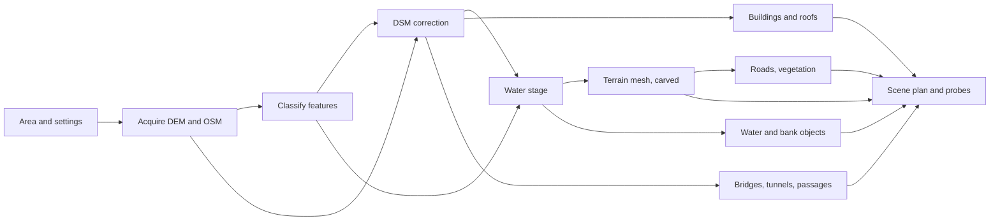
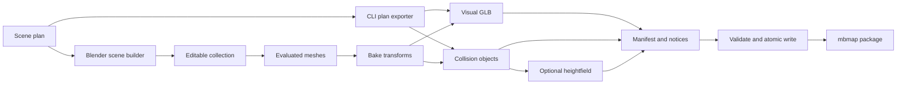

# Architecture overview

This page describes main at `fba2509` (after v0.5.0 and S5-STYLE-BASE). The product is a Blender extension and a
headless CLI that share a pure-Python core with no `bpy` (D1). The editable Blender scene and the exported package
are separate representations. The [package contract](../PACKAGE_FORMAT.md) is normative for consumers. Decisions
live only in the [decision record](../../design/roadmap.md#decision-record); this page points to them.

## From sources to package

| Stage | Code entry | What it does |
|---|---|---|
| Acquire | [`map_builder/core/pipeline.py`](../../map_builder/core/pipeline.py) `acquire`; helpers `dem.py`, `tiff.py`, `http.py`, `cache.py` in the same package | Loads Copernicus DEM and Overpass OSM, online or from the cache, or local files. Required-data errors stop the run. The optional wider DSM-mask request may fail with a warning only. |
| Classify | [`map_builder/core/osm.py`](../../map_builder/core/osm.py) `classify` | Turns tags into buildings, roads, areas (landcover and water), waterways, structures and trees. Unsupported and invalid features are reported, not dropped silently. |
| DSM correction | [`map_builder/core/dsm.py`](../../map_builder/core/dsm.py) `apply_correction` | Lowers masked heights (buildings, trees, forest, bridges) toward the surrounding ground and never raises them. The result is inferred terrain, not a true DTM (D15). |
| Water stage | [`map_builder/core/generate.py`](../../map_builder/core/generate.py) `_water_stage` → [`map_builder/core/water.py`](../../map_builder/core/water.py) `build_water`; [`map_builder/core/shore.py`](../../map_builder/core/shore.py) `shore_ramps`; [`map_builder/core/overlap.py`](../../map_builder/core/overlap.py) | Builds flat water bodies on a carved bed, plus shore ramps. See [Water and shores](#water-and-shores). |
| Terrain | [`map_builder/core/generate.py`](../../map_builder/core/generate.py) `build_terrain` | Builds the terrain grid mesh on the **carved** grid when water exists, and picks the landcover colour per cell (D123: no water colour under a built body). |
| Buildings and roofs | [`map_builder/core/generate.py`](../../map_builder/core/generate.py) `build_building`; [`map_builder/core/roofs.py`](../../map_builder/core/roofs.py), [`map_builder/core/skeleton.py`](../../map_builder/core/skeleton.py) | Footprints on the **pre-carve** ground. Flat, skillion, gabled, hipped and pyramidal roofs, including straight-skeleton roofs on non-rectangular footprints and vertical-cut gable ends (D54–D107). A roof that cannot be built carries a named fallback reason. |
| Roads and vegetation | [`map_builder/core/generate.py`](../../map_builder/core/generate.py) `build_road`, `tree_mesh`, `scatter_points` | Roads are draped on the **carved** terrain (#76, D126). Trees are shared-mesh instances with class `vegetation` collision. |
| Structures | [`map_builder/core/bridges.py`](../../map_builder/core/bridges.py), [`map_builder/core/tunnels.py`](../../map_builder/core/tunnels.py), [`map_builder/core/passages.py`](../../map_builder/core/passages.py), [`map_builder/core/structures.py`](../../map_builder/core/structures.py) | Bridge decks and piers, tunnel tubes and portals, building passages. `structures.py` shares stage context and checks passage probes on the finished scene (D18, D21). |
| Plan | [`map_builder/core/generate.py`](../../map_builder/core/generate.py) `build_plan` → `ScenePlan` | Runs the stages in order under vertex and triangle budgets (`SceneBudget`); every object is an `ObjectSpec` with a stable `mb_id`, class and provenance. |
| Textures and UVs | [`map_builder/core/uv.py`](../../map_builder/core/uv.py) `assign_uvs`, [`map_builder/core/textures.py`](../../map_builder/core/textures.py) | Optional textures (export setting). Luminance-only detail textures; the hue comes from vertex colours (D99). Package schema 2.1.0 (D57, D86). |

Shared helpers in `map_builder/core/`: `mesh.py` (mesh data), `triangulate.py` (polygon triangulation), `geodesy.py`
(local ENU frame and area limits), `query.py` (ray and capsule queries, used by probes and the tools).

## Water and shores

**Purpose.** Rivers and lakes are flat water surfaces on a carved bed, not terrain painted blue (S4-WATER-SURFACE,
user request, D112). A descending drone meets the water surface. It never stops on an invisible sheet edge or a road
cushion.

**Data flow:**

1. **Bodies** (`water.build_water`). Every validated water-class area and every closed `waterway=riverbank` way
   becomes a `Body`, clipped to the terrain extent; holes are kept (D113, D118). Standalone `water=*`, riverbank
   relations and coastline are not supported yet (S4-F3).
2. **Level** (`_make_level`). The 20th percentile of shore samples from the **pre-carve** corrected DEM, every 5 m in
   a band 0.5–2 cells outside the shore. The band widens once to 4 cells; if there are still too few samples the
   body falls back. A river of at least 300 m with exactly one consistent centreline gets an isotonic downstream
   profile from 100 m stations; above a 1 % slope cap the body becomes flat (D114).
3. **Carve** (`_CarveContext`). Every grid vertex of a cell that overlaps water goes to at least 1.5 m
   (`CARVE_DEPTH_M`) below the lowest level in that cell. A one-cell bank blend only ever lowers terrain, and skips
   roads, buildings and abutments. The rule "no terrain triangle above a water triangle" is checked **exactly** on
   the final overlaps. A bounded remedy runs up to 2 rounds; if that fails, the body falls back with
   `fallback(carve invariant)`, and the active bodies are recomputed from the pre-carve grid (D115, D118).
4. **Two grids** (D115). The **pre-carve** grid feeds buildings, bridges and clearance floors. The **carved** grid
   feeds the terrain mesh and roads (#76). Decks are never lowered: they are raised by the water maximum along
   the section. Probes whose capsule footprint touches water keep at least 0.62 m clearance (D116).
5. **Shore ramps** (`water._attach_ramps` → `shore.shore_ramps`; D129). The carve leaves the sheet edge above a lower
   bank, and two bodies at different levels leave an open drop between them. Each shore edge therefore gets a
   **ramp** that falls at slope 0.5 for at most 12 m:
   * over the bank, a terrain ramp (`bank:<id>` object, class `terrain`) starting 0.02 m under the sheet;
   * over a lower body, a **cascade** inside the higher body's `water:<id>` object.

   Each strip is typed per transition, and a mixed strip is split (D127). Every emitted triangle is tested with the
   exact area predicates in `core/overlap.py`:
   * against footprints, road ribbons, tunnels and bridges without a deck, with whole-strip masks;
   * against highway bridge decks only where the deck is at-grade (D178, `core/deck_underside.py`): a bank ramp may
     pass under an elevated deck, and is clipped out of the deck's plan footprint (sunk ends included) wherever the
     deck's underside, bounded from below by its ground-and-water profile (`bridges.deck_underside`), stands less
     than 2.5 m above it or the ramp reaches past a deck end. Clipping quarters a triangle at most 5 times;
   * against other water, by positive area, where a cascade may overlap only its lower receiving body.

   A blocked strip is skipped; its length, and that of a clipped strip, is added to `info["shore_ramp_blocked_m"]`.

   **Coverage limits, as implemented.** Ramps are attempted, not guaranteed:
   * a strip that meets a mask is left out;
   * if the scene triangle budget is exceeded, a body's ramps are left out entirely, with the note "shore ramps
     left out" (`water._attach_ramps`);
   * standalone `water=*` and other unsupported water stay unbuilt (S4-F3).

   The design target is "no sheet edge above the bank". Whether a given package meets it is measured by the audit
   below, not assumed from this design.
6. **Objects** (`generate._water_objects`). One `water:<id>` object per built body (collision class 5 `water`,
   material `MB Water`), plus one `bank:<id>` terrain object if ramps exist. `report.json` `water_bodies` gives
   each body's outcome. `.mbhf` stays terrain-only and therefore shows the bed (D117); consumers use the `.mbcol`
   query over water.

**Checks:**

* [`tools/floating_audit.py`](../../tools/floating_audit.py) ray-casts collision, heightfield and visual surfaces on a grid
  and checks the sheet-to-terrain gap in a ring around each wet area. `water_above_bank` and `water_buried` have
  contract 0. Its categories, thresholds and labelling tolerance are explained once, in
  [Developer tools § Floating audit](../dev/tools.md#floating-audit). The audit's tolerance is **not** the design
  bound: S5-F3 applies 1.5 m + 1 mm.
* [`tools/water_replay.py`](../../tools/water_replay.py) replays fixed queries between two packages in Python and C# and labels
  every difference (§7, `bank ramp`, `road lowered`).
* [`tools/water_check.py`](../../tools/water_check.py) checks the bed and clearance invariants.

**Measured state** (open defects, separate from the design):

| Package | `water_above_bank` | `water_shore_step` |
|---|---|---|
| v0.5.0 release packages (Pittsburgh) | 0 | 104 regions, max 1.500 m |
| Bellevue-Factoria classic build (#85) | **4** | **119 regions, max 1.548 m** |

The Factoria findings are open under [S5-F3](../../design/tasks/S5-F3.md), which owns their disposition.

**Trade-offs** (full rationale in the decision record):

| Alternative | Why it was not chosen | It would become viable if… |
|---|---|---|
| Paint water-coloured terrain (v0.4.0) | Followed the DEM dip and read as a "mat"; banks were blue (S4-F1) | — |
| Vertical skirt at the sheet edge | Terrain, road and water are +Z-only open surfaces, and the validator rejects down-facing triangles | a down-facing surface class were added (a format change, D101) |
| Confined carve (carve only under the sheet) | Breaks the −1.5 m bed under shore cells (D113–D118) | the bed rule were relaxed |
| Ramps, as built | Up-facing terrain and cascades close the sheet-edge gap wherever a ramp is placed (see the coverage limits above). The cost, measured as Python primitive calls on Pittsburgh textured **Blender Generate**, is about +5.2 % (#77) out of a +13.0 % water-stage total since v0.4.0 (D151) | — (cost tracked by S5-PERF-WATER) |

**Known open items:** [S5-F3](../../design/tasks/S5-F3.md) (the Factoria findings above), S4-F3 (wider water
coverage), [S5-PERF-WATER](../../design/tasks/S5-PERF-WATER.md) (mask cost).

## Two export paths

* **CLI:** [`map_builder/core/pipeline.py`](../../map_builder/core/pipeline.py) `plan_to_package` exports generated objects directly.
* **Blender:** [`map_builder/blender/scene_build.py`](../../map_builder/blender/scene_build.py) `build_scene`,
  [`export.py`](../../map_builder/blender/export.py) `export_map` and [`bake.py`](../../map_builder/blender/bake.py) `bake_object` / `export_baked` build the editable
  collection, then evaluate it,
  including modifiers and transforms. Blender stores float32 geometry, so its packages differ in bytes from the
  CLI's but carry the same probes.

Both paths export GLB and collision from the same final geometry and bind each collision object to a visual node by
name, one-to-one.

* [`map_builder/core/glb.py`](../../map_builder/core/glb.py) writes visual meshes.
* [`map_builder/core/collision.py`](../../map_builder/core/collision.py) writes `.mbcol`; `.mbhf` is derived from the final terrain collision.
* [`map_builder/core/package.py`](../../map_builder/core/package.py) assembles, validates and atomically writes the ZIP package. A failed export keeps the previous
  file.
* `report.json` carries warnings, provenance and omissions. An otherwise `VALID` package is not proof that every
  passage is clear.

The exported `passage_probes_dropped` keeps the generation-time `{id, reason}` entries and appends each probe of a
feature deleted in Blender as `{id, reason: "feature_deleted"}`.

## Package and consumer

* **Versions:** the writer emits schema **2.1.0**, `.mbcol` v2 and optional `.mbhf` v1, with generator 0.5.0
  ([`map_builder/core/__init__.py`](../../map_builder/core/__init__.py)).
* **Contents:** `manifest.json` holds the georeference, objects, sources, hashes, `asset_notices` and the
  orientation and passage probes. The archive also contains `visual/map.glb`, `collision/map.mbcol`, optional
  `collision/terrain.mbhf`, `report.json` and `NOTICES.txt`.
* **Identity:** the package ID hashes the raw manifest. Manifest file entries bind every other member by size and
  SHA-256.
* **Format stability:** minor versions are additive and backward compatible. The normative rules are the policy in
  [PACKAGE_FORMAT.md](../PACKAGE_FORMAT.md) (D101, D110); they are not restated here.

Collision is authoritative for the consumer's Core; the GLB is for presentation (D4). Map coordinates are local ENU
metres, and map-to-glTF is `(x, z, -y)`. Orientation probes test both position and winding. Passage probes test
capsule clearance against collision. The heightfield cannot represent underpasses or water surfaces. See the
[Unity / Core handoff](../UNITY_CORE_HANDOFF.md) and the [reference reader](../../examples/README.md).

## Decision pointers

| Topic | Decisions |
|---|---|
| Scope and sources | D1–D4, D11, D12, D25 |
| Terrain and structures | D15, D18, D21–D24, D39 |
| Roofs | D54–D56, D61, D76, D82, D84, D95, D105, D107 |
| Textures and format | D57, D64–D66, D86, D99, D101, D110 |
| Collision quality | D98, D111, D119 |
| Water | D112–D118, D123, D124, D126–D129, D151 |
| Performance method | D91, D106, D147, D153 |
| Licence | D13 |

See the [user limits](../../README.md#limits) and the [validation gaps](../VALIDATION.md).
