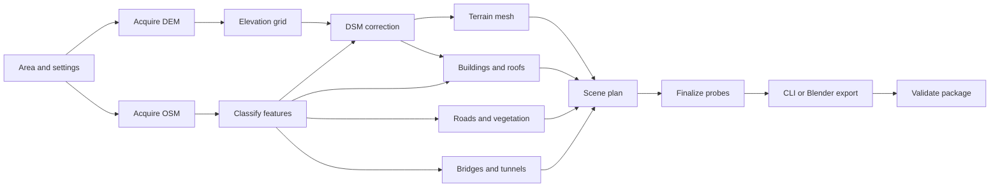
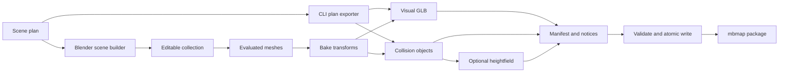

# Architecture overview

This describes main at `44cde701123a78f2cf714663f0f4b8605cb1e19d`, not
all Sprint 3 plans. The product is a Blender extension and a headless CLI,
sharing a pure-Python core (D1). The editable Blender scene and the exported
package are separate representations. The
[package contract](../PACKAGE_FORMAT.md) is normative for consumers.

## From sources to package

`pipeline.acquire` loads local files or online Copernicus and Overpass data;
`dem.py`, `tiff.py`, `http.py` and `cache.py` handle elevation and transport,
while `osm.py` parses and classifies features. `geodesy.py` defines the local
ENU frame and area limits. Required data errors stop generation. The optional
wider Overpass request for DSM mask candidates may instead fail with a warning
and leave the surface uncorrected; it does not change content selection.

`generate.build_plan` validates landcover, optionally corrects the DSM, builds
terrain and feature geometry, then runs the structure stages. `dsm.py` lowers
masked heights toward surrounding ground, never raises them; this is inferred
terrain, not a true DTM (D15). `roofs.py`, `bridges.py`, `tunnels.py`, and
`passages.py` specialize geometry; `structures.py` shares stage context and
checks probes after the scene is complete (D18, D21). `mesh.py` and
`triangulate.py` support mesh construction; scene, triangulation and query
work are bounded. Invalid or unsupported features are reported.

`core/skeleton.py` now implements a bounded straight skeleton for simple
polygons (D55), but no generation or roof module imports it on this audited
head. Non-rectangular skeleton roofs and textures in D54-D65 are **planned**,
not delivered by this merge. Existing roof fallback behavior remains in effect.

## Two export paths

The CLI uses `pipeline.plan_to_package` on generated objects; Blender's
`scene_build.py`, `export.py` and `bake.py` build and then evaluate the
editable collection, including modifiers and transforms. Both paths use final
geometry for GLB and collision and bind objects to visual nodes by name.
`glb.py` writes visual meshes; `collision.py` writes `.mbcol` and derives
`.mbhf` from final terrain collision. `package.py` assembles, validates and
atomically writes the ZIP package. A failed export preserves the previous file.
`report.json` carries warnings, provenance and omissions; do not treat an
otherwise `VALID` package as proof every passage is clear.

The exported `passage_probes_dropped` keeps the generation-time `{id, reason}` entries and appends each probe of a feature deleted in Blender as `{id, reason: "feature_deleted"}`.

## Package and consumer

The current writer emits schema `2.0.0`, `.mbcol` v2 and optional `.mbhf` v1
(`core/__init__.py`). `manifest.json` identifies the georeference, objects,
sources, hashes and orientation/passage probes. The archive also contains
`visual/map.glb`, `collision/map.mbcol`, optional `collision/terrain.mbhf`,
`report.json` and `NOTICES.txt`. The package ID hashes the raw manifest;
manifest file entries bind all other members by size and SHA-256.

Schema versions use semver: readers reject unknown major versions and ignore
unknown fields; 1.x must be regenerated for the current 2.x reader. New report
keys alone do not change the schema (D12/D19); the planned texture change has
its own proposed 2.1.0 semantics (D57), which are not current behavior.

The collision format is authoritative for the consumer's Core; GLB is for
presentation, not gameplay collision (D4). Map coordinates are local ENU
metres; map-to-glTF is `(x, z, -y)`. Importers can introduce a reflection;
orientation probes test both position and winding. Passage probes test capsule
clearance against collision but can be blocked or unchecked with warnings.
The heightfield is terrain-only and cannot represent underpasses. See
[Unity / Core handoff](../UNITY_CORE_HANDOFF.md) and the [reference reader](../../examples/README.md).

## Decision map and limits

- D1-D4: standalone Blender/CLI, OSM and Copernicus sources, small areas without
  streaming/LOD, and neutral collision for the simulator Core.
- D15, D18, D21: corrected ground precedes structure placement; structure
  stages share a seam; known blocked probes are not emitted.
- D25: highway bridges and tunnels are in scope; railway, culverts and
  certain bridge/tunnel outlines remain unsupported.
- D12/D19: retain schema 2.0 for already-defined classes and additive report
  data; bump the format for changed semantics.
- D54/D55/D57: Sprint 3 roof and texture work is underway; distinguish a
  merged skeleton building block from a connected roof implementation.

The [decision record](../../design/roadmap.md#decision-record) contains status,
rationale and later decisions. The code licence remains provisional (D10/D13);
source data attribution is separate. See [user limits](../../README.md#limits)
and [validation gaps](../VALIDATION.md).
