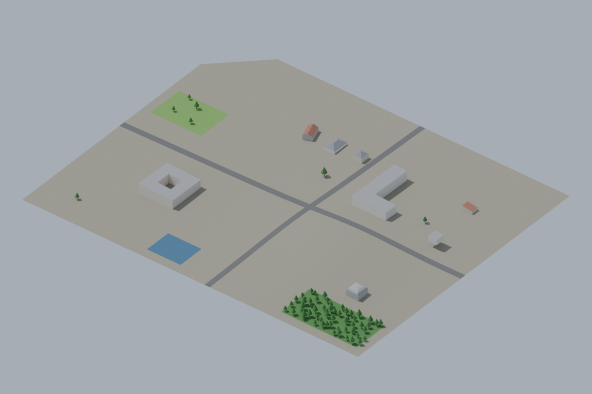
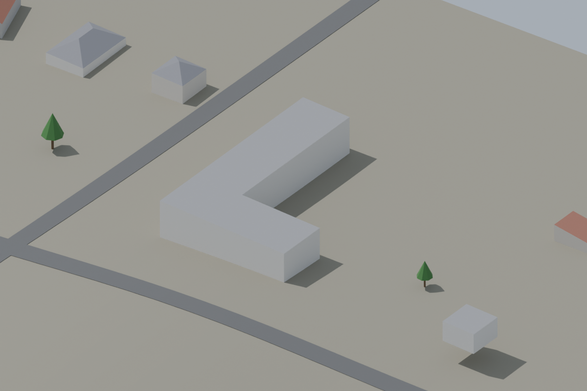
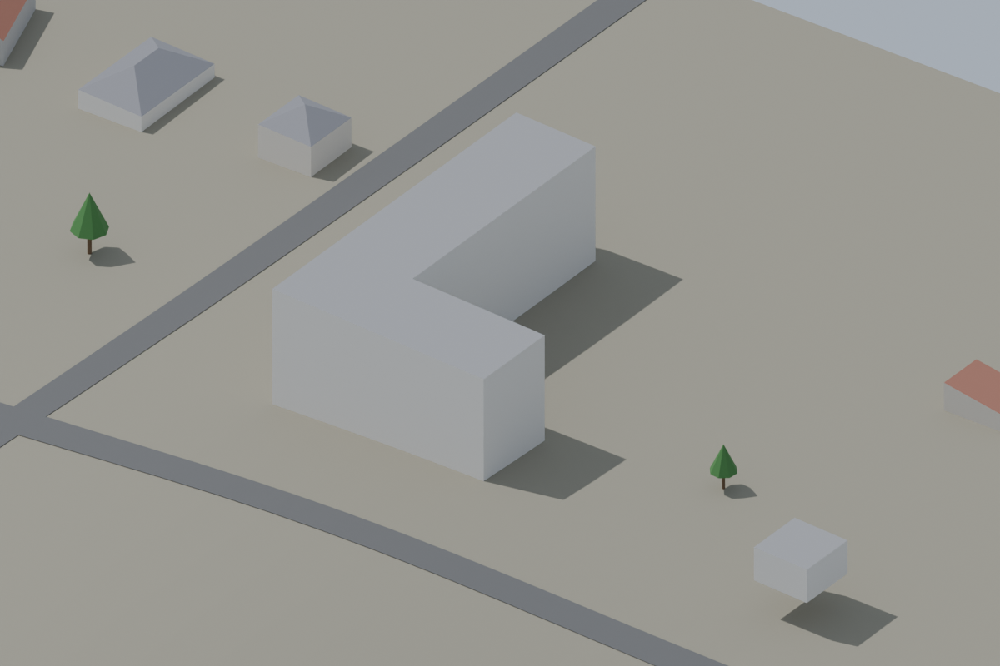
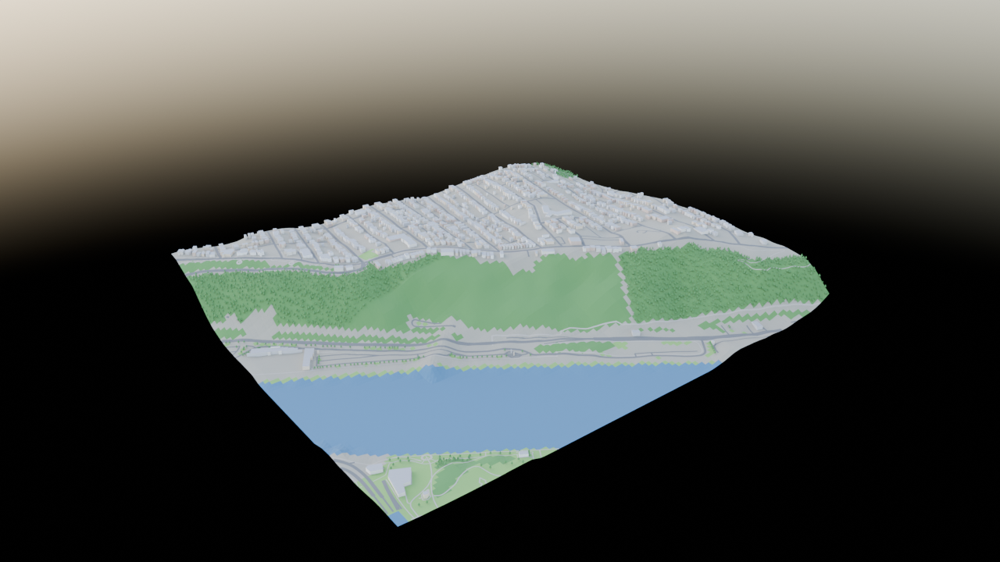
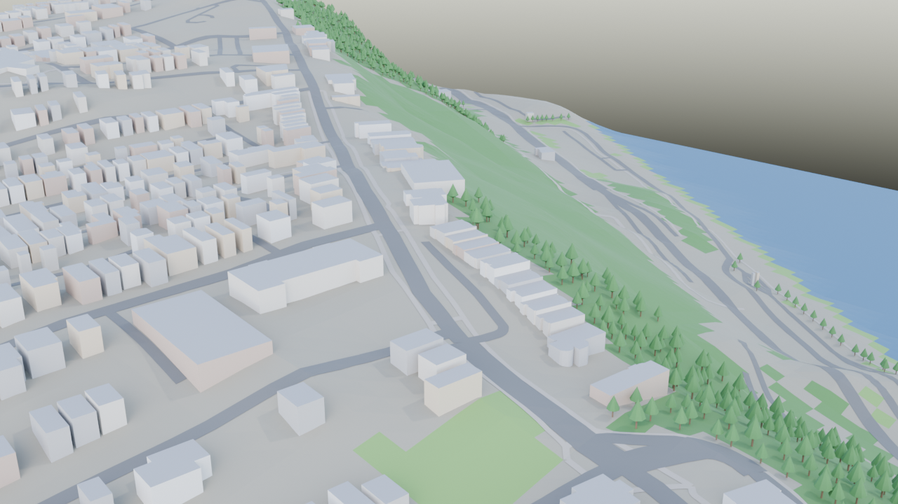
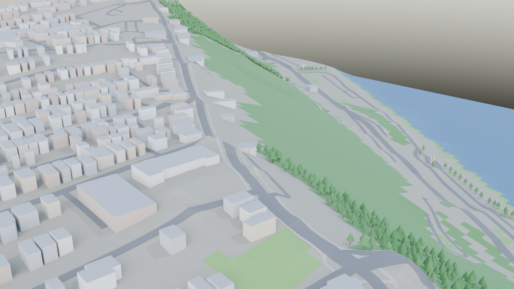
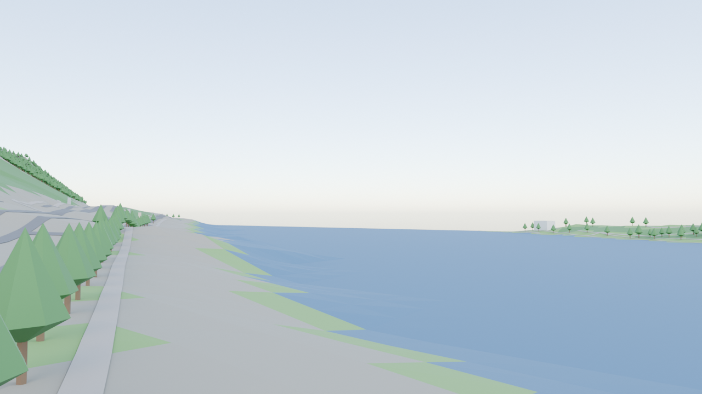
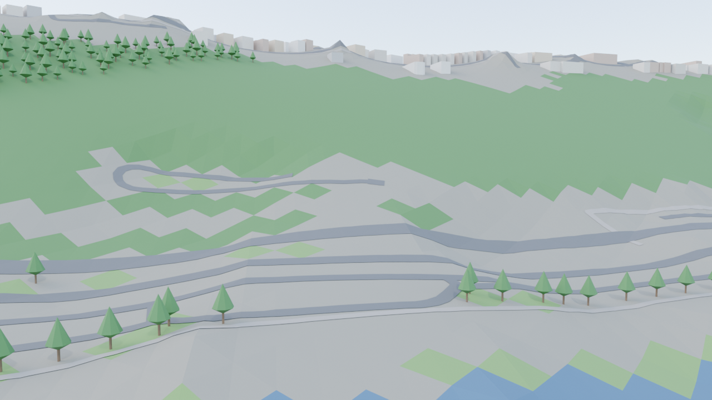

# v0.1.0 demo: editable map baseline

**Preview candidate; not a published release.** Examples 1-3 and the sidebar
show an invented **SYNTHETIC** 400 x 300 m area. The separate Pittsburgh section
uses actual online OSM / Copernicus data. Map images are actual Blender Cycles
CPU renders; the sidebar is a real Blender window captured with Mesa software
OpenGL. No UI is mocked.

## Real Blender interface


Captured by the merged demo kit from #14 using a separate, read-only Blender
4.2.23 + Mesa llvmpipe runtime. The sidebar shows the real Area, Sources,
Content and Export controls, including **DSM correction**. The viewport contains the committed CLI sample's
imported GLB (74 objects), not the separate 76-object edited Blender demo below.
The source controls show their defaults, including the disabled-online-access
warning; no online download was performed. An imported GLB does not restore
the add-on's export metadata, so this is not an export-ready generated collection.

## Example 1: generate ordinary editable objects

Use the [offline sample settings](../../user/generate.md). Inspect the terrain,
roads, courtyard and simple roofs; select a building independently of the terrain.
Open **MapBuilder Report** to see unsupported/invalid features rather than
assuming every source feature was generated.



## Example 2: edit and preserve matching collision

Select the large L-shaped building (`mb_id` = `osm:way/1007`), set its Z scale
from 1.0 to **1.8**, export to a new `.mbmap`, and validate. The two renders use
the **same camera**; the second shows the taller building.

| Before | After Z scale x1.8 |
|---|---|
|  |  |

The reproduction script also reads the exported collision bounds and checks the
height is multiplied by 1.8 (tolerance 0.0001 m). Validation checks GLB/collision
agreement, not just a changed package hash.

## Example 3: inspect exported visuals and the full package

The script writes `before.mbmap`, `after.mbmap` and their extracted `.glb` files
to your new throwaway directory. Import `after.glb` through Blender's
**File > Import > glTF 2.0**. Then run the Python validator and C# reference reader
against `after.mbmap`. A visual import is not a simulator collision test.

```powershell
py -3.12 tools\mbmap_cli.py validate "$out\after.mbmap"
dotnet run -c Release --project examples\csharp\MbmapReader -- "$out\after.mbmap"
```

Keep the editable `.blend` for future edits; importing the GLB alone does not
reconstruct the extension's collection metadata.

## Reproduce the evidence

From the candidate source root in PowerShell, with Blender 4.2.23 installed:

```powershell
$blender = "C:\path\to\blender.exe"
$out = Join-Path $env:TEMP ("map-builder-rel010-" + [guid]::NewGuid().ToString("N"))
& $blender --background --factory-startup --python-exit-code 1 `
    --python docs\demo\v0.1.0\make_demo.py -- --out $out
```

The output directory **must not exist**. The script copies the two fixtures into
its own `inputs` directory, uses local data only, generates via the shared
pipeline, exports through the real Blender Export operator, renders three PNGs,
validates both packages, verifies the edited collision height, imports the
edited GLB into a separate temporary scene, and saves `editable-demo.blend` and
`evidence.json`. Cameras and lights live outside the exported map collection.
It never starts a server, so port 8765 and all other demo servers are untouched.

The three CPU renders and edit checks were first produced with this
release-specific script before the reusable demo kit in
[#14](https://github.com/lingshf/map-builder/pull/14) merged. Keep this command
to reproduce the exact edit example; use the shared kit for standard sprint
renders, viewer bundles and real sidebar captures.

To reproduce the sidebar with the shared kit (the Mesa copy is a prerequisite;
never modify the main Blender installation):

```powershell
$panelRoot = Join-Path $env:TEMP ("map-builder-panel-" + [guid]::NewGuid().ToString("N"))
New-Item -ItemType Directory -Path $panelRoot | Out-Null
Copy-Item examples\synthetic_sample.mbmap "$panelRoot\sample.mbmap"
$env:BLENDER_USER_RESOURCES = "$panelRoot\blender-profile"
& $blender --background --factory-startup --python-exit-code 1 `
    --python tools\demo\run_demo.py -- --preset synthetic `
    --after "$panelRoot\sample.mbmap" --out "$panelRoot\output" `
    --bundle-only --panel --mesa-blender "C:\path\to\blender-mesa\blender.exe"
Remove-Item Env:\BLENDER_USER_RESOURCES
```

Check that `output\panel.png` exists and that `output\summary.md` reports a
real sidebar capture: a skipped screenshot is not success. Omit `--bundle-only`
to also render the kit's three preset views. See
[demo-kit setup](../../../tools/demo/README.md) for the separate Mesa runtime.
This command creates a viewer bundle but does not start a web server.

The shared pipeline receives an explicit synthetic OSM licence because the
baseline Blender UI does not expose that override. The saved demo packages
therefore say **not OpenStreetMap data**. This does not claim that the UI's
Generate button supports that override; see the caveat in the generation guide.

## Recorded candidate checks

Blender 4.2.23 LTS, Windows x64, Cycles **CPU**, 1200 x 800, 16 samples.
All images and package evidence were refreshed after rebasing onto main
`e5ed1fa4dc0554582b47f063adae0cb2a68304fe`, including the new roofs (#18),
structure routing (#19) and real-terrain road-normal fix (#20).
The [machine-readable evidence](evidence.json) records the exact package
identities and geometry check. Timestamps change package identities on rerun.

- Both Blender-exported packages: **VALID**, 0 errors; one warning for two
  degenerate zero-area triangles inherited from the fixture.
- 76 exported mesh objects; edited GLB imported successfully as 76 mesh objects.
  The committed CLI sample has 74 objects: that is a different export path,
  not the object count expected for this Blender demo.
- C# reference reader accepted the edited output and the committed sample.
- Extension validation/build and Install-from-Disk CLI operation succeeded using
  a separate temporary Blender resource directory; the installed extension
  enabled, registered the real Map Builder sidebar panel and exposed DSM
  correction with its default Auto value.

**Sidebar capture:** native graphical startup lacked the required WGL context,
but the shared kit's separate Mesa llvmpipe runtime successfully captured the
real 1920 x 1129 Blender window above. The screenshot uses the committed sample,
package identity
`sha256:ef66b4a5be150186ece546d983916f0c3595b1faf39cec040018b2773d44337b`.
It verifies visible panel layout, not an online-acquisition or simulator test.

**Synthetic DSM scope:** this candidate includes merged correction (#11). The offline
local-file demo keeps its default Auto setting, so correction is off; these
synthetic images do not demonstrate DSM lowering or flyable passages. Follow the
[DSM user guide](../../user/generate.md#dsm-terrain-correction-inferred-ground-preview)
for settings, comparison steps, reports and approximation limits.
Release review and coordinator authorization remain required before tagging.

## Real-data example: Pittsburgh DSM Off / On (default content, roads enabled)

Both packages were rebuilt and strictly validated after BUG-ROAD-NORMALS (#20)
merged. **Roads are enabled**, along with the default buildings, trees and
vegetation content. These renders replace the earlier interim roads-disabled
images. No validator bypass, omitted road layer or product-code modification
is used by the demo.

Area D26 is centred at **40.437 N, 80.016 W**, **1200 x 1000 m**, covering
Fort Pitt Bridge and the north Fort Pitt Tunnel portals. The southern tunnel
ends lie beyond this small area's southwest edge; this is not a reconstruction
of the entire tunnel. [Saved cameras](pittsburgh-cameras.json) use map-frame
ENU metres and are fixed for the DSM pair and subsequent v0.2.0 comparison.

| Same camera | DSM Off | DSM On |
|---|---|---|
| Real-area overview |  |  |
| Hillside ground detail |  |  |

| v0.2.0 baseline camera | v0.1.0: unsupported structure omitted |
|---|---|
| Fort Pitt Bridge approach |  |
| North tunnel portals |  |

The bridge/tunnel views are **absence baselines**, not fly-through evidence:
no bridge deck, tube, portals or passage probes are generated in v0.1.0. Their
OSM features are listed under `unsupported_features`, even though bridge ways
participate in the DSM mask.

### Recorded real-data evidence

Acquired online on **2026-11-19** through the normal pipeline: public Copernicus
AWS tiles and public Overpass. Two initial optional mask requests failed;
attempt 3 succeeded. The final rerun copies that throwaway acquisition's raw
cache into a new output directory and **reclassifies with the current code**:
the older pickled classification predates #19 and is not reused. Both normal
and mask responses are cache hits with the original timestamps. The same
newly acquired elevation grid and classified OSM snapshot are then deep-copied
for Off and On, eliminating network-response differences from the comparison.
No existing user's data/cache or demo server was used.

| Evidence | Off | On |
|---|---|---|
| Validation | VALID, 0 errors, 1 warning | VALID, 0 errors, 1 warning |
| Zero-area collision triangles (reported, allowed) | 74 | 75 |
| Objects / road objects | 3269 / 258 | 3246 / 258 |
| Collision triangles | 133336 | 132312 |
| Build + package validation, excluding acquisition | 32.890 s | 18.281 s |
| Vertical offset, EGM2008 | 213 m | 213 m |
| Terrain samples | 12221 | 12221 |
| Masked / lowered samples | 0 / 0 | 8532 / 5201 |
| Maximum / mean lowering over mask | 0 / 0 m | 33.255 / 3.670 m |
| Unsupported / invalid source-feature reports | 89 / 29 | 89 / 52 |

On converged in 8 cycles, residual 0.0002 m; it was **applied**, not skipped.
The object counts differ because terrain-dependent building eligibility changes;
the On report has 23 additional invalid features. This is not a promise that
every building improves or that hidden relief is accurately recovered.

Both complete Pittsburgh packages also passed the C# reference reader (`OK`).
Build times above are single wall-clock observations on a shared machine,
including planning, export and package validation; they are not a benchmark
or a guarantee that On is faster than Off.

The validator reports zero-area triangles as warnings; **non-degenerate
downward-facing road triangles still fail**. Both modes also report two
fully covered road ribbons represented by higher-priority roads and the
2000-tree scatter limit. Road `osm:way/11826594` records `slivers_dropped`:
one face, maximum width 0.000012 m and total area 0.000012 m2. The #20 fix
drops that unrepresentable face instead of relaxing the validator.

Off package identity:
`sha256:2a8aa7e1b41e7ae76f84a75e69adb7631d5455acfa82da9f3718ad7a890dd076`.
On package identity:
`sha256:5abdabef613b43bbf62cb4eb6a2528e6d0857e55c708b26795638705f26fedba`.
Normal OSM base timestamp: `2026-11-19T15:38:06Z`;
mask response: `2026-11-19T15:40:08Z`.
Copernicus tile: `Copernicus_DSM_COG_10_N40_00_W081_00_DEM`,
source spacing approximately 23.54 x 30.71 m, bilinearly resampled to 10 m.

The largest measured lowering is around map `(90, -70)` m, from z 145.144 m
to 111.889 m in the shared frame. Lowering measures the algorithm's change,
**not ground-truth accuracy**. Copernicus remains a surface model; large masked
areas can lose real relief.

### Exact acquisition, package, viewer and summary commands

Run from the v0.1.0 source root with Python 3.12. This command uses default
content, **including roads** (`PlanOptions(seed=1)`); seed 1 is fixed to match
the recorded comparison. No network credentials are needed.
Blender online UI permission is not involved in this Python process;
inside Blender enable **Preferences > System > Network > Allow Online Access**.

```powershell
$env:MB_DEMO_ROOT = Join-Path $env:TEMP ("map-builder-pittsburgh-" + [guid]::NewGuid().ToString("N"))
@'
import copy, json, os, pickle, time
from pathlib import Path
from map_builder.core.errors import MapBuilderError
from map_builder.core.generate import PlanOptions, build_plan
from map_builder.core.geodesy import Area
from map_builder.core.pipeline import Settings, acquire, elevation_correction_note, plan_to_package

root = Path(os.environ["MB_DEMO_ROOT"])
root.mkdir(parents=True, exist_ok=False)
settings = Settings(cache_dir=str(root / "cache"), terrain_spacing=10.0, dsm_correction=True)
for attempt in range(1, 4):
    try:
        grid, classified, sources = acquire(Area(40.437, -80.016, 1200, 1000), settings)
        if getattr(classified, "mask_unavailable", None):
            raise RuntimeError(classified.mask_unavailable)
        break
    except (MapBuilderError, OSError, RuntimeError) as error:
        print(f"Attempt {attempt}: {type(error).__name__}: {error}", flush=True)
        if attempt == 3:
            raise
        time.sleep(15 * attempt)
with (root / "acquired.pickle").open("wb") as stream:
    pickle.dump((grid, classified, sources), stream)
for mode, enabled in (("off", False), ("on", True)):
    plan = build_plan(Area(40.437, -80.016, 1200, 1000), copy.deepcopy(grid),
                      copy.deepcopy(classified), PlanOptions(seed=1),
                      dsm_correction=enabled)
    if enabled and not plan.report["terrain_correction"]["applied"]:
        raise RuntimeError(json.dumps(plan.report["terrain_correction"]))
    mode_sources = copy.deepcopy(sources)
    note = elevation_correction_note(plan.report["terrain_correction"])
    if note:
        for source in mode_sources:
            if source.get("kind") == "elevation":
                source["processing"] = note
    manifest, result = plan_to_package(
        plan, str(root / f"pittsburgh-{mode}.mbmap"), "pittsburgh", mode_sources,
        heightfield_spacing=2.0, created_utc="2026-11-19T15:40:00Z")
    if not result.ok:
        raise RuntimeError(result.summary())
    print(mode, result.summary(), json.dumps(plan.report["terrain_correction"]))
'@ | py -3.12 -
if ($LASTEXITCODE -ne 0) { throw "Pittsburgh acquisition/build failed; do not render substitute data" }
$blender = "C:\path\to\blender.exe"
& $blender --background --factory-startup --python-exit-code 1 `
    --python tools\demo\run_demo.py -- --preset docs\demo\v0.1.0\pittsburgh-cameras.json `
    --before "$env:MB_DEMO_ROOT\pittsburgh-off.mbmap" `
    --after "$env:MB_DEMO_ROOT\pittsburgh-on.mbmap" --out "$env:MB_DEMO_ROOT\demo"
if ($LASTEXITCODE -ne 0) { throw "Pittsburgh demo failed" }
```

The shared kit generates **eight 1280 x 720 Cycles CPU renders**, 64 samples,
using identical Off/On cameras, plus `demo\summary.md`, `demo\viewer.zip` and
`demo\viewer\` with `map.glb`, `probes.json`, bundled three.js and NOTICES.
Only selected PNGs, this README and the camera preset are committed; packages,
download cache, acquisition snapshot, viewer bundle and summary remain
throwaway outputs. Live providers change over time, so later acquisitions need
not reproduce these exact package identities.

To try the generated viewer separately (never port 8765):

```powershell
py -3.12 -m http.server 8792 --bind 127.0.0.1 --directory "$env:MB_DEMO_ROOT\demo\viewer"
```

Open `http://127.0.0.1:8792/`. It displays the DSM On GLB and no passage probes,
not simulator physics. Read `demo\summary.md` for identities and output listing.

**Real-data credits:** (c) OpenStreetMap contributors, ODbL 1.0.
Copernicus DEM GLO-30 / WorldDEM-30: (c) DLR e.V. 2010-2014 and
(c) Airbus Defence and Space GmbH 2014-2018, provided under COPERNICUS
by the European Union and ESA; all rights reserved. The generated viewer's
`NOTICES.txt` includes attribution and the On package's processing note.
