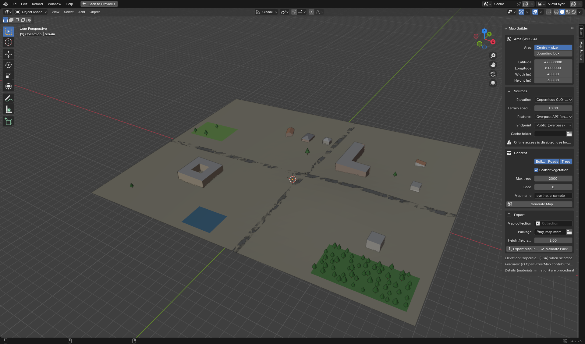

# v0.1.0 demo: editable map baseline

**Preview candidate; not a published release.** All images below show an
invented **SYNTHETIC** 400 x 300 m area. The map images are actual Blender
Cycles CPU renders; the sidebar image is a real Blender window captured
with Mesa software OpenGL. None is a real-city reconstruction or a mock UI.

## Real Blender interface



Captured by the merged demo kit from #14 using a separate, read-only Blender
4.2.23 + Mesa llvmpipe runtime. The sidebar shows the real Area, Sources,
Content and Export controls. The viewport contains the committed CLI sample's
imported GLB (74 objects), not the separate 76-object edited Blender demo below.
The source controls show their defaults, including the disabled-online-access
warning; no online download was performed. An imported GLB does not restore
the add-on's export metadata, so this is not an export-ready generated collection.

## Example 1: generate ordinary editable objects

Use the [offline sample settings](../../user/generate.md). Inspect the terrain,
roads, courtyard and simple roofs; select a building independently of the terrain.
Open **MapBuilder Report** to see unsupported/invalid features rather than
assuming every source feature was generated.


## Example 2: edit and preserve matching collision

Select the large L-shaped building (`mb_id` = `osm:way/1007`), set its Z scale
from 1.0 to **1.8**, export to a new `.mbmap`, and validate. The two renders use
the **same camera**; the second shows the taller building.

| Before | After Z scale x1.8 |
|---|---|
|  |  |

The reproduction script also reads the exported collision bounds and checks the
height is multiplied by 1.8 (tolerance 0.0001 m). Validation checks GLB/collision
agreement, not just a changed package hash.

## Example 3: inspect exported visuals and the full package

The script writes `before.mbmap`, `after.mbmap` and their extracted `.glb` files
to your new throwaway directory. Import `after.glb` through Blender's
**File > Import > glTF 2.0**. Then run the Python validator and C# reference reader
against `after.mbmap`. A visual import is not a simulator collision test.

```powershell
py -3.12 tools\mbmap_cli.py validate "$out\after.mbmap"
dotnet run -c Release --project examples\csharp\MbmapReader -- "$out\after.mbmap"
```

Keep the editable `.blend` for future edits; importing the GLB alone does not
reconstruct the extension's collection metadata.

## Reproduce the evidence

From the candidate source root in PowerShell, with Blender 4.2.23 installed:

```powershell
$blender = "C:\path\to\blender.exe"
$out = Join-Path $env:TEMP ("map-builder-rel010-" + [guid]::NewGuid().ToString("N"))
& $blender --background --factory-startup --python-exit-code 1 `
    --python docs\demo\v0.1.0\make_demo.py -- --out $out
```

The output directory **must not exist**. The script copies the two fixtures into
its own `inputs` directory, uses local data only, generates via the shared
pipeline, exports through the real Blender Export operator, renders three PNGs,
validates both packages, verifies the edited collision height, imports the
edited GLB into a separate temporary scene, and saves `editable-demo.blend` and
`evidence.json`. Cameras and lights live outside the exported map collection.
It never starts a server, so port 8765 and all other demo servers are untouched.

The three CPU renders and edit checks were first produced with this
release-specific script before the reusable demo kit in
[#14](https://github.com/lingshf/map-builder/pull/14) merged. Keep this command
to reproduce the exact edit example; use the shared kit for standard sprint
renders, viewer bundles and real sidebar captures.

To reproduce the sidebar with the shared kit (the Mesa copy is a prerequisite;
never modify the main Blender installation):

```powershell
$panelRoot = Join-Path $env:TEMP ("map-builder-panel-" + [guid]::NewGuid().ToString("N"))
New-Item -ItemType Directory -Path $panelRoot | Out-Null
Copy-Item examples\synthetic_sample.mbmap "$panelRoot\sample.mbmap"
$env:BLENDER_USER_RESOURCES = "$panelRoot\blender-profile"
& $blender --background --factory-startup --python-exit-code 1 `
    --python tools\demo\run_demo.py -- --preset synthetic `
    --after "$panelRoot\sample.mbmap" --out "$panelRoot\output" `
    --bundle-only --panel --mesa-blender "C:\path\to\blender-mesa\blender.exe"
Remove-Item Env:\BLENDER_USER_RESOURCES
```

Check that `output\panel.png` exists and that `output\summary.md` reports a
real sidebar capture: a skipped screenshot is not success. Omit `--bundle-only`
to also render the kit's three preset views. See
[demo-kit setup](../../../tools/demo/README.md) for the separate Mesa runtime.
This command creates a viewer bundle but does not start a web server.

The shared pipeline receives an explicit synthetic OSM licence because the
baseline Blender UI does not expose that override. The saved demo packages
therefore say **not OpenStreetMap data**. This does not claim that the UI's
Generate button supports that override; see the caveat in the generation guide.

## Recorded candidate checks

Blender 4.2.23 LTS, Windows x64, Cycles **CPU**, 1200 x 800, 16 samples.
The [machine-readable evidence](evidence.json) records the exact package
identities and geometry check. Timestamps change package identities on rerun.

- Both Blender-exported packages: **VALID**, 0 errors; one warning for two
  degenerate zero-area triangles inherited from the fixture.
- 76 exported mesh objects; edited GLB imported successfully as 76 mesh objects.
  The committed CLI sample has 74 objects: that is a different export path,
  not the object count expected for this Blender demo.
- C# reference reader accepted the edited output and the committed sample.
- Extension validation/build and Install-from-Disk CLI operation succeeded using
  a separate temporary Blender resource directory; the installed extension
  enabled and registered the real Map Builder sidebar panel.

**Sidebar capture:** native graphical startup lacked the required WGL context,
but the shared kit's separate Mesa llvmpipe runtime successfully captured the
real 1920 x 1129 Blender window above. The screenshot uses the committed sample,
package identity
`sha256:3bcc75e25368d71ec5c866233969e67fba03a0302594d61ca4767ca22165b0a2`.
It verifies visible panel layout, not an online-acquisition or simulator test.

**Release gate:** DSM correction (#11) remains unmerged in this candidate.
Update release notes and the changelog after it merges; these images demonstrate
the existing local-file workflow, not DSM correction or flyable passages.
