# v0.2.0 demo: fly under bridges and through tunnels

**Release candidate; not a published release.** The Pittsburgh images use
real OSM / Copernicus data. Every map image is a real Blender 4.2.23 Cycles
**CPU** render. The sidebar is a real Blender window captured with Mesa
software OpenGL, and the viewer image is a real headless-browser capture of
the generated three.js viewer. No UI is mocked.

The **before** column is the v0.1.0 DSM On package, rendered again from the
**unchanged** [v0.1.0 cameras](../v0.1.0/pittsburgh-cameras.json). These
renders are pixel-identical (maximum difference 0) to the committed v0.1.0
baselines. The **after** column is the v0.2.0 package built from the same
acquisition.

## Example 1: Fort Pitt Bridge (deck, piers, parapets)

| Camera | Before: v0.1.0 (bridge omitted) | After: v0.2.0 |
|---|---|---|
| `bridge-under` | 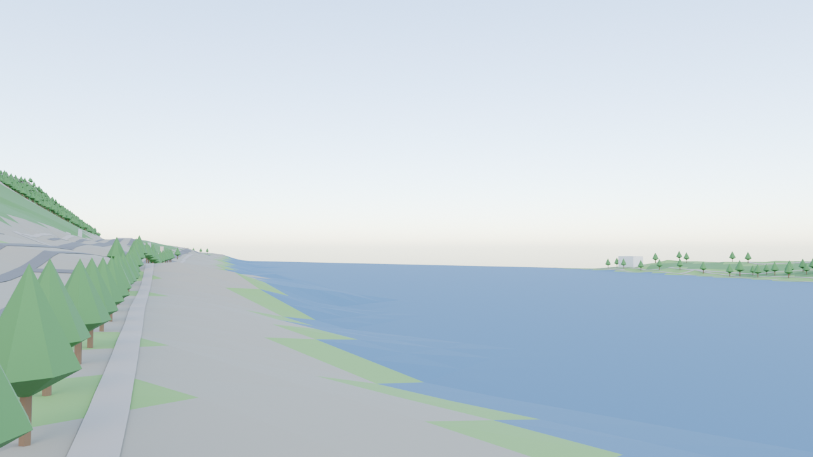 | 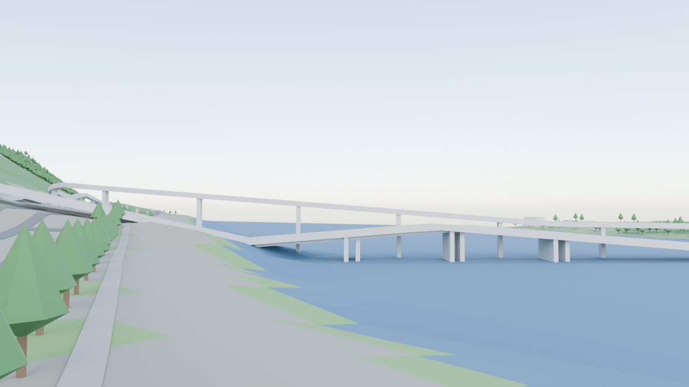 |
| `overview` | 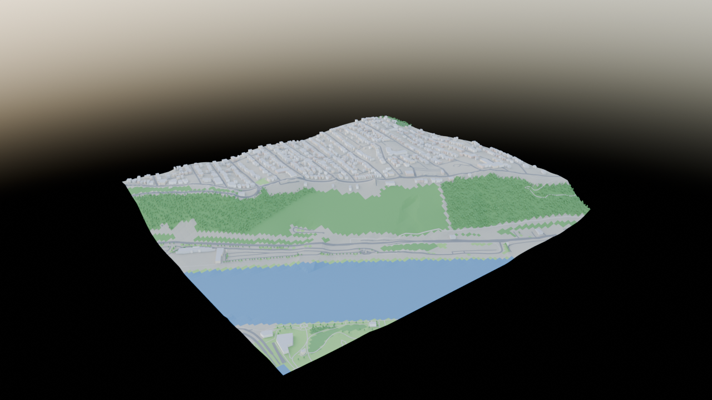 |  |

Fort Pitt Bridge is OSM ways 11950069, 24957029, 121593794 and 121593795
(`bridge:name`), a double deck on layers 2 and 3. The package has 33 bridge
deck objects. 20 piers were generated on 3 bridges: 3 each on Fort Pitt
Bridge ways 11950069 and 121593794, and 14 on cycleway 173225719 (646 m).
The Fort Pitt Bridge probes `11950069:under`, `24957029:under`,
`121593794:deck` and `121593794:under` PASS. The other Fort Pitt deck probes
are blocked by the opposite deck of the stacked pair, so they are reported,
not exported (see below).

## Example 2: Fort Pitt Tunnel (portal, headwall, leak test)

| Camera | Before: v0.1.0 (hill, tunnel omitted) | After: v0.2.0 |
|---|---|---|
| `tunnel-portal` | 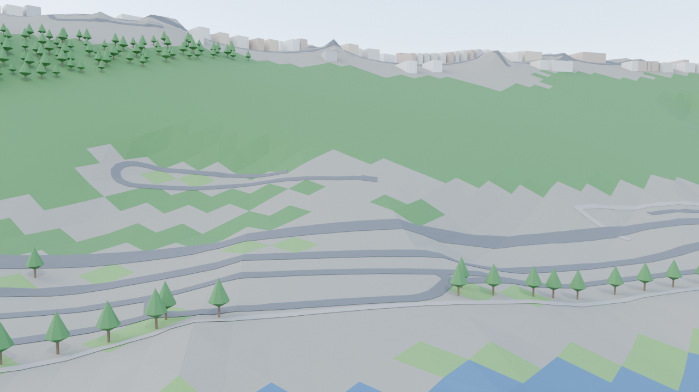 | 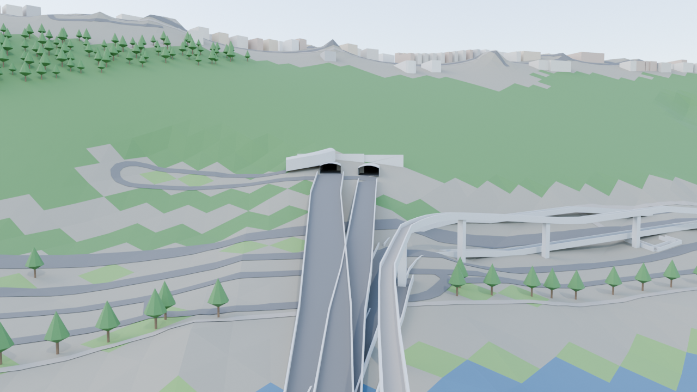 |
| `dsm-ground` | 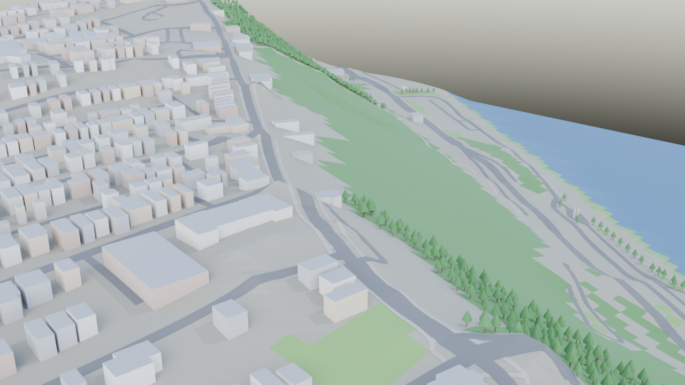 | 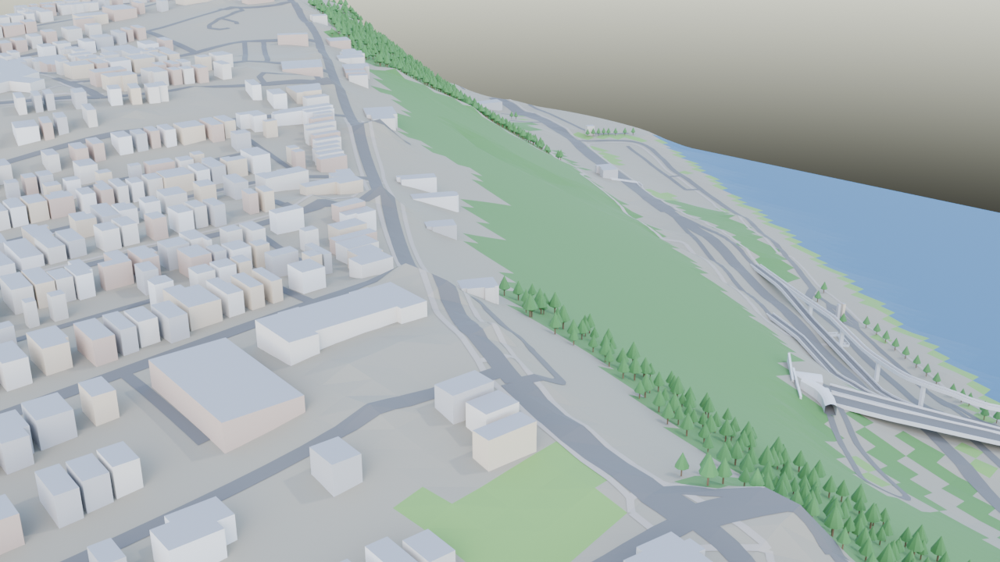 |

Fort Pitt Tunnel (`tunnel:name`) is ways 11965424 and 28411466: two tubes, two
`bore` probes (radius 1.5 m), both PASS. The package has 5 tunnel tubes
(including Wabash Tunnel 54223854) and 6 headwalls.

**Leak test (D23):** vertical rays on a 2 m grid within +/-30 m of each of the
6 headwalls, 4709 rays in total. **0 holes** (every ray hits terrain, the tube
roof or a headwall) and **0 hits below the ground**. The southern tunnel
ends lie beyond this 1200 x 1000 m area, so only the north portals are shown.

## Example 3: synthetic sample, elevated part and building passage

| Elevated building part (`osm:way/1048`, min_height 6 m) | Building passage (`osm:way/1098`) |
|---|---|
| 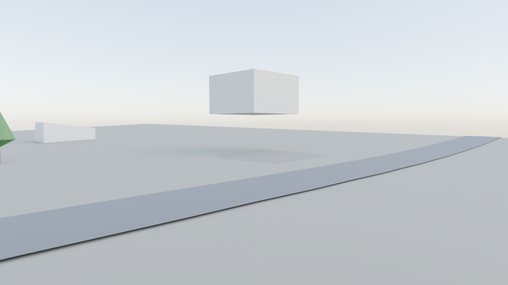 | 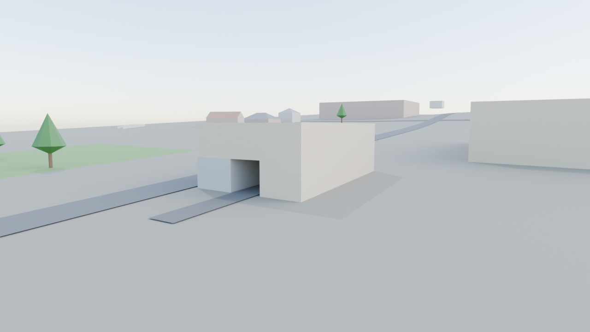 |

Pittsburgh has no elevated building parts or building passages in this area,
so the S2-ELEV examples use the invented **SYNTHETIC** fixture (not a real
place). Cameras: [synthetic-cameras.json](synthetic-cameras.json). The CLI
command below, with `--created-utc 2026-01-01T00:00:00Z`, rebuilt
`examples\synthetic_sample.mbmap` byte-identically
(`sha256:d1e98213052911657a5092365a8b99a0bb20e9e903bfb5eea22ebfd3141ebaea`):
`VALID: 0 error(s), 1 warning(s)` (two zero-area fixture triangles). C# reader:
`OK`, all 4 probes PASS: `1048:under` and `1098:passage` (elevated),
`1069:deck` (bridge), `1072:bore` (tunnel).

## Real Blender interface and viewer

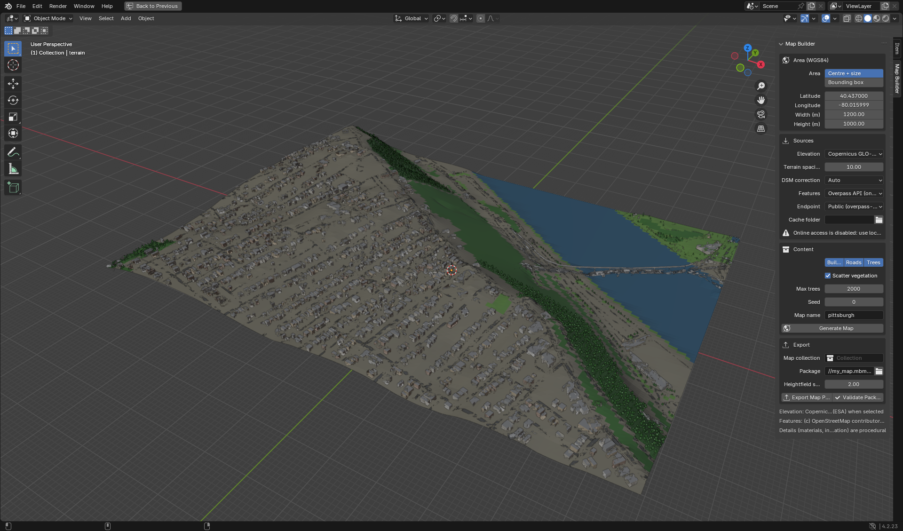

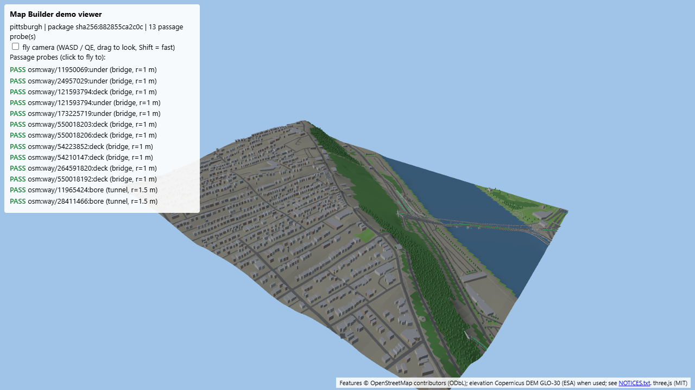

The viewer lists the package's 13 probes. Click one to fly to it, or enable
the fly camera. The viewer bundle (`viewer\`, `viewer.zip`) is a throwaway
output; [summary.md](summary.md) is the kit's generated summary.

## Recorded evidence

Machine-readable: [evidence.json](evidence.json). Recorded on the rebased RC
head (main `ecf349e`, which includes FIX-CS-PROBE-PARITY #27).

| Check | Result |
|---|---|
| Package | `sha256:882855ca2c0cf1b17294743c7f7865a5ede3b532999cdfd02f304d9a824c5b7c`, schema 2.0.0 |
| Objects | 3290: terrain 1, building 987, road 258, bridge 33, tunnel 5, structure (headwalls) 6, vegetation 2000 |
| Build + package + validation, excluding acquisition | 18.898 / 19.196 / 18.953 s, **median 18.953 s** (target 120 s or less); all 3 runs byte-identical |
| Python validator (strict) | `VALID: 0 error(s), 1 warning(s)`: 76 zero-area triangles |
| Passage probes | 13 exported (11 bridge, 2 tunnel), all PASS in Python; 29 reported in `passage_probes_blocked` |
| C# reference reader | `OK`; **13/13 probes checked and PASS** (passages 0-12), no budget warning, no `mb_id` warning |
| Renders | 8 Pittsburgh renders + panel, 1280 x 720, 64 samples, Cycles CPU: **280 s** total (budget 30 min) |
| DSM correction | applied; 5201 of 12221 samples lowered, max 33.255 m |

**Reproduction on the RC head (SPRINT_CLOSE step 2):** the package was first
built on main `b97f3a3` (median 20.198 s). Rebuilding on the rebased RC head
gave the **same package id**, and the Python and C# results above. The renders,
viewer and panel were made from that same package, so they were not redone.

**Release zip in a clean Blender profile (S1-REVIEW G4):** `map_builder-0.2.0.zip`,
built with `blender --command extension build` from the RC head (32 files,
SHA-256 `e9f3bcfe58f813a7dd6c8502eb47ca275c274775ffbae4000024bbb326ff5f89`), was
installed with `extension install-file -r user_default -e` into an empty
`BLENDER_USER_RESOURCES` profile with the Mesa Blender 4.2.23. On a normal
start it loads as `bl_ext.user_default.map_builder` and registers the
`MB_PT_main` sidebar. `tests\blender\run_integration.py` was then run once with
`map_builder` imported from the installed copy, not the source tree:
**`OK: 0 failure(s)`**, 99 PASS checks, 15 s.

**Blocked probes (D21)** come from the stacked Fort Pitt decks (each deck
blocks the other's clearance), short interchange ramps meeting terrain or
roads, and layers that need more clearance than an 8 % ramp allows. The report
also lists `man_made=bridge` outlines and funicular railway bridges as
unsupported (D25).

## Reproduce

Run from the source root with Python 3.12. The RC evidence reused the v0.1.0
throwaway acquisition (Overpass and Copernicus responses of 2026-11-19). It
copied its raw `cache\` and reclassified with the current code, with network
access forbidden. To start fresh, acquire online with the
[v0.1.0 command](../v0.1.0/README.md#exact-acquisition-package-viewer-and-summary-commands);
live data changes, so package identities will differ.

```powershell
$env:MB_DEMO_ROOT = Join-Path $env:TEMP ("map-builder-rel020-" + [guid]::NewGuid().ToString("N"))
$env:MB_V010_ROOT = "C:\path\to\v0.1.0-pittsburgh-root"   # contains cache\ and pittsburgh-on.mbmap
@'
import copy, os, shutil, statistics, time
from pathlib import Path
from map_builder.core.generate import PlanOptions, build_plan
from map_builder.core.geodesy import Area
from map_builder.core.pipeline import Settings, acquire, elevation_correction_note, plan_to_package

class NoNetwork:
    def fetch(self, url, *a, **k):
        raise RuntimeError("cache miss: " + url.split("?")[0])

root, area = Path(os.environ["MB_DEMO_ROOT"]), Area(40.437, -80.016, 1200, 1000)
root.mkdir(parents=True)
shutil.copytree(Path(os.environ["MB_V010_ROOT"]) / "cache", root / "cache")
grid, classified, sources = acquire(area, Settings(cache_dir=str(root / "cache"), terrain_spacing=10.0,
                                                   dsm_correction=True), client=NoNetwork())
times = []
for run in range(3):
    t = time.perf_counter()
    plan = build_plan(area, copy.deepcopy(grid), copy.deepcopy(classified), PlanOptions(seed=1),
                      dsm_correction=True)
    src = copy.deepcopy(sources)
    note = elevation_correction_note(plan.report["terrain_correction"])
    for s in src:
        if note and s.get("kind") == "elevation":
            s["processing"] = note
    _, result = plan_to_package(plan, str(root / "pittsburgh-v020.mbmap"), "pittsburgh", src,
                                heightfield_spacing=2.0, created_utc="2026-11-20T00:00:00Z")
    times.append(time.perf_counter() - t)
    if not result.ok:
        raise RuntimeError(result.summary())
print(result.summary(), "median build s:", round(statistics.median(times), 3))
'@ | py -3.12 -
py -3.12 tools\mbmap_cli.py validate "$env:MB_DEMO_ROOT\pittsburgh-v020.mbmap"
dotnet run -c Release --project examples\csharp\MbmapReader -- "$env:MB_DEMO_ROOT\pittsburgh-v020.mbmap"

$blender = "C:\path\to\blender.exe"
$env:BLENDER_USER_RESOURCES = "$env:MB_DEMO_ROOT\blender-profile"
& $blender --background --factory-startup --python-exit-code 1 `
    --python tools\demo\run_demo.py -- --preset docs\demo\v0.1.0\pittsburgh-cameras.json `
    --before "$env:MB_V010_ROOT\pittsburgh-on.mbmap" `
    --after "$env:MB_DEMO_ROOT\pittsburgh-v020.mbmap" --out "$env:MB_DEMO_ROOT\demo" `
    --panel --mesa-blender "C:\path\to\blender-mesa\blender.exe"
Remove-Item Env:\BLENDER_USER_RESOURCES
```

The synthetic sample and its two S2-ELEV renders:

```powershell
py -3.12 tools\mbmap_cli.py build --osm tests\fixtures\synthetic_area.osm --dem tests\fixtures\synthetic_dem.asc `
    --datum SYNTHETIC --dem-license "SYNTHETIC test data (no licence required)" `
    --osm-license "SYNTHETIC test fixture (hand-written OSM-format XML, not OpenStreetMap data; no licence required)" `
    --lat 47.0 --lon 8.0 --width 400 --height 300 --name synthetic_sample --created-utc 2026-01-01T00:00:00Z `
    --out "$env:MB_DEMO_ROOT\synthetic.mbmap"
py -3.12 tools\mbmap_cli.py validate "$env:MB_DEMO_ROOT\synthetic.mbmap"
& $blender --background --factory-startup --python-exit-code 1 `
    --python tools\demo\run_demo.py -- --preset docs\demo\v0.2.0\synthetic-cameras.json `
    --after examples\synthetic_sample.mbmap --out "$env:MB_DEMO_ROOT\demo-synth"
```

The release zip in a clean profile (G4). The harness adds the source root to
`sys.path`, so a tiny wrapper imports the installed copy first:

```powershell
$env:BLENDER_USER_RESOURCES = "$env:MB_DEMO_ROOT\g4-profile"
New-Item -ItemType Directory "$env:MB_DEMO_ROOT\dist" -Force | Out-Null
& $blender --background --factory-startup --command extension build --source-dir map_builder --output-dir "$env:MB_DEMO_ROOT\dist"
& $blender --background --factory-startup --command extension install-file -r user_default -e "$env:MB_DEMO_ROOT\dist\map_builder-0.2.0.zip"
@'
import os, runpy, sys
sys.path.insert(0, os.path.join(os.environ["BLENDER_USER_RESOURCES"], "extensions", "user_default"))
import map_builder  # the installed copy; print(map_builder.__file__) to confirm
runpy.run_path(os.path.join(os.getcwd(), "tests", "blender", "run_integration.py"), run_name="__main__")
'@ | Set-Content "$env:MB_DEMO_ROOT\run_installed.py"
& $blender --background --factory-startup --python-exit-code 1 --python "$env:MB_DEMO_ROOT\run_installed.py" -- "$env:MB_DEMO_ROOT\g4-out"
Remove-Item Env:\BLENDER_USER_RESOURCES
```

To view the bundle (never port 8765):
`py -3.12 -m http.server 8793 --bind 127.0.0.1 --directory "$env:MB_DEMO_ROOT\demo\viewer"`.
Only the PNGs, cameras, summary, evidence and this README are committed;
packages, caches and the viewer bundle stay throwaway.

**Real-data credits:** (c) OpenStreetMap contributors, ODbL 1.0.
Copernicus DEM GLO-30 / WorldDEM-30: (c) DLR e.V. 2010-2014 and
(c) Airbus Defence and Space GmbH 2014-2018, provided under COPERNICUS
by the European Union and ESA; all rights reserved. The viewer's
`NOTICES.txt` includes attribution and the DSM processing note.
