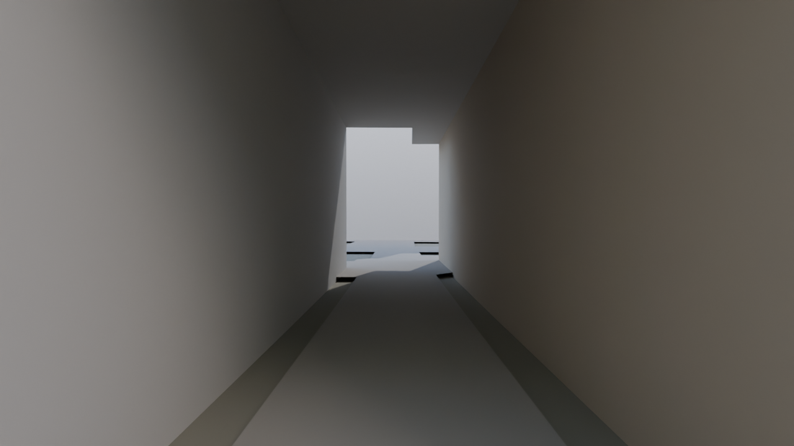
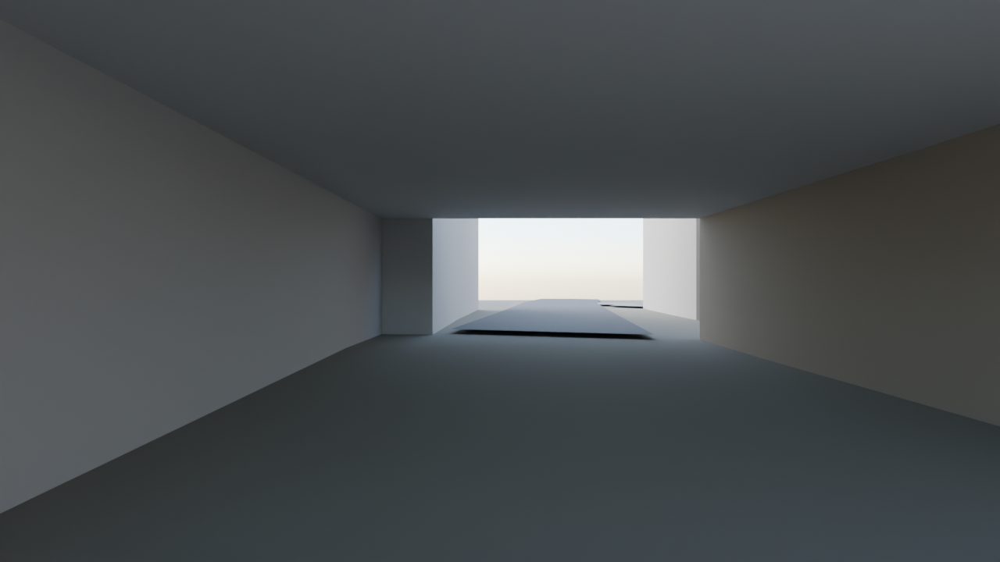
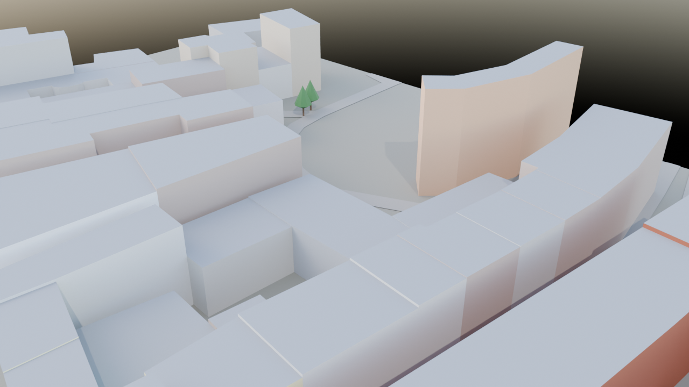
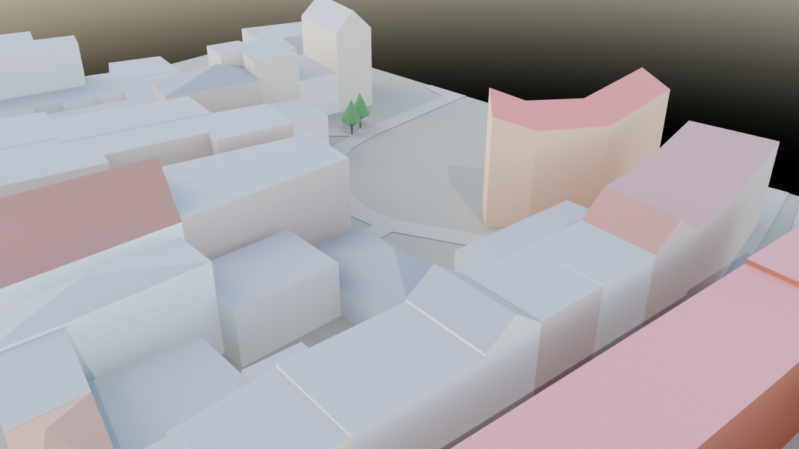
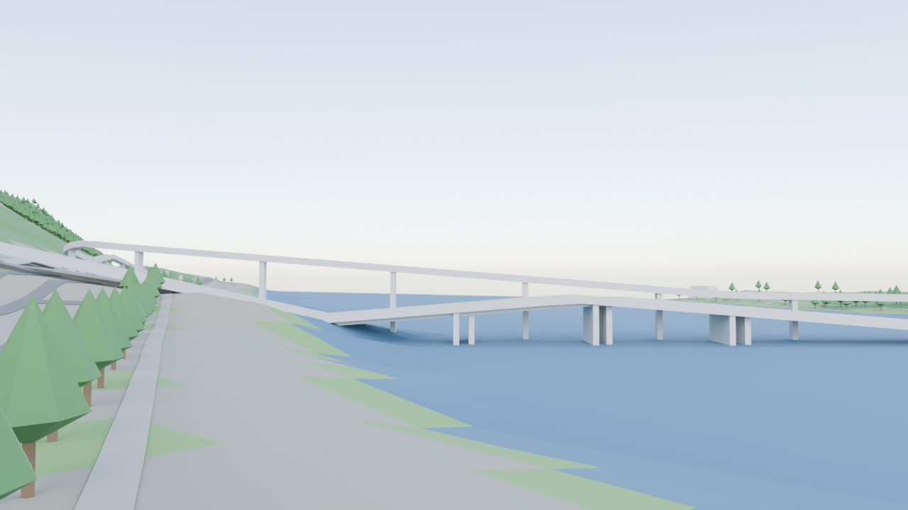
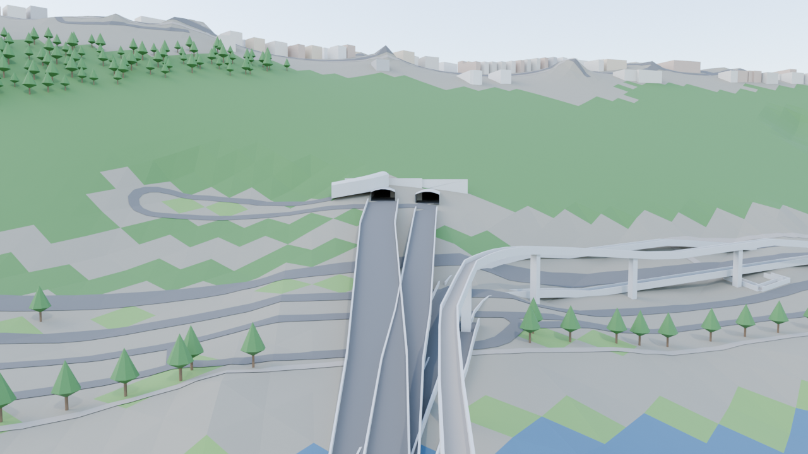
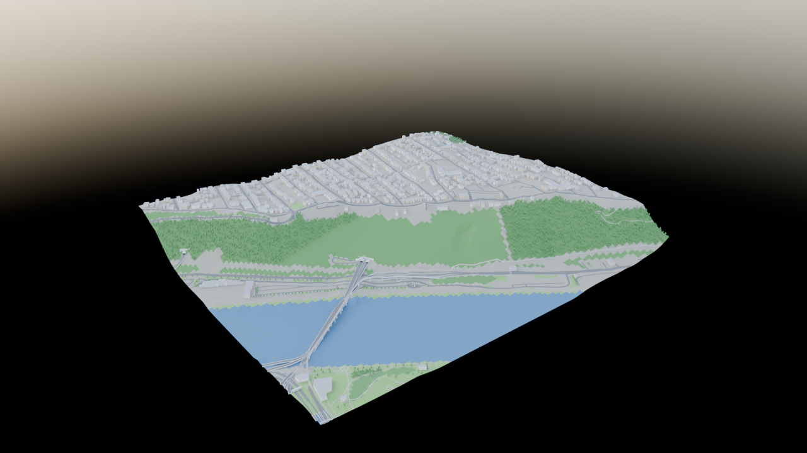
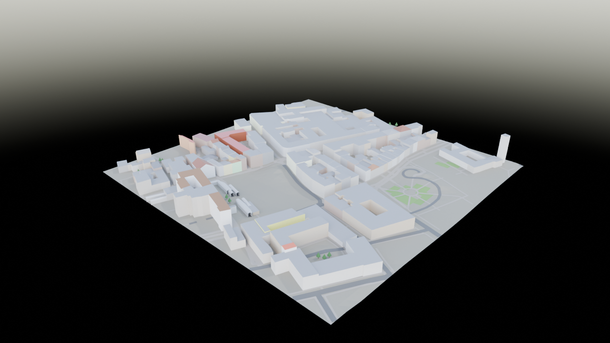
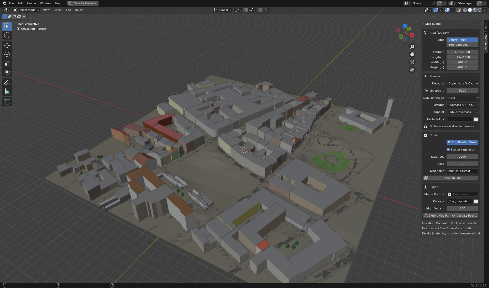

# v0.3.0 demo: passages, roofs and two real-data areas

**Release candidate; not a published release.** Both areas use real OSM and
Copernicus GLO-30 data. They were acquired live for this release on
2026-11-20 (UTC). Every map image is a real Blender 4.2.23 Cycles **CPU**
render. The sidebar is a real Blender window captured with Mesa software
OpenGL. No UI is mocked. To reproduce, see [docs/DEMO.md](../../DEMO.md).

| Area | Preset | What it shows |
|---|---|---|
| Munich Altstadt, 48.1395 N 11.5764 E, 400 x 400 m | [munich-altstadt](../../../tools/demo/presets/munich-altstadt.json) | Real elevated building part, building passage, road tunnel, tagged roofs |
| Pittsburgh, 40.437 N 80.016 W, 1200 x 1000 m | [pittsburgh](../../../tools/demo/presets/pittsburgh.json) | Fort Pitt Bridge (double deck, piers) and Fort Pitt Tunnel |

**Why the before images are not v0.2.0.** The task asks for a v0.2.0
"before". Built from the same acquisition, the v0.2.0 packages are
**byte-identical** to v0.3.0 in every member (GLB, collision, heightfield,
report, NOTICES). Only `manifest.json` differs, in `generator.version` (D50).
A v0.2.0 render would therefore be the same image. The before images use the
nearest real difference instead:

- elevated part and passage: the **v0.1.0** package (before S2-ELEV), from
  the same acquisition;
- roofs: the same v0.3.0 code with every `roof:*` tag removed, so every roof
  is flat.

## Example 1: building passage (Rid Passage)

| Camera `passage` | Before: v0.1.0 (passage omitted) | After: v0.3.0 |
|---|---|---|
| Munich |  |  |

The passage probe `osm:way/1163022325:passage` (kind `elevated`, radius 1 m)
**PASS** in the Python validator and the C# reader. In v0.1.0 the building
was solid, and the package had no passage probes.

**Beneath an elevated part.**

Probe `osm:way/879138845:under` (radius 1 m) PASS. From this camera, the
v0.1.0 render is the same image: that space was already open in v0.1.0, which
kept the part's `min_level` height but had no probe. So it is shown as
after only.

## Example 2: tagged roofs

| Camera `roofs` | Before: `roof:*` tags removed (all flat) | After: v0.3.0 |
|---|---|---|
| Munich |  |  |

| Roofs in the area (148 buildings) | Count |
|---|---|
| No `roof:shape` tag (`inferred:flat`) | 68 |
| Tagged flat | 13 |
| Tagged non-flat, **built as tagged** | **5** (4 gabled, 1 skillion) |
| Tagged non-flat, **fallback** | **62** (53 flat, 9 pyramidal) |
| Built shapes overall | 134 flat, 9 pyramidal, 4 gabled, 1 skillion |

Only 5 of 67 tagged non-flat roofs are built as tagged. 46 of the 62
fallbacks are gabled or hipped roofs on footprints that are not rectangular.
This is S2-F5, a later item. Each building's `provenance.roof_shape` gives
the reason.

## Example 3: drone-eye tour, Pittsburgh

| Under Fort Pitt Bridge | Fort Pitt Tunnel north portals |
|---|---|
|  |  |

Pittsburgh is unchanged from v0.2.0 apart from `generator.version`. The
[v0.2.0 demo](../v0.2.0/README.md) has before/after renders from the fixed
v0.1.0 cameras. 13 probes are exported (11 bridge, 2 tunnel bores), and all
PASS in Python and C#.

## Real Blender interface

Centre 48.1395 / 11.5764, 400 x 400 m, Copernicus GLO-30 and Overpass.
The "Online access is disabled" line appears because the screenshot is
taken with Blender's online access turned off, after the map was generated.

## Recorded evidence

Machine-readable: [evidence.json](evidence.json). Kit summaries:
[summary-munich.md](summary-munich.md), [summary-pittsburgh.md](summary-pittsburgh.md).

| Check | Munich Altstadt | Pittsburgh |
|---|---|---|
| package_id | `sha256:2caff942c8f528111e229415047f5e926375d94fe2ac4595c3ddf0e7940eea64` | `sha256:094fb730dfd27386d90b8de08682265f96712986b983e29850ca19508e846d16` |
| Objects | 389: terrain 1, building 148, road 197, tunnel 26, vegetation 17 | 3290: terrain 1, building 987, road 258, bridge 33, tunnel 5, structure 6, vegetation 2000 |
| Collision triangles | 22,608 (59 degenerate) | 144,108 (76 degenerate) |
| Build, excluding download (3 runs) | 3.451 / 3.499 / 3.519 s, **median 3.499 s** | 18.402 / 18.740 / 18.704 s, **median 18.704 s** |
| Python validator (strict) | `VALID: 0 error(s), 1 warning(s)` (degenerate triangles) | `VALID: 0 error(s), 1 warning(s)` (degenerate triangles) |
| Passage probes | 3 exported, all PASS; 26 blocked and reported | 13 exported, all PASS; 29 blocked and reported |
| Probe-check visits (capsule work units) | 813 + 493 + 1,342 = 2,648 | 121,457 |
| C# reference reader | `OK`: 5 members verified, 389 nodes bound 1:1, 3/3 probes PASS | `OK`: 13/13 probes checked and PASS |
| Live acquisition (Overpass + GLO-30) | 107 s | 127 s |
| CPU renders, 1280 x 720, 64 samples | 8 renders + panel: 366 s; roofs pair: 78 s | 4 renders: 124 s |
| Headless Blender, live generate + export | `VALID`, 385 objects, export 3.2 s; C# `OK`, 1/1 probes PASS | `VALID`, 3313 objects, export 22.2 s; C# `OK`, 14/14 probes PASS. Failed before S2-F6 (#37) on one downward-facing road triangle |
| Release zip, clean-profile install (G4) | `map_builder-0.3.0.zip` built from the RC and passes `extension validate`. Installed into an empty `BLENDER_USER_RESOURCES`, it imports as (0, 3, 0) and the Blender harness reports `OK: 0 failure(s)` (169 PASS) in 16 s | (same zip) |
All renders together took 9 min 28 s on the CPU (budget 30 min). Each package
was built 3 times from the cached acquisition, and the runs were
byte-identical. Probe work is the validator's capsule query count (the
`WorkBudget` units), the same in both validators.

## Release assets (S2-F4)

The GitHub Release attaches `munich-altstadt-0.3.0.mbmap` and
`pittsburgh-0.3.0.mbmap` (GLB inside, `NOTICES.txt` with attribution) next to
`map_builder-0.3.0.zip`. Only the PNGs, summaries, evidence and this README are
committed. Built from the RC on main `f9ef418`, sha256:

| Asset | sha256 |
|---|---|
| `munich-altstadt-0.3.0.mbmap` | `B6B4A1AF755592D686C31067689771086B14B5369CC373652E3E485388DA723C` |
| `pittsburgh-0.3.0.mbmap` | `6FB2E99EAE10963710C8035F869CB99CD014EC7C2E67A19A4E393EAC0A984FF5` |
| `map_builder-0.3.0.zip` | `BD6057EFC446183F32EB7B41E7FDCB627548200636F1702076B24CC4814DB5BB` |

**Real-data credits:** (c) OpenStreetMap contributors, ODbL 1.0.
Copernicus DEM GLO-30 / WorldDEM-30: (c) DLR e.V. 2010-2014 and
(c) Airbus Defence and Space GmbH 2014-2018, provided under COPERNICUS
by the European Union and ESA; all rights reserved.
