# v0.5.0 demo: rivers, banks and roof ends

**Release candidate, not final.** S4-COL-FLOAT (D126) is pending and blocks
v0.5.0. These images and numbers are from the RC before that fix; they will be
regenerated after it merges, and the section reserved for it below will be
filled in.

Both areas use the frozen v0.4.0 data caches (OSM and Copernicus GLO-30,
acquired 2026-11-20 UTC), replayed offline, so every difference below comes
from the code, not from new data. "Before" is the released v0.4.0 package
(same sha256 as the v0.4.0 release asset), "after" the v0.5.0 RC package, both
textured and seen from the same fixed cameras.
Every map image is a real Blender 4.2.23 Cycles **CPU** render (1280 x 720,
64 samples). The sidebar is a real Blender window captured with Mesa software
OpenGL, and the viewer images are the real three.js bundle in headless Edge.
No UI is mocked. To reproduce, see [docs/DEMO.md](../../DEMO.md). Cameras:
[pittsburgh-v050-preset.json](pittsburgh-v050-preset.json) and
[munich-v050-preset.json](munich-v050-preset.json).

The neutral terrain texture (S4-TEX-WATER, D99) changes the ground in every
pair: untagged ground that read green/tan in v0.4.0 now reads grey (S4-F4).

## Example 1: the river under the Fort Pitt Bridge (Pittsburgh `bridge-under`)

| v0.4.0 | v0.5.0 |
|---|---|
| 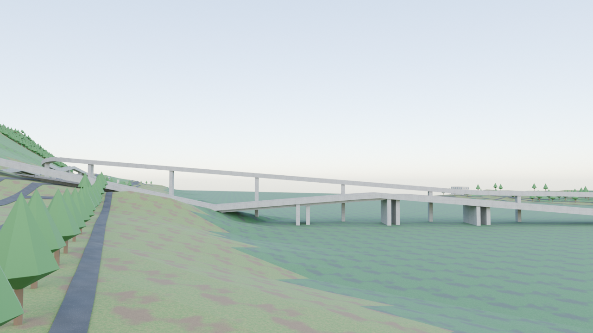 | 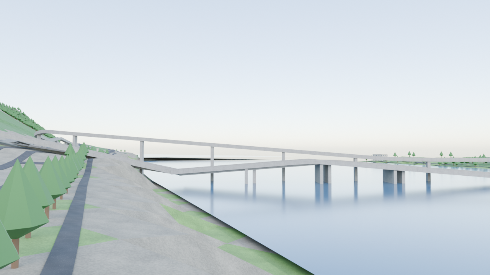 |

In v0.4.0 there was no water surface: the terrain was coloured, so the river
followed the dip in the elevation data. In v0.5.0 the river is its own flat
mesh (one of three `water:` objects in Pittsburgh) over a bed carved 1.5 m
below it, and it is collision class 5.

## Example 2: the bank (Pittsburgh `bank`)

| v0.4.0 | v0.5.0 |
|---|---|
|  |  |

The bank camera looks at the north bank of the Monongahela by the Fort Pitt
Bridge, where S4-REVIEW found water-coloured terrain triangles above the water
(S4-F1). With S4-WATER-BANK the bank keeps its landcover colour. The green and
grey squares on the bank are landcover painted per 10 m cell (S4-F6, a
pre-existing limit).

## Example 3: the overview (Pittsburgh `overview`)

| v0.4.0 | v0.5.0 |
|---|---|
|  | 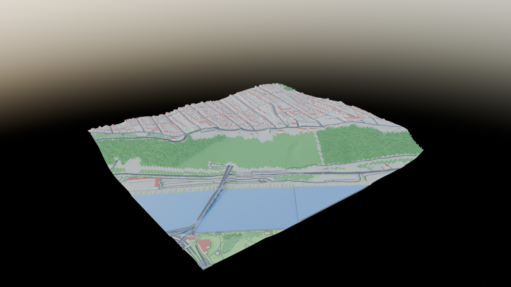 |

## Example 4: vertical-cut gable ends (Munich)

| Camera | v0.4.0 | v0.5.0 |
|---|---|---|
| `vcut-2edge` (way 80965543) | 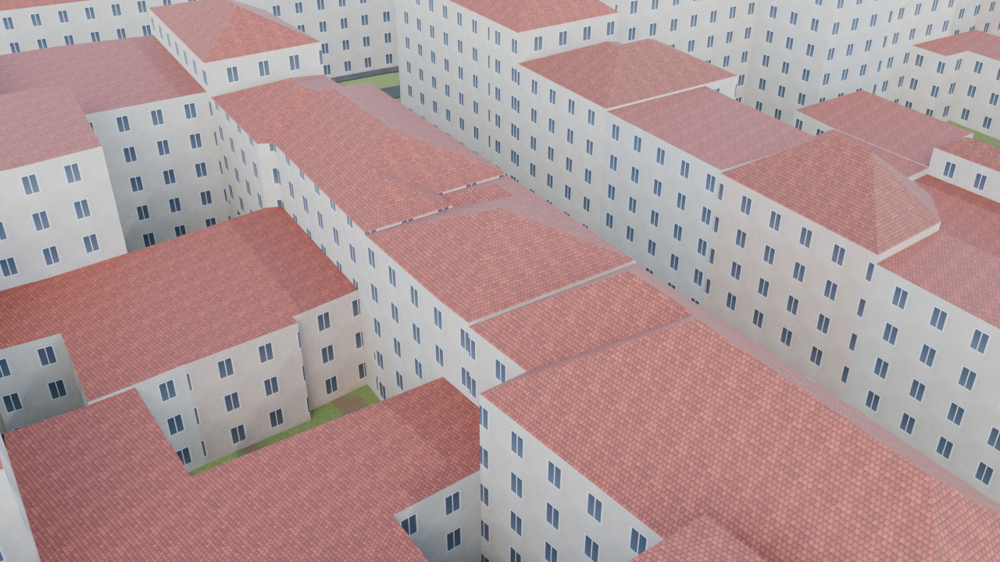 | 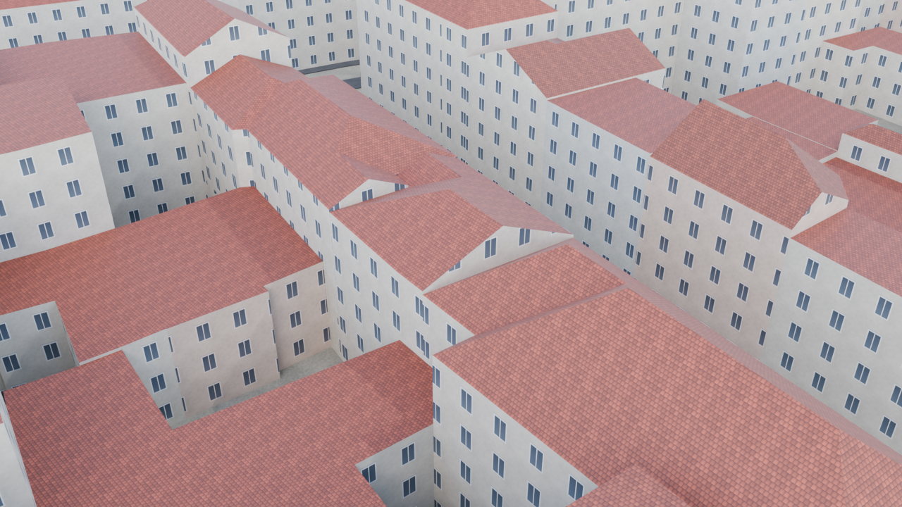 |
| `vcut-3edge` (way 80965639) |  | 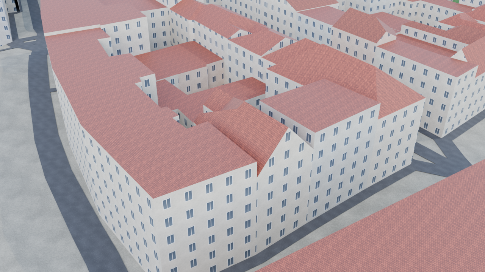 |
| `named-fallback` (way 79401261) | 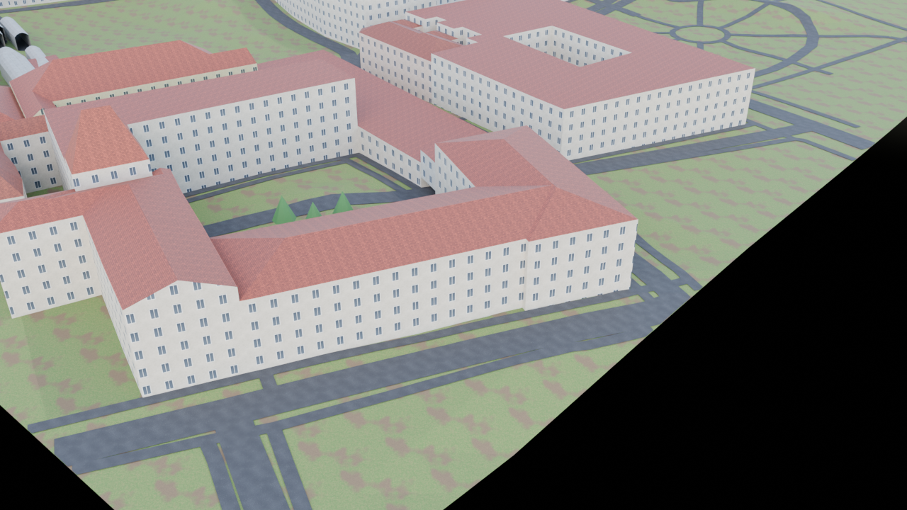 | 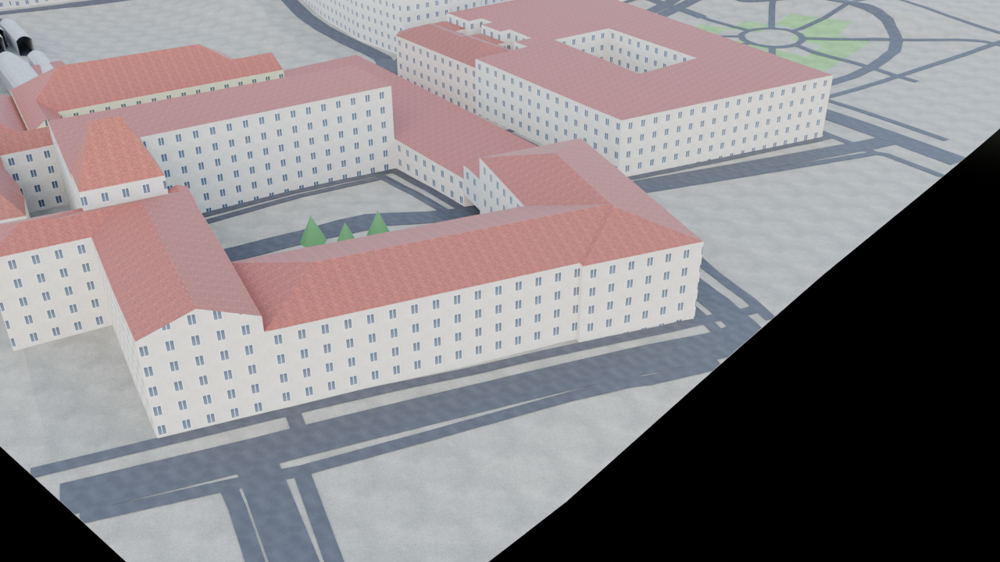 |
| `roofs` |  |  |
| `overview` | 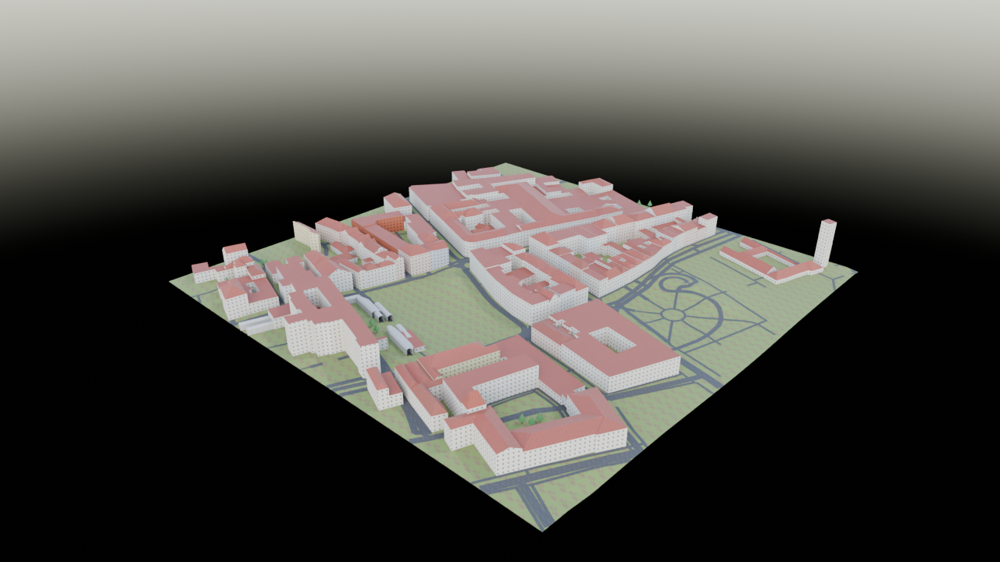 | 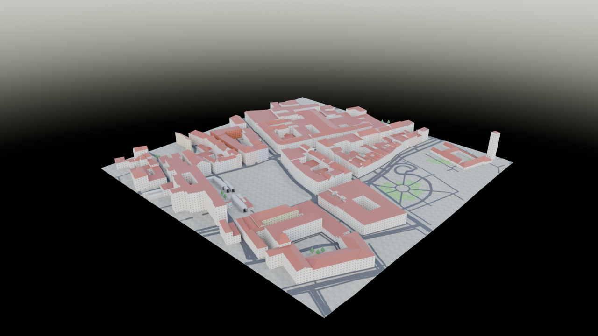 |

The roof changes are small in each frame. `vcut-2edge` shows them most
clearly: several gables that v0.4.0 built hipped now have vertical end walls.
The `named-fallback` roof is still hipped in v0.5.0 (no end is representable
even with a vertical cut), and `provenance.roof_shape` names why.

### Roofs in numbers (Munich, 67 tagged non-flat)

| | v0.4.0 | v0.5.0 |
|---|---|---|
| Built as tagged | 29 (17/52 gabled) | **45** (33/52 gabled, 11/12 hipped, 1/1 skillion) |
| Fallback with a named reason | 34 | 22 (18 gabled -> hipped, 4 -> flat) |
| No named reason | 4 (S3-F1) | 0 |

Source: S4-REVIEW section 1.1. Mixed roof ends are covered by synthetic tests
only; no Munich roof has one.

## S4-COL-FLOAT (D126): reserved

Pending. A user reported floating collision in the simulator (the drone stops
above the ground; the gap between the river surface and the banks acts like a
floating mat). The before/after images and probe evidence for the fix go here
when S4-COL-FLOAT merges.

## The three.js viewer (v0.5.0, textured)

| Munich Altstadt | Pittsburgh |
|---|---|
| 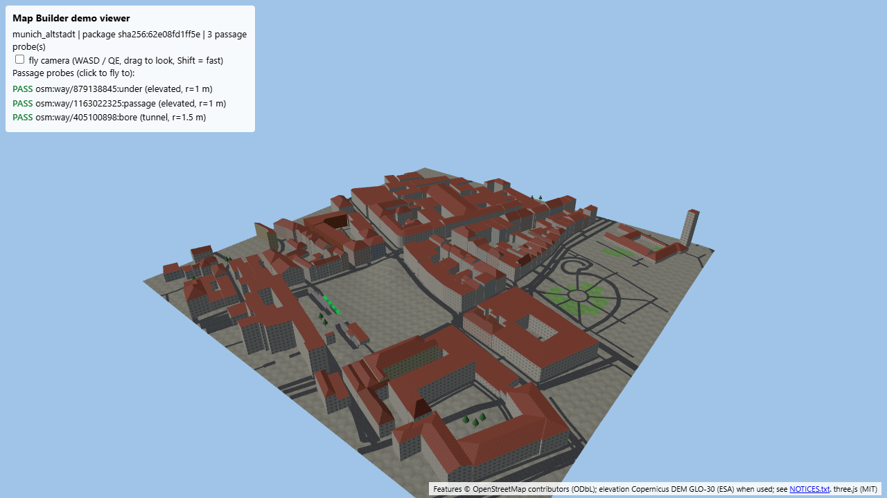 |  |

## Real Blender interface

The "Online access is disabled" line appears because the screenshot is taken
with online access off, after generation.

## Recorded evidence

Machine-readable: [evidence.json](evidence.json). Kit summaries:
[summary-munich.md](summary-munich.md), [summary-pittsburgh.md](summary-pittsburgh.md).

| Check | Munich Altstadt | Pittsburgh |
|---|---|---|
| package_id (textured) | `sha256:62e08fd1ff5e284fef9b5341e4d1ad2fcb99b3125b228e74351982a79da488af` | `sha256:b3fbee0c5212bafb3620b4bf35b67f604afb461d39ddf70e6d3fa5bb2e352ae1` |
| package_id (untextured) | `sha256:7d8ed27299cd676bebe9229c6c7c927df33d2f77a059cfb200d48fd4fcd64d8f` | `sha256:bff2935d688bf8b471de38ceb2dbd8b6dad53ba7780941ef9049fd8fbd5bd79a` |
| Objects | 389: terrain 1, building 148, road 197, tunnel 26, vegetation 17 | 3293: terrain 1, water 3, building 987, road 258, bridge 33, tunnel 5, structure 6, vegetation 2000 |
| Collision triangles | 23,372; 57 degenerate (v0.4.0: 59) | 144,145 (43 water); 75 degenerate (v0.4.0: 76) |
| Build, textured, 3 runs | 3.297 / 3.260 / 3.325 s, **median 3.297 s** | 17.828 / 15.887 / 16.031 s, **median 16.031 s** |
| Build, untextured, 3 runs | 4.187 / 3.014 / 3.019 s, **median 3.019 s** | 15.029 / 15.197 / 15.334 s, **median 15.197 s** |
| Python validator | `VALID: 0 error(s), 1 warning(s)` (degenerate triangles) | `VALID: 0 error(s), 1 warning(s)` (degenerate triangles) |
| Passage probes | 3 exported, all PASS; 26 blocked and reported | 11 exported, all PASS; 31 blocked and reported (v0.4.0: 13 and 29) |
| C# reference reader | `OK`, 3/3 PASS, 0 `mb_id` warnings | `OK`, 11/11 PASS, 0 `mb_id` warnings |
| Headless Blender, generate + export | textured and untextured `VALID` (56 degenerate); C# `OK`, 3/3 PASS, same probe ids as the CLI | textured and untextured `VALID` (71 degenerate); C# `OK`, 11/11 PASS, same probe ids as the CLI; export 23.3 s textured, 19.4 s untextured |
| CPU renders | 10 renders + panel: 268 s | 6 renders: 150 s |

All renders together took 7 min 0 s on the CPU (budget 30 min). Each CLI
package was built 3 times and the runs were byte-identical. The frozen caches
were hashed before and after every build and did not change. The two
Pittsburgh probes that v0.4.0 exported and v0.5.0 does not
(`osm:way/11950069:under`, `osm:way/121593794:deck`) are listed in
`passage_probes_blocked`; see the [release notes](../../releases/v0.5.0.md).

## Release asset candidates

Built from the RC (preliminary until S4-COL-FLOAT); only the PNGs, summaries,
the camera presets, the evidence and this README are committed. The release
notes list sizes and package_ids.

| Asset | Path | Textures | sha256 |
|---|---|---|---|
| `munich-altstadt-0.5.0.mbmap` | CLI | on | `F12DC1345EE51BDAC0A5363345086E4F05BB8168E720F22B9CA5C859C4AC4CB5` |
| `pittsburgh-0.5.0.mbmap` | CLI | on | `0EF863C5718B4E15FCE46BBCE70784D10DC6954FF2A49179690DAE19FF5ADB81` |
| `munich-altstadt-0.5.0-notex.mbmap` | CLI | off | `5BA47765921DD56C156DAC24175D6F0405D1338D2FB22E26131DB8F7168C17AB` |
| `pittsburgh-0.5.0-notex.mbmap` | CLI | off | `DCA3F69D00535FA8D48ADDF7622C78CA3DA16B17BEDC15B1BB4CDDF6D66EB195` |
| `munich-altstadt-0.5.0-blender.mbmap` | headless Blender | on | `69CB5E7C057118B91376AEC690F353796C002224410995FBAB2F281C8D4A55BD` |
| `munich-altstadt-0.5.0-blender-notex.mbmap` | headless Blender | off | `BE8F0981FDD33EB1DC63F7E837E938FB03FA0891178D1484FAB4DB5C8DA333BC` |
| `pittsburgh-0.5.0-blender.mbmap` | headless Blender | on | `F2147A6537D2739A55A6DBBCDA3583A3B5139F0A3EED493856BC1CFDEA6CACEC` |
| `pittsburgh-0.5.0-blender-notex.mbmap` | headless Blender | off | `A0F25D4B1DB6F9D68C1FCFAF219EF7C89BF868B1094A9D0CC7497E1D8E271EC6` |
| `map_builder-0.5.0.zip` (RC build; the release workflow rebuilds it from the tag) | | | ZIP_SHA |

**Credits:** (c) OpenStreetMap contributors, ODbL 1.0. Copernicus DEM
GLO-30 / WorldDEM-30: (c) DLR e.V. 2010-2014 and (c) Airbus Defence and Space
GmbH 2014-2018, provided under COPERNICUS by the European Union and ESA; all
rights reserved. Textures: CC0 1.0, map-builder contributors.
