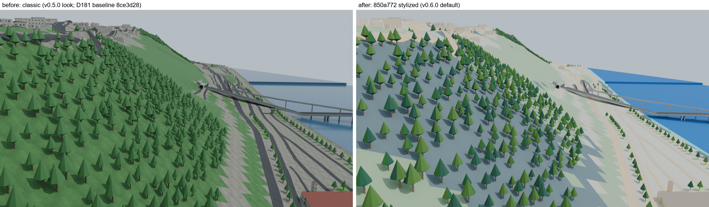
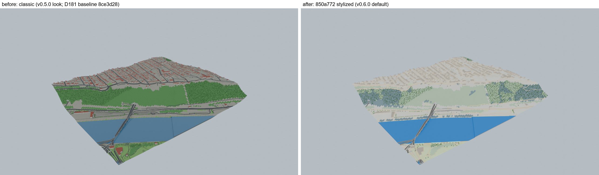
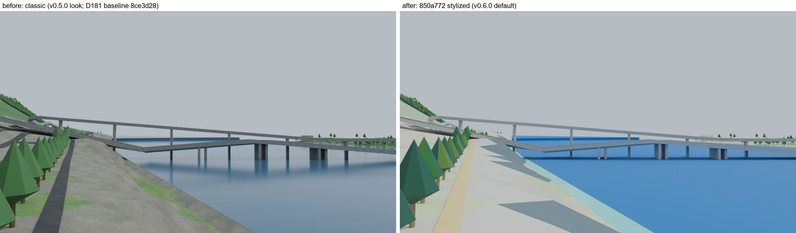
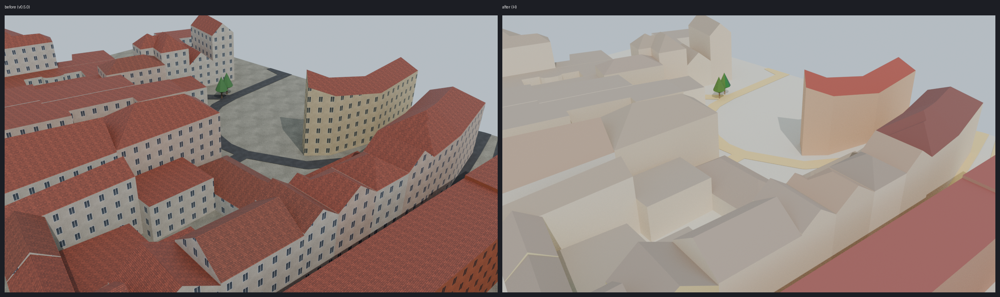
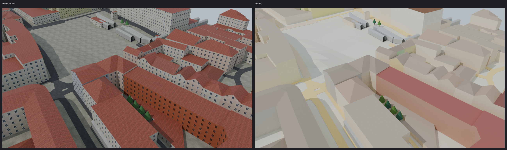
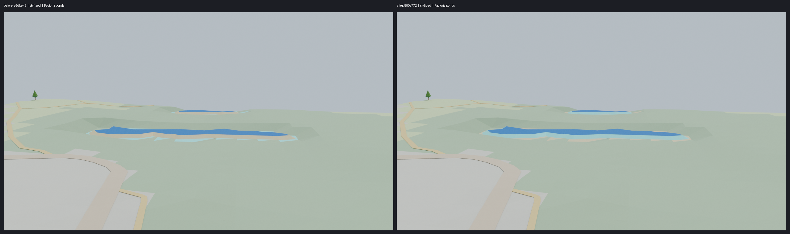
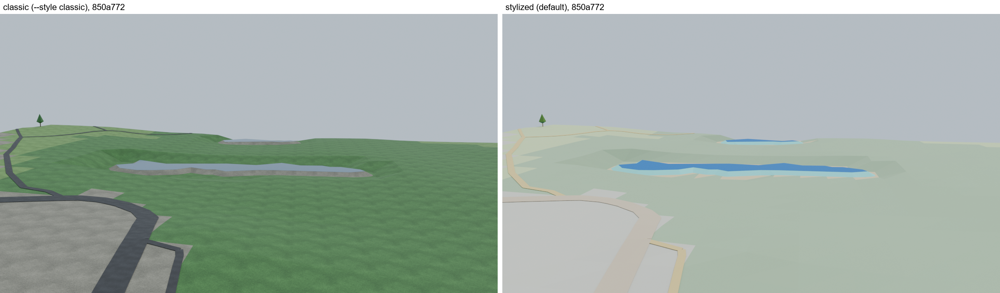
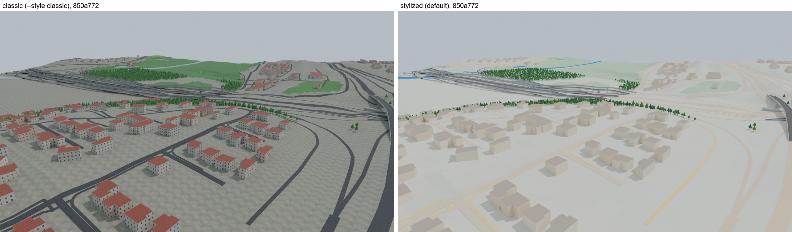
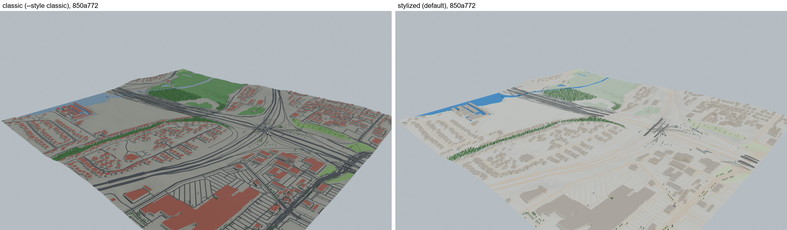

# v0.6.0 demo: the stylized look

Before/after images for the v0.6.0 release candidate (sprint 5). Every map
image is built from real Blender 4.2.23 Cycles **CPU** renders (1280 x 720, 64
samples, seed 1, no denoise) of CLI packages, composed into labelled two-column
sheets. The renders come from
`tools/demo/style_render_recipe.py` from the fixed preset cameras in
`tools/demo/presets/`. All packages are built offline from the frozen S5
caches (Factoria uses the D177 cache, per D190) with `created_utc` pinned, so every difference comes from the code.
Provenance and hashes are in [evidence.json](evidence.json).

"Before" is the classic look. The classic baseline is the D181 package
(`8ce3d28`, the v0.5.0 look plus the S5-F3 bank fix), and classic at
`850a772` is byte-identical to it (issue #108, gate G3). "After" is the stylized
default at `850a772`, the REL-v0.6.0 base. Sheets marked *QA* are reused from
the S5-STYLE-REVIEW run (issue #108) and use QA's label style; the rest were
rendered for this release. In QA labels, "H" is the review head `a6dbe48`.
The Munich QA sheets use the released v0.5.0 package as "before"; Munich has no
banks, so the S5-F3 change does not touch it and v0.5.0 is the same classic
look as the D181 baseline.

## Pittsburgh: the river bend (`style-pittsburgh-river-bend`)



The water is a clear blue and the bank ramp beside it is a light shallow rim.
Forest slopes get three foliage tones and the hillside is flat-shaded.

## Pittsburgh: overview (`pittsburgh` / `overview`)



The same map, the same triangles: only colours, materials and normals change.
The GLB drops from 15,246,708 to 9,153,644 bytes.

## Pittsburgh: under the Fort Pitt Bridge (`pittsburgh` / `bridge-under`)



Bridge, piers and water geometry are unchanged; the collision is
byte-identical between the two packages.

## Munich: roofs (`munich-altstadt` / `roofs`, *QA*)



Tagged `roof:colour` keeps its hue (the red roofs on the right); untagged roofs
and walls get pale palette colours, and in this view they merge (known issue).
Munich has no water, and its stylized package at `850a772` is byte-identical
to the one QA rendered at `a6dbe48`, so this sheet shows the release.

## Munich: roofscape (`style-munich-roofscape`, *QA*)



## Bellevue-Factoria ponds: the R3 fix (*QA*)



Both columns are stylized. Before #109 the light shallow band sat on land
triangles a few metres from the water; after it the `bank:` ramp touching the
water is the rim. QA accepted this at `850a772`: 72/72 sampled pixels in the
water-shore window hit the bank ramp and read cyan, against 0/72 before.

## Bellevue-Factoria: classic vs stylized (`bellevue-factoria`)

Both columns are `850a772` from the same inputs; the left is `--style classic`,
the right the default.







On Factoria the stylized road network loses its dark contrast against the
ground (known issue).

## Reproduce

Build each package with the CLI (`--style classic` or the default) from the
frozen caches, then render the two packages from the same preset. The recipe
requires `--reference` and `--palette-regions` for its palette metrics; per D187
the reference is a dummy image (it lands only in the recipe's own three-column
`contact-sheet-*.png`, which this demo does not use), and the regions file only
affects the palette reports, not the renders:

```powershell
blender -b --factory-startup --python-exit-code 1 --python tools\demo\style_render_recipe.py -- `
    --preset tools\demo\presets\style-pittsburgh-river-bend.json `
    --before classic.mbmap --after stylized.mbmap `
    --reference placeholder.png --palette-regions tools\demo\palette_regions_factoria.json `
    --out out --engine CYCLES --samples 64 --seed 1
```

The recipe writes `render-<camera>-before.png` and `-after.png`. Each sheet
puts the two renders side by side at full size (12 px gap) under a 36 px white
label row; this composition step uses Pillow and is not a repository tool
(D187: no reference column).
