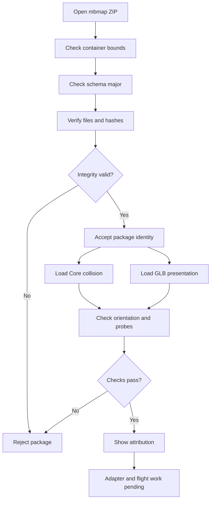

# Consumer handoff: preview, not simulator integration

This is the required loading sequence for an eventual adapter, not an already
delivered UI in the simulator. The reference reader exercises package checks.

