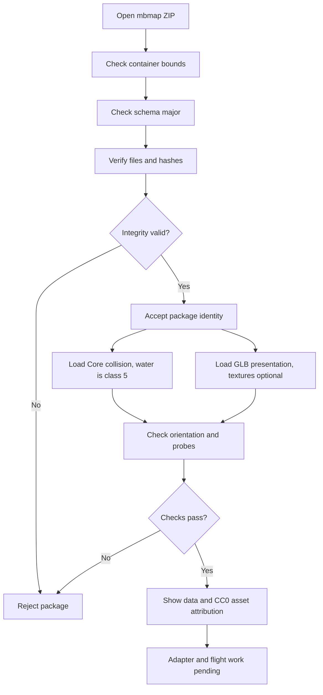

# Consumer handoff: preview, not simulator integration

This is the required loading sequence for an eventual adapter, not an already
delivered UI in the simulator. The reference reader exercises package checks.
Schema 2.1 textures are optional: a 2.0 reader ignores the UVs, images and
`asset_notices`, and collision does not depend on them. Since v0.5.0, water
surfaces are class 5 `water` triangles in `.mbcol`; the heightfield `.mbhf`
stays terrain-only and shows the carved riverbed, so query `.mbcol` over water.

