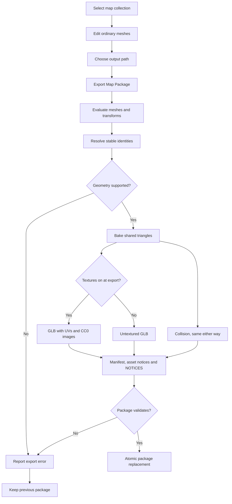

# Export: final edits to package

No scene modifiers are destructively applied. Validation errors block package
replacement; warnings require review. The Textures setting at export decides
materials, UVs, embedded CC0 images and the asset notice together; collision is
the same either way. Water surfaces (since v0.5.0) are exported like other
objects: one GLB node and class 5 `water` collision each. Degenerate collision
triangles that a probe could hit are kept and listed per object in
`report.json` (`degenerate_objects`).

