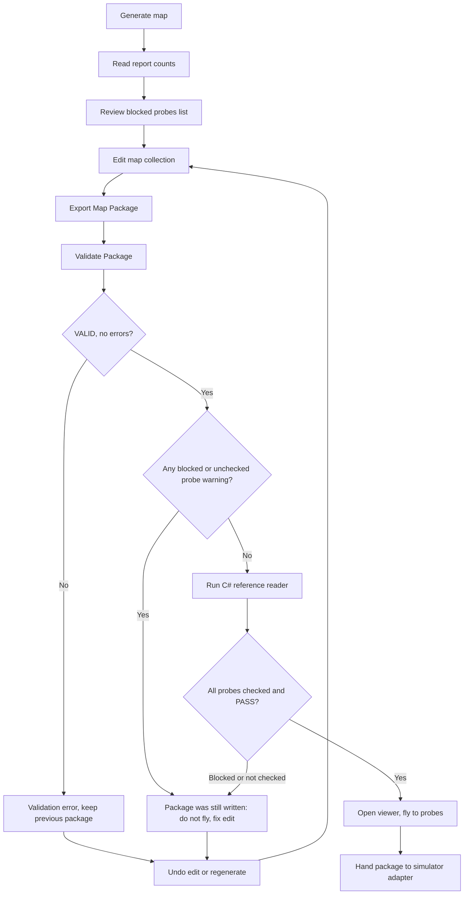

# Fly-through check: export, validate, probe results

v0.2.0. Detail: [bridges, tunnels and passages](../user/structures.md).

There are two kinds of missing or failing probe:

- **Generator omission:** a probe that is blocked when the map is generated is
  never exported. It is listed in `report.json` `passage_probes_blocked` with
  its blocker.
- **Export-time warning:** validation tests only the exported probes. A probe
  that an edit blocks (`passage probe N is blocked ...`), or that runs out of
  query budget (`... probes A..B were not checked`), is a **warning**. The
  package is still `VALID` and replaces the previous one.

Stop on either kind of warning, even when the package is `VALID`.
