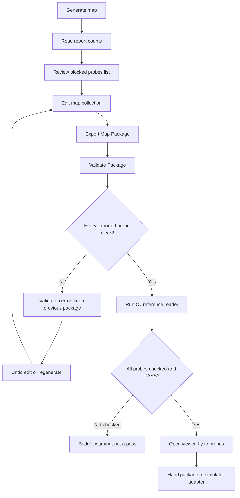

# Fly-through check: export, validate, probe results

v0.2.0. Detail: [bridges, tunnels and passages](../user/structures.md).

A blocked probe is never exported. It is listed in `report.json`
`passage_probes_blocked` with its blocker. Validation tests only the exported
probes, so read the report as well.
