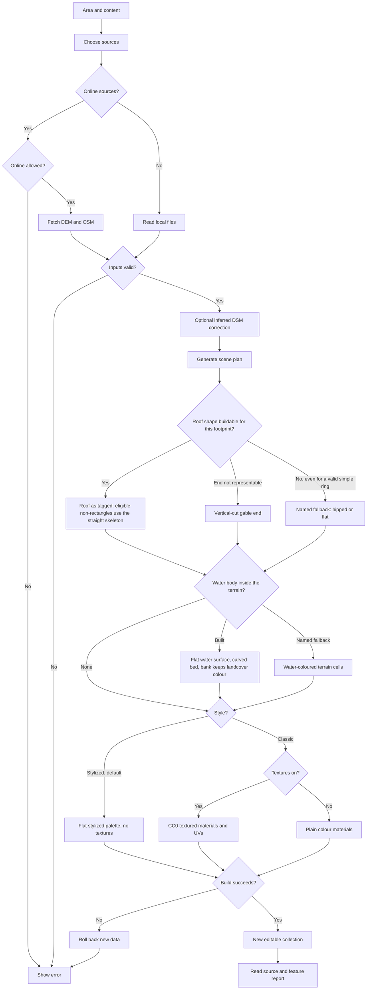

# Generate: source and failure flow

The report is Blender's **MapBuilder Report** text block. Online failures never
silently become synthetic or flat maps. Optional DSM mask/correction failure
warns and keeps the original surface model; required source failures stop.
Tagged roofs that cannot be built as tagged fall back with a named reason in
`provenance.roof_shape`; a gabled roof whose gable end is not representable
is cut by a vertical wall through that end (since v0.5.0) and falls back to
hipped only when that is not possible either. Each water body inside the
terrain becomes a flat water surface on a carved bed (since v0.5.0); a body
that cannot be built keeps water-coloured terrain cells and the report names
why. Style (since v0.6.0; default Stylized) is fixed here and reused at
export; it changes only materials, never geometry or collision. Textures
applies only to Classic, and only changes the viewport look here; the package
follows the setting at export.

