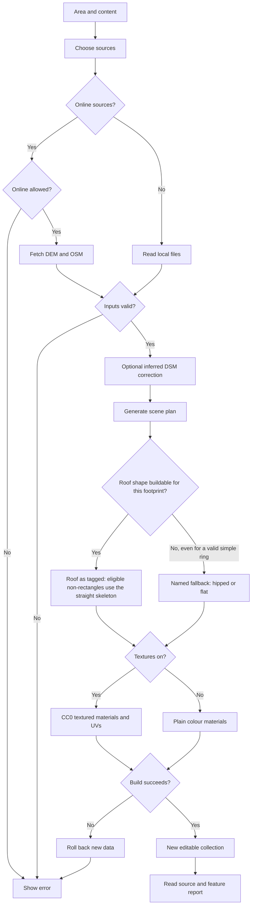

# Generate: source and failure flow

The report is Blender's **MapBuilder Report** text block. Online failures never
silently become synthetic or flat maps. Optional DSM mask/correction failure
warns and keeps the original surface model; required source failures stop.
Tagged roofs that cannot be built as tagged fall back with a named reason in
`provenance.roof_shape`; a gabled roof whose gable end is not representable
falls back to hipped (since v0.4.0). The Textures setting only changes the
viewport look here; the package follows the setting at export.

